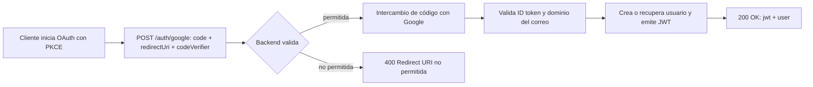

# Manual del Backend — `tsj-core`

> Manual de referencia de los contratos de la API del microservicio backend `tsj-core`. Relacionado con [[Proyecto]] y [[Tsj-Web-plan-desarollo]].

- **Tecnología:** ASP.NET Core (`.NET 10`), EF Core, MySQL, Redis, JWT y auth por cookie.
- **Base de ruta global:** `/tsj-api` (config `ApiSettings:BaseRoute`).
  - Producción: `https://tecmm.mx/tsj-api`
  - Local: `http://localhost:<puerto>/tsj-api`
- **Formato de intercambio:** `application/json` (respuestas camelCase).
  - Solicitudes con cuerpo → cabecera `Content-Type: application/json`.
  - Respuestas correctas → JSON del recurso (`application/json`).
  - Respuestas de error → `application/problem+json` (ver [[#Errores]]).

---

## Autenticación y autorización

### Roles

El backend tiene **dos vocabularios de rol** independientes: `AppRoles` para el personal (Google) y `AspiranteRoles` para los aspirantes. No se mezclan.

**Personal (`AppRoles`)** — con cadena de herencia:

| Rol             | Descripción                           | Cadena de herencia                                |
| --------------- | ------------------------------------- | ------------------------------------------------- |
| `Public`        | Visitante anónimo (cookie)            | `Public`                                          |
| `Vinculador`    | Vinculación institucional             | `Vinculador` → `Public`                           |
| `CampusManager` | Administrador de una unidad académica | `CampusManager` → `Public`                        |
| `Director`      | Dirección del plantel                 | `Director` → `CampusManager` → `Public`           |
| `Admin`         | Administración global                 | `Admin` → `Director` → `CampusManager` → `Public` |

**Aspirantes (`AspiranteRoles`)** — sin herencia:

| Rol         | Descripción                          | Cadena de herencia |
| ----------- | ------------------------------------ | ----------------- |
| `Aspirante` | Persona con cuenta en EDCORE         | `Aspirante`       |

> [!note] Herencia de roles
> Un rol satisface automáticamente las políticas de los roles que le siguen en la cadena (ej. `Admin` puede llamar rutas `Director`, `CampusManager` y `Public`). `Aspirante` **no** hereda de `Public`: un JWT de aspirante no abre rutas públicas de gestión.

> [!warning] `Vinculador` sin rutas expuestas
> El rol `Vinculador` y la política `vinculador` existen, pero **ningún endpoint los requiere hoy**. Está preparado para la siguiente fase.

### Cómo autenticarse

1. **Endpoints públicos** (`GET /unidad-academica*`, todo `/aspirantes/*` de alta y login): el backend asigna automáticamente una **cookie HTTP-only** (`tesj-public-user-id`) en la primera petición. No hay que enviar nada; el cliente guarda la cookie y la reenvía.
2. **Endpoints de gestión y `/auth/me`**: requieren un **JWT de Google** en la cabecera:

```http
Authorization: Bearer <jwt>
```

3. **Endpoints de perfil y modalidad del aspirante**: requieren un **JWT de Aspirante**:

```http
Authorization: Bearer <jwt>
```

### Los dos JWT

Ambos son **HS256** y comparten `JwtSettings` (misma llave, emisor y audiencia), pero son **tokens distintos** y no intercambiables.

| | JWT de Google | JWT de Aspirante |
|---|---|---|
| Se emite en | `POST /auth/google` | `POST /aspirantes/registro`, `POST /aspirantes/login` |
| Identifica a | Personal (rol `AppRoles`) | Aspirante por id de EDCORE |
| Claims propios | `unidad_academica_scope` | `aspirante_id`, `token_type=aspirante` |
| Claim de rol | `Public` … `Admin` | `Aspirante` |
| Política que lo acepta | `Public`, `CampusManager`, `Vinculador`, `Director`, `Admin`, `GoogleUser` | `Aspirante` |
| Permisos finos | `IResourcePermissionDefinition<UnidadAcademica>` | `IResourcePermissionDefinition<Aspirante>` |

La policy `Aspirante` exige **las tres** condiciones: scheme `jwt` + usuario autenticado + claims `token_type=aspirante` y `aspirante_id` + rol `Aspirante`. Un JWT de Google en una ruta de aspirante **no** autoriza (le falta `token_type`).

### Flujo de login con Google (OAuth PKCE)



> [!tip] Detalles del flujo
> 1. El cliente inicia OAuth en Google con PKCE (`authorization code`, `redirect_uri` y `codeVerifier`).
> 2. Envía los tres valores a `POST /auth/google`.
> 3. El backend valida `redirectUri` (config `GoogleAuth:AllowedRedirectUris`), intercambia el código, valida el ID token (firma + emisor + audiencia) y el dominio del correo (`GoogleAuth:AllowedEmailDomains`, ej. `tecmm.edu.mx`).
> 4. Devuelve `200` → `{ jwt, user }`.

> [!warning] Expiración del JWT
> Ambos JWT expiran según `JwtSettings:ExpirationMinutes` (**1440 min = 1 día** por defecto). No hayrefresh token ni revocación: caducan solos.

---

## Índice de endpoints

| # | Método | Ruta | Autorización | Rate limit | Caché | Respuestas |
|---|--------|------|--------------|------------|-------|------------|
| 1 | `POST` | `/auth/google` | Anónimo | `auth-login` (10/300 s) | — | 200, 400, 401, 429 |
| 2 | `GET` | `/auth/me` | `GoogleUser` (JWT) | Sin rate limit | — | 200, 401 |
| 3 | `POST` | `/auth/logout` | Anónimo | Sin rate limit | — | 204 |
| 4 | `GET` | `/unidad-academica` | `Public` | `get-public` (10/60 s) | Sí · TTL 7 d | 200, 401, 429 |
| 5 | `GET` | `/unidad-academica/{id}` | `Public` | `get-public` (10/60 s) | Sí · TTL 7 d | 200, 401, 404, 429 |
| 6 | `GET` | `/unidad-academica/management` | `CampusManager` | `write` (token bucket) | No | 200, 401, 403, 429 |
| 7 | `GET` | `/unidad-academica/management/{id}` | `CampusManager` | `write` (token bucket) | No | 200, 401, 403, 404, 429 |
| 8 | `POST` | `/unidad-academica/management` | `Director` | `write` (token bucket) | No | 201, 401, 403, 422, 429 |
| 9 | `PUT` | `/unidad-academica/management/{id}` | `CampusManager` | `write` (token bucket) | No | 200, 401, 403, 404, 422, 429 |
| 10 | `PATCH` | `/unidad-academica/management/{id}` | `CampusManager` | `write` (token bucket) | No | 200, 401, 403, 404, 422, 429 |
| 11 | `POST` | `/unidad-academica/management/{id}/disable` | `CampusManager` | `write` (token bucket) | No | 200, 401, 403, 404, 429 |
| 12 | `POST` | `/unidad-academica/management/{id}/enable` | `CampusManager` | `write` (token bucket) | No | 200, 401, 403, 404, 429 |
| 13 | `DELETE` | `/unidad-academica/management/{id}` | `Admin` | `write` (token bucket) | No | 200, 401, 403, 404, 422, 429 |
| 14 | `POST` | `/aspirantes/registro` | `Public` | `registro-aspirante` (5/300 s) | No | 201, 401, 409, 422, 429, 503 |
| 15 | `POST` | `/aspirantes/login` | `Public` | `auth-login` (10/300 s) | No | 200, 401, 422, 429 |
| 16 | `POST` | `/aspirantes/contrasena/recuperacion` | `Public` | `auth-login` (10/300 s) | No | 202, 422, 429, 503 |
| 17 | `POST` | `/aspirantes/contrasena/restablecer` | `Public` | `auth-login` (10/300 s) | No | 204, 422, 429, 503 |
| 18 | `POST` | `/aspirantes/perfil` | `Aspirante` (JWT) | `write` (token bucket) | No | 200, 400, 401, 403, 404, 422 |
| 19 | `PATCH` | `/aspirantes/perfil` | `Aspirante` (JWT) | `write` (token bucket) | No | 200, 400, 401, 403, 404, 422 |
| 20 | `PATCH` | `/aspirantes/modalidad` | `Aspirante` (JWT) | `write` (token bucket) | No | 200, 400, 401, 404, 422, 429 |

> [!warning] Rate limiting por ruta
> Los valores entre paréntesis son los **aplicables a esa ruta** según la configuración actual de `appsettings.json` (sección `RateLimiting:Policies`). Son editables; el contrato es la **política**, no el número exacto.

> [!info] Endpoints operativos (no forman parte del contrato de negocio)
> `GET /tsj-api/` , `GET /tsj-api/health/live`, `GET /tsj-api/health/ready`, `GET /tsj-api/health/external` — todos anónimos. Ver [[#Health checks]].

> [!note] `CustomizeUa` aún no es API
> El modelo `CustomizationUa` tiene tabla propia en Postgres y hay DTOs preparados, pero **no existe controlador**. No es integrable: no hay ruta que consuma.

---

## Endpoints de `UnidadAcademica`

### Recurso `UnidadAcademicaResponse`

```json
{
  "id": 3,
  "name": "Tecnológico de Estudios Superiores de Jocotitlán",
  "coverPhoto": "https://cdn.example.com/covers/jocotitlan.jpg",
  "iconPhoto": "https://cdn.example.com/icons/jocotitlan.png",
  "address": "Calle Tecnológico S/N, Jocotitlán, Estado de México",
  "phone": "712 123 4567",
  "email": "contacto@tesj.edu.mx",
  "whatsapp": "5217121234567",
  "disabled": false
}
```

### Listar unidades académicas (público, cacheado)

`GET /tsj-api/unidad-academica`

- **Autorización:** `Public` (cookie automática).
- **Rate limit:** `get-public` — 10 peticiones / ventana de 60 s.
- **Caché:** SÍ. Clave `catalog:unidad-academica:all`, TTL **7 días**. Se invalida al escribir (crear/editar/disable/enable/eliminar).
- **Reglas:** devuelve **solo las unidades no deshabilitadas** (`disabled = false`), ordenadas por `name`.
- **Responses:** `200` (lista), `401`, `429`.

> [!info] Fail-open de caché
> Si Redis no está disponible, el catálogo público responde desde la BD (fail-open) — no se rompe la petición.

`200 OK`

```json
[
  {
    "id": 3,
    "name": "Tecnológico de Estudios Superiores de Jocotitlán",
    "coverPhoto": "https://cdn.example.com/covers/jocotitlan.jpg",
    "iconPhoto": "https://cdn.example.com/icons/jocotitlan.png",
    "address": "Calle Tecnológico S/N, Jocotitlán, Estado de México",
    "phone": "712 123 4567",
    "email": "contacto@tesj.edu.mx",
    "whatsapp": "5217121234567",
    "disabled": false
  }
]
```

### Obtener una unidad académica (público, cacheado)

`GET /tsj-api/unidad-academica/{id}` (`id` entero)

- **Autorización:** `Public`.
- **Rate limit:** `get-public` — 10 / 60 s.
- **Caché:** SÍ. Clave `catalog:unidad-academica:id:{id}`, TTL **7 días**, invalidada al escribir.
- **Reglas:** devuelve la unidad **si `id` existe y NO está deshabilitada**; si está deshabilitada se comporta como inexistente (`404`).
- **Responses:** `200`, `401`, `404`, `429`.

`404` (cuerpo de error, `application/problem+json`)

```json
{
  "status": 404,
  "title": "Entity Not Found",
  "detail": "99: unidad académica not found or disabled",
  "instance": "/tsj-api/unidad-academica/99"
}
```

### Listar unidades académicas (gestión, incluye deshabilitadas)

`GET /tsj-api/unidad-academica/management`

- **Autorización:** JWT con rol `CampusManager` (o superior por herencia).
- **Rate limit:** `write` — token bucket (ver [[#Rate limiting (por ruta)]]).
- **Caché:** No.
- **Reglas:** devuelve **todas** las unidades (con y sin `disabled`), ordenadas por `name`.
- **Responses:** `200`, `401`, `403`, `429`.

### Obtener una unidad académica (gestión)

`GET /tsj-api/unidad-academica/management/{id}`

- **Autorización:** `CampusManager`+.
- **Rate limit:** `write`.
- **Caché:** No.
- **Reglas:** devuelve la unidad aunque esté deshabilitada. `404` si no existe.
- **Responses:** `200`, `401`, `403`, `404`, `429`.

### Crear unidad académica

`POST /tsj-api/unidad-academica/management`

- **Autorización:** JWT con rol **`Director`** (o `Admin`). Requiere además permiso fino `WriteAll` (Director/Admin) → si no, `403`.
- **Rate limit:** `write`.
- **Caché:** No (pero invalida el catálogo público: `all` + `id:{id}`).
- **Cuerpo requerido:** los **7 campos**, todos obligatorios. Ver [[#Reglas de validación de campos]].
- **Responses:** `201`, `401`, `403`, `422`, `429`.

Ejemplo de objeto **correcto**:

```json
{
  "name": "Tecnológico de Estudios Superiores de Jocotitlán",
  "coverPhoto": "https://cdn.example.com/covers/jocotitlan.jpg",
  "iconPhoto": "https://cdn.example.com/icons/jocotitlan.png",
  "address": "Calle Tecnológico S/N, Jocotitlán, Estado de México",
  "phone": "712 123 4567",
  "email": "contacto@tesj.edu.mx",
  "whatsapp": "5217121234567"
}
```

`201 Created` → devuelve el mismo formato de `UnidadAcademicaResponse` con `id` asignado y `disabled: false`.

### Reemplazar unidad académica (PUT, reemplazo total)

`PUT /tsj-api/unidad-academica/management/{id}`

- **Autorización:** `CampusManager`+. Además verifica permiso fino `CanEdit` sobre el recurso: `CampusManager` solo sobre su propia unidad (scope); Director/Admin sobre cualquier (`403` de lo contrario).
- **Rate limit:** `write`.
- **Caché:** No (invalida catálogo).
- **Cuerpo requerido:** los **7 campos**, todos obligatorios (misma especificación que el `POST`). Si se omite uno → `422`.
- **Responses:** `200`, `401`, `403`, `404`, `422`, `429`.

`200 OK` → devuelve el recurso actualizado (mismo formato de `UnidadAcademicaResponse`).

### Editar unidad académica (PATCH, parcial)

`PATCH /tsj-api/unidad-academica/management/{id}`

- **Autorización:** `CampusManager`+ con `CanEdit` sobre el recurso.
- **Rate limit:** `write`.
- **Caché:** No (invalida catálogo).
- **Cuerpo:** cualquier combinación de campos **opcionales**, pero debe incluir **al menos un campo no nulo** (`422` si el objeto llega vacío o con todos los campos `null`).
- **Responses:** `200`, `401`, `403`, `404`, `422`, `429`.

> [!note] PATCH no puede "limpiar" campos
> Un campo enviado con valor `null` equivale a *no enviado*: no se modifica. En el estado actual del contrato no hay forma de borrar un campo vía PATCH.

Ejemplo de objeto **correcto** (solo cambia `name` y `email`):

```json
{
  "name": "Tecnológico de Estudios Superiores de Jocotitlán",
  "email": "nuevo-contacto@tesj.edu.mx"
}
```

`200 OK` → devuelve el recurso actualizado.

### Deshabilitar unidad académica

`POST /tsj-api/unidad-academica/management/{id}/disable`

- **Autorización:** `CampusManager`+ con `CanEdit` sobre el recurso.
- **Rate limit:** `write`.
- **Caché:** No (invalida el catálogo público, de modo que deja de aparecer en los GET públicos).
- **Cuerpo:** sin cuerpo.
- **Responses:** `200`, `401`, `403`, `404`, `429`.

`200 OK` → devuelve el recurso con `"disabled": true`.

### Habilitar unidad académica

`POST /tsj-api/unidad-academica/management/{id}/enable`

- **Autorización:** `CampusManager`+ con `CanEdit` sobre el recurso.
- **Rate limit:** `write`.
- **Caché:** No (invalida el catálogo público).
- **Cuerpo:** sin cuerpo.
- **Responses:** `200`, `401`, `403`, `404`, `429`.

`200 OK` → devuelve el recurso con `"disabled": false`.

### Eliminar unidad académica

`DELETE /tsj-api/unidad-academica/management/{id}`

- **Autorización:** JWT con rol **`Admin`**. Requiere además permiso `DropAll` (solo Admin) → si no, `403`.
- **Rate limit:** `write`.
- **Caché:** No (invalida catálogo).
- **Cuerpo:** sin cuerpo.
- **Regla de negocio:** la unidad **no puede eliminarse** si aún tiene personal administrativo (`AdministrativeStaff`), investigadores (`Researchers`) o programas de estudio vinculados (`UnidadAcademicaStudyPrograms`) → `422`.
- **Responses:** `200`, `401`, `403`, `404`, `422`, `429`.

`200 OK` → devuelve la entidad eliminada (con su estado previo).

---

## Endpoints de `Auth`

### Iniciar sesión con Google

`POST /tsj-api/auth/google`

- **Autorización:** anónima.
- **Rate limit:** `auth-login` — 10 peticiones / ventana de 300 s.
- **Caché:** No.
- **Cuerpo obligatorio:** los **3 campos** (`[Required]`). Si falta alguno, el framework devuelve `400` con `ValidationProblemDetails`.

Ejemplo de objeto **correcto**:

```json
{
  "code": "4/0AX4Xf...código-de-autorización-de-google",
  "redirectUri": "http://localhost:5173/callback",
  "codeVerifier": "pkce-code-verifier-generado-por-el-cliente"
}
```

`200 OK`

```json
{
  "jwt": "eyJhbGciOiJIUzI1NiIsInR5cCI6IkpXVCJ9.eyJzdWIiOiIxMTU5NTQ3…",
  "user": {
    "id": 12,
    "email": "efrain.martinez@tecmm.edu.mx",
    "displayName": "Efraín Martínez",
    "avatarUrl": "https://lh3.googleusercontent.com/a/…",
    "role": "CampusManager",
    "unidadAcademicaId": 3
  }
}
```

- `400` si `redirectUri` no está en `AllowedRedirectUris` (título: `Redirect URI no permitida`).
- `401` si Google rechaza el intercambio / el ID token es inválido / el correo no pertenece a un dominio permitido (`GoogleAuthException`, título `Authentication Failed`, `detail` con el motivo).

### Obtener mi sesión

`GET /tsj-api/auth/me`

- **Autorización:** `GoogleUser` (**JWT de Google obligatorio**; un JWT de aspirante ni la cookie pública sirven aquí).
- **Rate limit:** sin rate limit.
- **Caché:** No.
- **Reglas:** devuelve la info del usuario autenticado. `401` si el token falta/vencido o el usuario ya no existe.
- **Responses:** `200`, `401`.

`200 OK` → mismo objeto `user` del login.

### Cerrar sesión

`POST /tsj-api/auth/logout`

- **Autorización:** anónima.
- **Rate limit:** sin rate limit.
- **Caché:** No.
- **Reglas:** los tokens son stateless; este endpoint sirve para que el cliente descarte el JWT. No invalida nada en servidor.
- **Responses:** `204 No Content` (sin cuerpo).

---

## Endpoints de `Aspirantes`

Todo el dominio de aspirantes vive en **EDCORE**, no en Postgres (ver [[#Dependencias y fuentes de datos]]). No existe endpoint de **prevalidación**: el alta es una sola llamada que ya valida y decide.

### Recurso `AspiranteResponse`

```json
{
  "id": 42,
  "curp": "PEPJ800101HDFRRN09",
  "nombre": "Juan",
  "primerApellido": "Pérez",
  "segundoApellido": "Ramírez",
  "fechaNacimiento": "1980-01-01T00:00:00",
  "lugarNacimiento": "Ciudad de México",
  "sexo": "H",
  "correo": "juan.perez@example.test",
  "celular": "5512345678",
  "proceso": "Licenciaturas",
  "procedimiento": "Nuevo Ingreso",
  "status": "Interesado",
  "programaId": null
}
```

### Valores controlados (van como cadenas, con espacios)

| Campo | Valores admitidos |
|---|---|
| `proceso` | `Licenciaturas` · `Posgrados` — **`Pase Directo` no es un proceso válido** |
| `procedimiento` | `Nuevo Ingreso` · `Pase Directo` |
| `sexo` | `H` · `M` |

> [!tip] Tolerancia de mayúsculas y alias
> El backend acepta indistintamente mayúsculas y minúsculas, y en `proceso` acepta **también el nombre interno del enum** sin espacios: `"Posgrados"`, `"posgrados"`, `"NuevoIngreso"` y `"Nuevo Ingreso"` son equivalentes. En los DTOs con enum tipado (`modalidad`) manda la etiqueta con espacio (`"Nuevo Ingreso"`).

### Registrar aspirante

`POST /tsj-api/aspirantes/registro`

- **Autorización:** `Public` (cookie automática).
- **Rate limit:** `registro-aspirante` — 5 peticiones / 300 s. Es la política más estricta por escritura de identidad.
- **Caché:** No.
- **Cuerpo:** `curp`, `proceso`, `correo`, `contrasena` son obligatorios; `celular` es opcional. **El cliente NO envía nombre, apellidos, fecha ni lugar de nacimiento**: la identidad la aporta el sistema.

```json
{
  "curp": "PEPJ800101HDFRRN09",
  "proceso": "Licenciaturas",
  "correo": "juan.perez@example.test",
  "celular": "5512345678",
  "contrasena": "una-contrasena-larga"
}
```

`201 Created` → `{ "aspirante": { … }, "jwt": "<jwt-aspirante>" }`. Devuelve sesión válida de inmediato: **no hay token temporal ni paso intermedio de confirmación**.

**Reglas de negocio** (las decide `AspirantesCoreService`, sin conocimiento de HTTP):

| Situación detectada en EDCORE | Resultado |
|---|---|
| La CURP ya existe como **aspirante** | `422` título `Usuario registrado` — *«Ya cuentas con un registro. Inicia sesión o recupera tu contraseña.»* |
| Existe como **alumno** y `proceso = Licenciaturas` | `422` título `Usuario registrado` — *«Ya cuentas con un registro escolar…»* |
| Existe como **alumno**, `proceso = Posgrados`, **sin** antecedente de licenciatura | `422` — *«Para registrarte a Posgrados debes contar con antecedente de Licenciatura.»* |
| Existe como **alumno** y como **aspirante** a la vez | `409` — *«La CURP presenta una inconsistencia; acude a control escolar.»* |
| CURP **inexistente** | Se consulta **RENAPO** y se crea con esa identidad → `201` |
| Solo existe como alumno con licenciatura y pide **Posgrados** | Se reutiliza su identidad de EDCORE → `201` |

- El alta siempre guarda `procedimiento = Nuevo Ingreso` y `status = Interesado`.
- **Identidad desde RENAPO** cuando la CURP es nueva; **desde EDCORE** cuando es un alumno con antecedente de licenciatura que entra a Posgrados.
- `contrasena` solo se valida como cadena no vacía y se guarda **hasheada con SHA-1** (compatibilidad EDCORE). No se devuelve ni se puede leer.

`201 Created`

```json
{
  "aspirante": {
    "id": 42,
    "curp": "PEPJ800101HDFRRN09",
    "nombre": "Juan",
    "primerApellido": "Pérez",
    "segundoApellido": null,
    "fechaNacimiento": null,
    "lugarNacimiento": null,
    "sexo": "H",
    "correo": "juan.perez@example.test",
    "celular": "5512345678",
    "proceso": "Licenciaturas",
    "procedimiento": "Nuevo Ingreso",
    "status": "Interesado",
    "programaId": null
  },
  "jwt": "eyJhbGciOiJIUzI1NiIsInR5cCI6IkpXVCJ9…"
}
```

> [!note] El perfil queda incompleto a propósito
> `fechaNacimiento` y `lugarNacimiento` llegan `null` porque RENAPO no siempre los entrega. El siguiente paso del cliente es `POST /aspirantes/perfil`.

### Iniciar sesión de aspirante

`POST /tsj-api/aspirantes/login`

- **Autorización:** `Public`.
- **Rate limit:** `auth-login` — 10 / 300 s.
- **Caché:** No.

```json
{ "curp": "PEPJ800101HDFRRN09", "contrasena": "una-contrasena-larga" }
```

`200 OK` → `{ "aspirante": { … }, "jwt": "<jwt-aspirante>" }`.

- `401` → *«Credenciales inválidas.»* — **idéntico** tanto si la CURP no existe como si la contraseña no coincide.
- `422` si el formato de la CURP es inválido.

> [!important] Anti-enumeración de CURP
> Cuando la CURP no existe, el backend igualmente ejecuta la verificación contra un hash señuelo para que el tiempo de respuesta no delate si la CURP está registrada.

### Recuperar contraseña (solicitar)

`POST /tsj-api/aspirantes/contrasena/recuperacion`

- **Autorización:** `Public`.
- **Rate limit:** `auth-login` — 10 / 300 s.
- **Caché:** No.

```json
{ "curp": "PEPJ800101HDFRRN09" }
```

`202 Accepted`

```json
{
  "message": "Solicitud recibida. El correo puede tardar hasta 12 horas en llegar."
}
```

- Responde **`202` siempre** que la CURP tenga formato válido — exista o no el aspirante. Si no existe, simplemente no se envía correo.
- `422` si la CURP es inválida.
- `503` si `AspirantePasswordRecovery:FrontendResetUrl` no está configurada, o si el envío falla.

### Recuperar contraseña (restablecer)

`POST /tsj-api/aspirantes/contrasena/restablecer`

- **Autorización:** `Public`.
- **Rate limit:** `auth-login` — 10 / 300 s.
- **Caché:** No.

```json
{ "token": "<token-del-enlace>", "contrasena": "una-contrasena-nueva-larga" }
```

`204 No Content`.

- `422` si el token no existe, ya se usó, venció (TTL **15 min**) o apunta a otra entidad.
- `503` si la URL de recuperación no está configurada.

> [!note] El enlace que llega por correo
> El backend compone `{FrontendResetUrl}?token={token}` y lo manda en el correo. **El frontend no genera ese enlace**: solo consume el `token`.

### Completar perfil

`POST /tsj-api/aspirantes/perfil`

- **Autorización:** `Aspirante` (JWT de aspirante).
- **Rate limit:** `write` — token bucket.
- **Caché:** No.
- **Cuerpo:** ambos campos son **obligatorios** en la práctica.

```json
{ "fechaNacimiento": "1980-01-01", "lugarNacimiento": "Ciudad de México" }
```

`200 OK` → el `AspiranteResponse` actualizado.

- `404` si el aspirante de la sesión ya no existe en EDCORE.
- `403` si la sesión no es dueña del registro.
- `422` si falta `fechaNacimiento` o `lugarNacimiento`.

> [!warning] Campos desconocidos se rechazan
> Los DTOs de perfil usan `JsonUnmappedMemberHandling.Disallow`: mandar un campo que no existe en el contrato devuelve **`400`**, no se ignora en silencio. Aprovechar esto: no intentar mandar `curp`, `proceso` ni `procedimiento` aquí — el perfil del aspirante **no** es editable desde estas rutas.

### Editar perfil

`PATCH /tsj-api/aspirantes/perfil`

- **Autorización:** `Aspirante` (JWT de aspirante).
- **Rate limit:** `write` — token bucket.
- **Caché:** No.
- **Cuerpo:** combinación **no vacía** de `fechaNacimiento`, `lugarNacimiento`, `correo`, `celular`.

```json
{ "correo": "nuevo.correo@example.test", "celular": "5512345679" }
```

`200 OK` → el `AspiranteResponse` actualizado.

- `400` campo desconocido · `401` sesión inválida · `403` no es dueño · `404` no existe.
- `422` si el objeto llega vacío o con todos los campos `null`, o si un campo no cumple su regex.

> [!note] Los datos de identidad no se tocan
> Nombre, apellidos, CURP, sexo, proceso y modalidad **no** son editables por el aspirante. `nombre`/`apellidos`/`sexo` vienen de RENAPO o EDCORE; `procedimiento` tiene su propia ruta.

### Cambiar modalidad (procedimiento)

`PATCH /tsj-api/aspirantes/modalidad`

- **Autorización:** `Aspirante` (JWT de aspirante).
- **Rate limit:** `write` — token bucket.
- **Caché:** No.

```json
{ "procedimiento": "Pase Directo" }
```

`200 OK` → el `AspiranteResponse` con la modalidad nueva.

- **Solo para `Licenciaturas`**: un aspirante de Posgrados recibe `422` — *«La modalidad solo puede modificarse para Licenciaturas.»*
- `400` si el valor no corresponde a `Nuevo Ingreso` ni a `Pase Directo`.
- `404` si el aspirante de la sesión no existe · `401` sesión inválida.

> [!warning] No hay alternancia forzada
> El endpoint **no** obliga a alternar entre las dos modalidades: cualquier aspirante de Licenciaturas puede pasar de `Nuevo Ingreso` a `Pase Directo` y de vuelta. Si el negocio requiere que solo se pueda cambiar **una vez**, esa regla **no está implementada** en el backend.

---

## Reglas de validación de campos

### Unidad académica

Aplican a **`POST` (crear)** y **`PUT` (reemplazar)** con todos los campos obligatorios, y a **`PATCH`** cuando el campo se incluya.

| Campo | Obligatorio | Regex / regla | Ejemplo válido | Error si falla (422) |
|-------|-------------|---------------|----------------|----------------------|
| `name` | Sí | Letras `A-Z a-z ÁÉÍÓÚÜÑ áéíóúüñ`, separadores `' - ` y espacio; al menos 1 letra | `Tecnológico de Estudios Superiores de Jocotitlán` | `Missing value` / `Name: Invalid name.` |
| `coverPhoto` | Sí | URL (con/sin `https://`, dominio y puerto opcional, ruta opcional) | `https://cdn.example.com/covers/jocotitlan.jpg` | `Missing value` / `CoverPhoto: Invalid cover photo URL.` |
| `iconPhoto` | Sí | URL (ídem `coverPhoto`) | `https://cdn.example.com/icons/jocotitlan.png` | `Missing value` / `IconPhoto: Invalid icon photo URL.` |
| `address` | Sí | Texto de **1 a 255 caracteres**, no solo espacios | `Calle Tecnológico S/N, Jocotitlán, Estado de México` | `Missing value` / `Address: Invalid address.` |
| `phone` | Sí | Teléfono México: opcional `+52`, código de área 2-3 dígitos, luego 3 y 4 dígitos | `712 123 4567` | `Missing value` / `Phone: Invalid phone number.` |
| `email` | Sí | `local@dominio.tld` mínimo 2 chars de dominio | `contacto@tesj.edu.mx` | `Missing value` / `Email: Invalid email.` |
| `whatsapp` | Sí | `+` opcional **seguido de 10 a 15 dígitos** | `5217121234567` | `Missing value` / `Whatsapp: Invalid WhatsApp number.` |

> [!warning] PATCH vacío
> En PATCH, si el JSON llega con **todos los campos `null` o vacío** → `422` *«Unidad académica patch request must include at least one non-null field to modify.»*

> [!example] Qué NO enviar
> El campo `disabled` **no se recibe** en ningún request (create/replace/edit). Su estado solo cambia con los endpoints `disable`/`enable`.

### Aspirantes

| Campo | Obligatorio | Regla | Ejemplo válido | Si falla |
|-------|-------------|-------|----------------|----------|
| `curp` | Sí (registro, login, recuperación) | Regex CURP de 18 posiciones, **normalizada** a mayúsculas y sin espacios | `PEPJ800101HDFRRN09` | `422` *«Formato inválido.»* |
| `proceso` | Sí (registro) | `Licenciaturas` o `Posgrados` | `Posgrados` | `422` *«El proceso recibido no es válido.»* |
| `correo` | Sí (registro, perfil) | `local@dominio.tld` | `juan.perez@example.test` | `422` *«Correo: Valor inválido.»* |
| `celular` | No | Teléfono México (misma regex que `phone`) | `5512345678` | `422` *«Celular: Valor inválido.»* |
| `contrasena` | Sí (registro, restablecer) | **Solo cadena no vacía** — no hay política de complejidad | `una-contrasena-larga` | `422` *«Contrasena: Valor obligatorio.»* |
| `fechaNacimiento` | Sí en `POST /perfil` | Fecha ISO | `1980-01-01` | `422` si falta en el completado |
| `lugarNacimiento` | Sí en `POST /perfil` | Cadena no vacía | `Ciudad de México` | `422` si falta en el completado |
| `token` | Sí (restablecer) | Token opaco emitido por el backend | — | `422` si no existe/venció/se usó |
| `procedimiento` | Sí (modalidad) | `Nuevo Ingreso` o `Pase Directo` | `Pase Directo` | `400` si el valor es otro |

> [!warning] La contraseña no tiene política de complejidad
> El backend solo exige que no esté vacía. No hay mínimo de longitud, ni mayúscula, ni dígito, ni carácter especial. Si el negocio la requiere, es trabajo pendiente.

---

## Dependencias y fuentes de datos

El backend habla con **cinco** dependencias. No todas son bases de datos.

| Dependencia | Config | Uso | Tecnología |
|---|---|---|---|
| **Postgres** | `ConnectionStrings:Postgres` | Catálogo institucional: unidades académicas, usuarios, departamentos, programas, `CustomizationUa` | EF Core, `snake_case`, migraciones auto |
| **EDCORE** | `ConnectionStrings:Edcore` | **Aspirantes y alumnos**: identidades y procedencia académica | MySQL/MariaDB, **SQL crudo** (`MySqlCommand`), esquema `core` |
| **Redis** | `ConnectionStrings:Redis` | Caché del catálogo + tokens de un solo uso de recuperación | `StackExchange.Redis` |
| **RENAPO** | `Renapo:*` | Identidad de CURPs nuevas | REST vía RapidAPI (`curp-mexico1.p.rapidapi.com`) |
| **SMTP** | `Smtp:*` | Avisos de recuperación de contraseña | `System.Net.Mail` + cola de reintentos en Redis |

### Postgres — catálogo institucional

- Única fuente con **EF Core** (`AppDbContext`) y migraciones versionadas.
- Las migraciones se aplican **solas al arrancar** (servicio en segundo plano `DatabaseMigrationService`). No hay que correr `database update`.
- Nombres de tabla y columna en `snake_case`.
- `Aspirante` **no** es entidad de EF: el contexto no la conoce.

### EDCORE — aspirantes

- **Segunda base de datos**, independiente de Postgres, contra el esquema `core`.
- Se consulta con **SQL escrito a mano** (`EdcoreSqlSentences`), no con LINQ ni EF.
- Tablas que toca: `core.CapAspirantes` (alta, perfil, modalidad, contraseña), `core.Users` + `core.UserStudents` (identidad de alumnos) y `core.Programs` (nivel de programa).
- El alta usa `LAST_INSERT_ID()` para recuperar el id generado dentro de una transacción.
- `ConnectionStrings:Edcore` ausente → la app **no arranca**.
- Un `MySqlException` con código `1062` (CURP duplicada) se traduce a `409`; cualquier otro error de MySQL a `503`.

> [!warning] Bases separadas, una sola API
> Una operación de aspirantes toca **solo EDCORE**; una de unidad académica, **solo Postgres**. No hay transacción distribuida entre ambas: un alta que falle en EDCORE nunca hace rollback en Postgres porque no escribe ahí.

### RENAPO

- Proxy HTTP a `Renapo:BaseUrl` + `Renapo:Path`, autenticado con `Renapo:ApiKey`.
- Reintentos: hasta `Renapo:MaxRetries` con espera de `Renapo:RetryBaseDelayMilliseconds` entre intentos, y timeout por intento de `Renapo:TimeoutSeconds`.
- Cuando se agotan los reintentos, el servicio responde **`503`** con detalle genérico (*«Error en servicio externo.»*) sin filtrar detalles internos.
- Si la configuración está incompleta, el health check externo lo reporta como **unhealthy** (con log una vez cada 5 minutos).

### SMTP

- Envío con `Smtp:Host`, `Smtp:Port` (587), `Smtp:EnableSsl`, credenciales y remitente (`Smtp:FromAddress` / `Smtp:FromName`).
- **Cola de reintentos en Redis**: un envío fallido se reencola con TTL `Smtp:RetryQueueTtlHours`.
- Un *worker* en segundo plano reintenta empezando en `Smtp:RetryStartDelayMinutes` y consulta la cola cada `Smtp:RetryWorkerPollSeconds`.

---

## Health checks

Tres endpoints anónimos bajo el prefijo de la API. Sirven para readiness de despliegue y para diagnóstico.

| Endpoint | Qué evalúa | Etiquetas |
|---|---|---|
| `GET /tsj-api/health/live` | **Siempre sano.** No ejecuta ningún chequeo: responde `200` mientras el proceso alive. | — |
| `GET /tsj-api/health/ready` | Dependencias **necesarias** para servir tráfico: `postgres` (EF `AddDbContextCheck`) y `redis` | `ready` |
| `GET /tsj-api/health/external` | Dependencias **de terceros**, cuyo fallo degrada pero no tumba: `edcore` y `renapo` | `external` |

`GET /tsj-api/` devuelve un índice en JSON con las rutas de salud:

```json
{
  "service": "tesj-core",
  "api": "tsj-api",
  "health": "tsj-api/health/live",
  "ready": "tsj-api/health/ready",
  "external": "tsj-api/health/external"
}
```

> [!tip] Por qué existe el índice en la raíz
> El smoke check del deploy apunta a la raíz pública. Sin este endpoint, el prefijo publicado devolvería `404` y el despliegue se marcaría como fallido aunque la API esté bien. Por eso es `AllowAnonymous` aunque la política de respaldo exija rol `Public`.

> [!note] Un unhealthy no siempre es una caída
> `health/external` puede estar `unhealthy` (por ejemplo, RENAPO sin `ApiKey`) mientras la API sirveAspirantes con normalidad. Para decidir un rollback hay que mirar `health/ready`, no `health/external`.

---

## CORS y proxy inverso

### CORS

- Los orígenes permitidos salen de `Cors:AllowedOrigins` (array **o** lista separada por comas).
- Se normalizan: se recortan espacios y la `/` final, y se eliminan duplicados sin distinguir mayúsculas.
- La política `AllowFrontend` usa esos orígenes con `AllowAnyHeader`, `AllowAnyMethod` y **`AllowCredentials`**.

> [!danger] Arranque bloqueado sin orígenes
> **Fuera de `Development`, si `Cors:AllowedOrigins` está vacío, la aplicación no arranca** (`InvalidOperationException`). Es una guarda deliberada: no se permite exponer la API con credenciales desde cualquier origen por accidente. En `Development` sí puede quedar vacío.

### Proxy y TLS

- `UsePathBase("/tsj-api")` aplica el prefijo a todas las rutas.
- `UseForwardedHeaders` con `X-Forwarded-For` y `X-Forwarded-Proto`, `ForwardLimit = 1`, y **sin** `KnownProxies`/`KnownIPNetworks` (acepta el header del proxy de infraestructura).
- HSTS activo fuera de `Development`; `UseHttpsRedirection` siempre.
- Orden del pipeline: `PathBase` → `ForwardedHeaders` → `ExceptionHandler` → `HSTS` → `HttpsRedirection` → `CORS` → `Authentication` → `Authorization` → `RateLimiter` → `Controllers`.

### Cookie pública

| Propiedad | Valor |
|---|---|
| Nombre | `tesj-public-user-id` (`PublicAuth:CookieName`) |
| TTL | **365 días** (`PublicAuth:CookieTtlDays`) |
| `HttpOnly` | Sí — el JavaScript no puede leerla |
| `Secure` | `Request.IsHttps` — se activa sola bajo HTTPS |
| `SameSite` | `Lax` |
| `IsEssential` | Sí |
| Valor | 16 bytes aleatorios en hexadecimal, en minúsculas |

> [!warning] `SameSite=Lax` entre sitios distintos
> Si el frontend y la API no comparten sitio, el navegador puede no guardar ni reenviar la cookie. No afecta al JWT (`Authorization: Bearer`), que es el camino recomendado para cualquier flujo autenticado.

---

## Errores

Todos los errores se devuelven como `application/problem+json`:

```json
{
  "status": "<int>",
  "title": "<título del error>",
  "detail": "<detalle>",
  "instance": "/tsj-api/..."
}
```

El mapeo vive en un único `IExceptionHandler`. Cualquier excepción no reconocida produce `500` con detalle genérico.

| Código | `title` | Cuándo |
|--------|---------|--------|
| `400` | `Invalid request` | Cuerpo JSON malformado o no parseable |
| `400` | `Bad Request` | Petición que no cumple el contrato del endpoint |
| `400` | `Missing Scope in User` | El usuario no trae el claim de alcance que el permiso fino requiere |
| `400` | `Redirect URI no permitida` | `redirectUri` de login fuera de la allowlist |
| `401` | `Authentication Failed` | Login de Google falla (intercambio / token inválido / dominio no permitido) |
| `401` | `Unauthorized` | Credenciales inválidas, sesión ausente o token vencido |
| `403` | `Forbidden` | Rol o permiso fino insuficiente (ej. `CampusManager` sobre unidad ajena) |
| `404` | `Entity Not Found` | Recurso inexistente, o deshabilitado en un GET público |
| `409` | `Conflict` | Inconsistencia de estado en EDCORE, o CURP duplicada |
| `422` | `Business rule violation` | Regla de negocio incumplida o formato inválido |
| `422` | `Usuario registrado` | El alta se rechaza porque la CURP ya tiene registro |
| `422` | `Missing value in a body or URL` | Campo obligatorio ausente |
| `422` | `Solicitud inválida` | Entrada que pasó el parseo pero no satisface el contrato |
| `429` | *(sin cuerpo)* | Se excede el rate limit de la ruta |
| `503` | `Servicio externo no disponible` | EDCORE, RENAPO o SMTP no completan la operación |
| `503` | `Service Unavailable` | Configuración interna ausente (p. ej. URL de recuperación) |
| `500` | `Internal Server Error` | Excepción no controlada |

> [!note] 429 y el ExceptionHandler
> Los rechazos de rate limit se configuran en `RateLimiterModule` (`RejectionStatusCode = 429`) y **no** pasan por el `ExceptionHandler`; el middleware los rechaza antes.

> [!note] `RenapoTransientException` no es de negocio
> Es la única excepción deRENAPO que **no** hereda de `AppException`. Si se escapa sin envolverse, aterriza en el `catch-all` y se reporta como `500`, no como `503`. Es el comportamiento esperado para un fallo transitorio ya reintentado.

### Ejemplos reales

`422` por campo obligatorio ausente en `POST`:

```json
{
  "status": 422,
  "title": "Missing value in a body or URL",
  "detail": "Name is required",
  "instance": "/tsj-api/unidad-academica/management"
}
```

`422` por formato inválido:

```json
{
  "status": 422,
  "title": "Business rule violation",
  "detail": "Phone: Invalid phone number.",
  "instance": "/tsj-api/unidad-academica/management"
}
```

`422` por CURP ya registrada:

```json
{
  "status": 422,
  "title": "Usuario registrado",
  "detail": "Ya cuentas con un registro. Inicia sesión o recupera tu contraseña.",
  "instance": "/tsj-api/aspirantes/registro"
}
```

`409` por inconsistencia en EDCORE:

```json
{
  "status": 409,
  "title": "Conflict",
  "detail": "La CURP presenta una inconsistencia; acude a control escolar.",
  "instance": "/tsj-api/aspirantes/registro"
}
```

`400` por cuerpo JSON malformado:

```json
{
  "status": 400,
  "title": "Invalid request",
  "detail": "The request body is invalid or malformed.",
  "instance": "/tsj-api/unidad-academica/management"
}
```

`400` por campos `[Required]` faltantes en `POST /auth/google` (formato del framework, `ValidationProblemDetails` — **no** `ProblemDetails`):

```json
{
  "type": "https://tools.ietf.org/html/rfc7231#section-6.5.1",
  "title": "One or more validation errors occurred.",
  "status": 400,
  "errors": {
    "Code": ["The Code field is required."],
    "RedirectUri": ["The RedirectUri field is required."]
  }
}
```

---

## Caché (solo rutas aplicables)

| Ruta | ¿Cacheada? | Clave | TTL |
|------|-----------|-------|-----|
| `GET /unidad-academica` | Sí | `catalog:unidad-academica:all` | `Cache:LongLivedTtlDays` = **7 días** |
| `GET /unidad-academica/{id}` | Sí | `catalog:unidad-academica:id:{id}` | **7 días** |
| Resto de rutas | No | — | — |

- **Invalidación:** cada escritura persistida (crear, reemplazar, editar, disable, enable, eliminar) borra **ambas** claves (`all` y `id:{id}`), por lo que el catálogo público se refresca en la siguiente lectura.
- **Fail-open:** si Redis no responde, el servicio cae a la base de datos (no se rompe la petición).
- **No hay caché en el dominio de aspirantes:** los datos son personales y se consultan siempre contra EDCORE. Redis sí se usa ahí, pero para tokens de recuperación, no para lecturas.

---

## Rate limiting (por ruta)

| Ruta(s) | Política | Modelo | Límite actual (`appsettings.json`) |
|---------|----------|--------|-------------------------------------|
| `GET /unidad-academica` y `GET /unidad-academica/{id}` | `get-public` | Fixed window | 10 peticiones / 60 s |
| `POST /auth/google`, `POST /aspirantes/login`, recuperación y restablecimiento de contraseña | `auth-login` | Fixed window | 10 peticiones / 300 s |
| `POST /aspirantes/registro` | `registro-aspirante` | Fixed window | **5** peticiones / 300 s |
| Gestión de `/unidad-academica/management*` y perfil/modalidad de `/aspirantes*` | `write` | Token bucket | **5 tokens**, se repone **1 token cada 10 s**, sin cola (`QueueLimit = 0`) |

**Partición:** por identidad del usuario (`user:<nombre>`); si no hay sesión, por IP (`ip:<ip>`); si tampoco hay IP, por host (`host:<host>`).

> [!example] Reglas del límite `write`
> - El bucket parte con los 5 tokens. Cada petición consume 1.
> - Al llegar a 0, se rechaza con `429` hasta que se reponga un token (cada 10 s) — sin cola.
> - `PATCH /aspirantes/perfil` y `PATCH /aspirantes/modalidad` comparten la cubeta `write` **entre sí y con la gestión de unidades**, porque la partición es por usuario.

> [!warning] Valores configurables
> Los números son editables en `appsettings.json` (`RateLimiting:Policies:GetPublic`, `...:AuthLogin`, `...:RegistroAspirante`, `...:Write`). La **política aplicada por ruta** es lo que documenta el contrato; el valor numérico puede cambiar.

---

## Recuperación de contraseña

Mecánica común reutilizable (`BasePasswordRecovery`) parametrizada por entidad.

| Aspecto | Comportamiento |
|---|---|
| Token | Opaco, de **un solo uso**, guardado en Redis con prefijo `password-reset:v1:` |
| TTL | `PasswordRecovery:TokenTtlMinutes` = **15 minutos** |
| Aislamiento | Cada tipo de entidad tiene su *kind* (`aspirante`), revalidado al consumir el token además de la propia clave |
| Consumo | Una única operación atómica: si dos peticiones llegan con el mismo token, solo una gana |
| URL | `{AspirantePasswordRecovery:FrontendResetUrl}?token={token}` — si la URL no es http/https absoluta, `503` |
| Correo | Plantilla `PasswordResetEmail.html`, asunto *«Restablece tu contraseña»*, con los marcadores `correoDestinatario` y `resetUrl` |
| Fuga de información | La **solicitud** siempre responde `202` exista o no el aspirante; el fallo real solo se conoce al intentar restablecer |

---

## Troubleshooting

| Síntoma | Causa probable | Qué revisar |
|---|---|---|
| La app **no arranca** en producción | `Cors:AllowedOrigins` vacío fuera de `Development` | Poblar la lista de orígenes en la config |
| `503` al registrar un aspirante | EDCORE o RENAPO no responden | `health/external`; credenciales y timeouts |
| `422` *«Formato inválido.»* al mandar la CURP | CURP mal escrita o en minúsculas con espacios | El backend la normaliza, pero debe tener 18 posiciones válidas |
| `422` *«Usuario registrado»* | La CURP ya tiene registro en EDCORE | Iniciar sesión o recuperar contraseña en vez de registrar |
| `409` al registrar | Inconsistencia en EDCORE: la CURP es aspirante **y** alumno | escalar a control escolar; no es un bug de frontend |
| `401` *«Credenciales inválidas.»* | Contraseña incorrecta **o** CURP sin registro | El mensaje es idéntico a propósito; no distinguir en la UI más allá de "revisa tus datos" |
| `400` en `POST`/`PATCH /aspirantes/perfil` | Se mandó un campo que el DTO no define | Quitar `curp`, `proceso`, `procedimiento` del cuerpo |
| `429` en `PATCH /aspirantes/modalidad` | Cubeta `write` agotada (5 peticiones cada ~50 s) | agrupar escrituras o esperar el reposición |
| `202` de recuperación que nunca llega al correo | SMTP caído o correo en cola de reintentos | `health/external` no cubre SMTP: revisar logs y la cola de Redis |
| La cookie pública no se guarda | `SameSite=Lax` entre sitios distintos | usar JWT, o cambiar la política de cookie |
| `404` en un recurso que "sí existe" | En GET público, una unidad deshabilitada se comporta como inexistente | usar las rutas `management` |

---

## Relacionado

- [[Proyecto]] — vista general del proyecto.
- [[Tsj-Web-plan-desarollo]] — plan de desarrollo con FASEs, pendientes y decisiones.
- [[to-production-manual]] — versionado y despliegue a producción.
- [[pase-directo-api-aspirantes-sub-plan]] — plan SITEM-12 del módulo de aspirantes y su matriz EDCORE.

> [!note] Versión documentada
> Este manual refleja `tesj-core` en el commit `ee49bc2` (2026-10-06), desplegado como **0.0.2.02** en el entorno de pruebas. El historial de versiones vive en `backend/docs/versions/version-history.md`.

---

## Referencias a código fuente

| Tema | Archivo |
|------|---------|
| Rutas de `Auth` | `backend/tesj-core/Endpoints/Auth/AuthController.cs` |
| Rutas de `UnidadAcademica` | `backend/tesj-core/Endpoints/UnidadAcademica/UnidadAcademicaController.cs` |
| Rutas de `Aspirantes` | `backend/tesj-core/Endpoints/Aspirantes/AspirantesController.cs` |
| Fachada del dominio de aspirantes | `backend/tesj-core/Endpoints/Aspirantes/Services/AspirantesService.cs` |
| **Reglas de negocio del alta** (sin HTTP) | `backend/tesj-core/Endpoints/Aspirantes/Services/Registration/AspirantesCoreService.cs` |
| Registro (decide RENAPO vs EDCORE) | `backend/tesj-core/Endpoints/Aspirantes/Services/Registration/AspiranteRegistroService.cs` |
| Login y anti-enumeración | `backend/tesj-core/Endpoints/Aspirantes/Services/Authentication/AspiranteLoginService.cs` |
| Recuperación de contraseña del aspirante | `backend/tesj-core/Endpoints/Aspirantes/Services/Authentication/AspirantePasswordRecoveryService.cs` |
| Flujo común de recuperación | `backend/tesj-core/Common/Utils/Password/BasePasswordRecovery.cs` |
| Acceso a EDCORE (SQL) | `backend/tesj-core/Endpoints/Aspirantes/Services/Infrastructure/Edcore/AspirantesEdcoreService.cs` |
| Sentencias SQL de EDCORE | `backend/tesj-core/Data/Models/Edcore/EdcoreSqlSentences.cs` |
| Cliente RENAPO (reintentos) | `backend/tesj-core/Common/Http/Renapo/RenapoClient.cs` |
| Validación de aspirantes | `backend/tesj-core/Endpoints/Aspirantes/AspiranteVerifier.cs` |
| Validación de unidad académica | `backend/tesj-core/Endpoints/UnidadAcademica/UnidadAcademicaVerifier.cs` |
| Regex compartidas | `backend/tesj-core/Common/Utils/RegexDictionaries.cs` |
| Enums del dominio y sus etiquetas | `backend/tesj-core/Data/Models/Edcore/` (`ProcesoAspirante`, `ProcedimientoAspirante`, `SexoAspirante`, `StatusAspirante`) |
| Servicio público (caché, filtro disabled, orden) | `backend/tesj-core/Endpoints/UnidadAcademica/Services/UnidadAcademicaPublicService.cs` |
| Invalidación de caché al escribir | `backend/tesj-core/Common/Services/ManageServiceBase.cs`, `backend/tesj-core/Endpoints/UnidadAcademica/Services/UnidadAcademicaModifyService.cs` |
| Claves de caché | `backend/tesj-core/Endpoints/UnidadAcademica/Services/UnidadAcademicaCacheKeys.cs` |
| Policies de rate limiting y partición | `backend/tesj-core/Common/Config/RateLimiting/RateLimiterModule.cs`, `.../RateLimitPolicies.cs` |
| Pipeline, CORS, health checks | `backend/tesj-core/Program.cs` |
| Health checks concretos | `backend/tesj-core/Common/Config/Health/` (`RedisHealthCheck`, `EdcoreHealthCheck`, `RenapoHealthCheck`) |
| Roles, políticas y cookie pública | `backend/tesj-core/Common/Config/Security/` (`AuthModule.cs`, `AuthPolicies.cs`, `AppRoles.cs`, `AspiranteRoles.cs`, `RoleHierarchy.cs`) |
| Permisos finos por rol | `backend/tesj-core/Common/Services/Security/Permissions/` (`RolePermissions.cs`, `AspiranteRolePermissions.cs`, `CanDoService.cs`) |
| Emisión de JWT | `backend/tesj-core/Common/Services/Security/Jwt/JwtTokenService.cs`, `.../AspiranteJwtTokenService.cs` |
| Claims de sesión | `backend/tesj-core/Common/Config/Security/Models/AuthClaims.cs` |
| Correo y cola de reintentos | `backend/tesj-core/Common/Utils/Notifications/Email/` (`SmtpEmailSender.cs`, `SmtpRetryQueue.cs`, `SmtpRetryWorker.cs`) |
| Mapa errores → HTTP (`ExceptionHandler`) | `backend/tesj-core/Common/Config/Exceptions/ExceptionHandler.cs` |
| Excepciones de negocio y códigos | `backend/tesj-core/Common/Config/Exceptions/Throwable/*.cs` |
| Valores configurables | `backend/tesj-core/appsettings.json` |
| DTOs | `backend/tesj-core/Endpoints/*/Dto/`, `backend/tesj-core/Common/Config/Security/GoogleAuth/Dto/` |
| Despliegue | `backend/to-production.sh` (producción), `backend/to_testing.sh` (pruebas) |