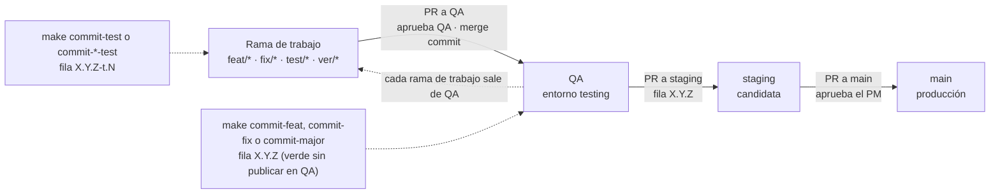
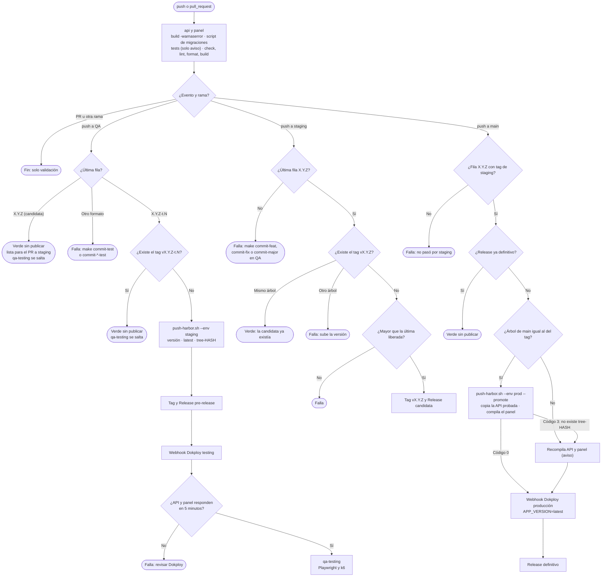
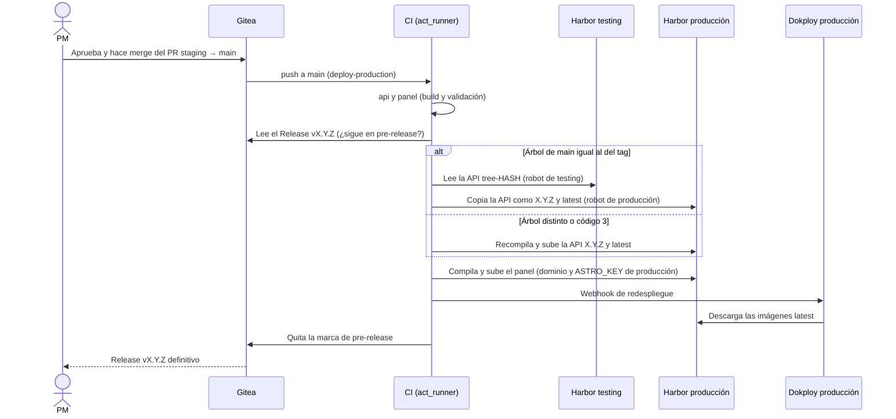

# Flujo de CI/CD: QA → staging → main

> Cómo viaja un cambio desde una rama de trabajo hasta producción en los proyectos del equipo: ramas protegidas en Gitea, quién aprueba cada paso, qué hace cada job del CI (Gitea Actions), cómo se publican las imágenes en Harbor y se despliegan en Dokploy, y qué hacer si una entrega se queda a medias. La implementación de referencia es **EmailSendService** (`.gitea/workflows/ci.yml`, el `Makefile` y los scripts de `infra/utils/`).

## Resumen

- **Entrada única:** el `Makefile` de la raíz. Versionado con `make commit-*`, publicación manual con `make publish-*`, perfiles de Docker con `make up|down|logs|config-<perfil>` y comprobaciones con `make check`. Los scripts (`infra/utils/push.sh`, `push-harbor.sh`, `perfil.sh`, `check.sh`, `version-lib.sh`) siguen ahí para quien los necesite directamente.
- **Ramas:** las ramas de trabajo salen de `QA`; un cambio pasa por PR a `QA`, después a `staging` y después a `main`. Todo, incluso una urgencia, recorre el flujo completo.
- **Versión:** la decide una persona con `make commit-*` antes del PR (ver [[versionado-semver-manual]]). El CI solo lee la última fila del historial.
- **El bot del CI nunca hace commits:** solo crea tags `v<versión>` y Releases de Gitea.
- **Entornos:** `QA` despliega **testing** (pre-release `X.Y.Z-t.N`); la candidata `X.Y.Z` que se registra en `QA` antes del PR a staging no publica nada (verde); `staging` solo marca la **candidata** `vX.Y.Z` (sin imágenes ni entorno); `main` despliega **producción** promoviendo la imagen de la API que se probó en testing.

## Requisitos previos

- Gitea con Actions habilitado y un runner propio (`gitea/act_runner`, en EmailSendService en el servidor de Dokploy con `capacity: 1`).
- Ramas `QA`, `staging` y `main` creadas y protegidas.
- Harbor con dos proyectos (testing y producción), cada uno con su **cuenta robot**.
- Dokploy con un compose de testing (`infra/perfiles/compose.testing.yml`, rama `QA`, Autodeploy por webhook) y uno de producción (`infra/perfiles/compose.prod.yml`, rama `main`).
- En el repo: `Makefile`, `infra/utils/{push.sh,version-lib.sh,push-harbor.sh,perfil.sh,check.sh}`, los composes de `infra/perfiles/` y el historial `docs/versions/version-history.md`.
- Los `.env` creados a partir de sus ejemplos (todos en `.gitignore`; ver sección 9). Antes de empezar, `make check`: dice qué falta (`OK` / `FALTA` / `AVISO`) sin mostrar valores.

## Uso / Pasos

### 1. Ramas y aprobaciones

| Rama | Para qué | Cómo entra un cambio | Quién aprueba |
|------|----------|----------------------|---------------|
| `feat/*`, `fix/*`, `test/*`, `ver/*` | Trabajo diario; salen de `QA` | Commits del desarrollador; antes del PR, `make commit-test` o un `commit-*-test` | — |
| `QA` | Entorno de testing | PR desde la rama de trabajo, **merge con commit de merge** | QA |
| `staging` | Candidata a producción | PR desde `QA` con la fila liberada `X.Y.Z` | QA: cuando da por aprobada la versión en testing, abre el PR a `staging` y hace el merge |
| `main` | Producción | PR desde `staging` | El PM |

- Cada responsable puede hacer **cambios mínimos directos en su rama**: QA en `QA` (p. ej. registrar la candidata con `make commit-feat`) y el PM en `main`.
- Un cambio directo del PM en `main` cambia el árbol de git: producción **recompila** en lugar de promover la imagen probada (ver sección 4).

### 2. Qué hace cada job

| Evento | Job | Qué hace | Si ya estaba hecho |
|--------|-----|----------|--------------------|
| `push` a cualquier rama y `pull_request` | `api` | Compila la API con advertencias como errores (bloquea), genera el script idempotente de migraciones (artefacto `migrations-sql`) y corre las pruebas unitarias (no bloquean: dejan aviso) | — |
| ídem | `panel` | `check`, `lint`, `format` y `build` del panel (en `QA` el build lo hace la imagen) | — |
| `push` a `QA` | `deploy-testing` | Lee la última fila. Si es `X.Y.Z-t.N`: publica API y panel en el Harbor de testing (`infra/utils/push-harbor.sh --env staging`, con versión, `latest` y `tree-<hash del árbol git>`); crea tag y Release **pre-release**; llama al webhook de Dokploy de testing; espera hasta 5 min a `health/ready` y al panel; avisa si hay migraciones nuevas desde el tag anterior. Si es la candidata `X.Y.Z`: **verde sin publicar**. Otro formato: falla | Si el tag ya existe: verde sin publicar y `qa-testing` se salta |
| tras `deploy-testing` con versión nueva | `qa-testing` | Playwright (humo, API, UI en Chromium y accesibilidad) y k6 (informativo) contra testing; deja el reporte como artefacto | Se salta (también con la candidata `X.Y.Z`) |
| `push` a `staging` | `release-staging` | Exige fila `X.Y.Z` **mayor que la última liberada con tag**; crea el tag `vX.Y.Z` y su Release como pre-release "(candidata)". Sin imágenes ni despliegue | Tag con el mismo árbol: verde; con otro árbol: falla |
| `push` a `main` | `deploy-production` | Exige fila `X.Y.Z` cuyo tag venga de staging; promueve o recompila (sección 4); compila el panel de producción; webhook de Dokploy de producción; quita la marca de pre-release del Release | Release ya definitivo: verde sin publicar |

Un mensaje de commit con `[skip ci]` salta todo el pipeline. Con `capacity: 1`, dos pushes seguidos se encolan y las entregas salen una detrás de otra. `make check-repo` muestra en local qué haría el CI en la rama actual con el historial.

### 3. Tags y Releases

| Momento | Tag | Release en Gitea | Imágenes |
|---------|-----|------------------|----------|
| Merge a `QA` (fila `X.Y.Z-t.N`) | `vX.Y.Z-t.N` | Pre-release con la fila del historial | Harbor de testing: `X.Y.Z-t.N`, `latest`, `tree-<hash>` |
| Push a `QA` con la candidata (fila `X.Y.Z`) | Ninguno | Ninguno | Ninguna (verde sin publicar) |
| Merge a `staging` | `vX.Y.Z` | Pre-release "(candidata)" | Ninguna |
| Merge a `main` | (el mismo `vX.Y.Z`) | Pasa a **definitivo** (se quita la pre-release) | Harbor de producción: `X.Y.Z` y `latest` |

- El tag lo crea Gitea al crear el Release, sobre el commit de la entrega. Se usa el token automático del job (`GITEA_TOKEN`) o, si no basta (tags protegidos), el secreto `RELEASE_TOKEN` de una cuenta bot.
- Una candidata devuelta conserva su Release como pre-release para siempre: así se distingue de las que llegaron a producción.

### 4. Imágenes: promoción de la API y panel por entorno

- **API:** en testing cada imagen lleva además la etiqueta `tree-<hash del árbol git>`. En producción, si el árbol de `main` es **idéntico** al del tag de staging, `push-harbor.sh --env prod --promote` **copia la misma imagen probada** (lee de testing con la cuenta robot de testing y sube a producción con la de producción; cada cuenta en su configuración temporal de Docker). Así llega a producción exactamente lo que QA probó.
- Si el árbol cambió (el PM tocó `main`) o la imagen `tree-<hash>` no existe (`push-harbor.sh` sale con **código 3**), el CI **recompila** la API y deja un aviso.
- **Panel:** se compila **siempre** por entorno, porque Astro fija al compilar el dominio público (`PANEL_PUBLIC_HOST` / `PANEL_PROD_PUBLIC_HOST`) y la clave `ASTRO_KEY` (`PANEL_PROD_ASTRO_KEY`, de `bunx astro create-key`, como secreto de BuildKit). En testing son opcionales; en producción, obligatorias.
- `push-harbor.sh` no republica una versión que ya exista en el registro destino.
- **Publicación manual** (solo el responsable del proyecto; normalmente lo hace el CI): `make publish-testing` y `make publish-prod`, que llaman a `infra/utils/push-harbor.sh` con las cuentas robot de `infra/.env`. Variables: `v=` (versión; por defecto la última fila), `only=api|panel`, `promote=1` (solo prod), `dry=1` (ensayo) y `m="mensaje"`.

### 5. Entrega a producción paso a paso

El compose de producción (`infra/perfiles/compose.prod.yml`) usa `APP_VERSION=latest`. **Volver atrás:** en Dokploy se fija `APP_VERSION` a una `X.Y.Z` anterior y se redespliega; al terminar el incidente se regresa a `latest`.

### 6. Entregas a medias y cómo terminarlas

| Dónde se cortó | Qué quedó | Cómo terminar |
|----------------|-----------|---------------|
| Testing: falló el webhook de Dokploy o el health check | Imágenes en Harbor y tag/Release creados | Redesplegar a mano desde Dokploy (revisa Autodeploy y la rama `QA` del compose). Un nuevo push con la misma fila no publica (el tag ya existe); para otra entrega, `make commit-test` |
| Testing: imágenes subidas pero falló la creación del tag/Release | Imágenes `X.Y.Z-t.N` en Harbor sin tag | Reintentar no sirve: `push-harbor.sh` rechaza una versión ya publicada. Crea el tag y el Release pre-release a mano en Gitea y redespliega, o registra otra entrega con `make commit-test` |
| Staging: falló la creación del Release | Sin tag o tag sin Release | Volver a lanzar el job (con el mismo árbol, si el tag ya existe, termina en verde); si falta el Release, créalo a mano como pre-release |
| Producción: falló el webhook | Imágenes `X.Y.Z` en Harbor de producción; Release aún pre-release | Redesplegar a mano desde Dokploy y **quitar a mano la marca de pre-release** del Release `vX.Y.Z` (un nuevo push a `main` fallaría porque la versión ya está publicada) |
| Producción: falló la publicación de imágenes a la mitad | API subida y panel no (o al revés) | Revisar el log; publicar la imagen que falte con `make publish-prod v=X.Y.Z only=panel` (o `only=api`) desde una máquina con las cuentas de producción en `infra/.env` (`make check-harbor` antes); después webhook y Release como en la fila anterior |

### 7. Qué configura el responsable

**En Gitea**
1. Activar Actions en el repo y registrar el runner (`infra/ci/act-runner/README.md` en EmailSendService).
2. Proteger `QA`, `staging` y `main`: solo por PR, con aprobación (QA en `QA` y en el PR a `staging`, PM en `main`) y merge con commit de merge; permitir el push directo solo al responsable de cada rama.
3. Cargar los secretos del repo (Settings → Actions → Secrets) con los nombres de la tabla siguiente.
4. Si los tags están protegidos, crear la cuenta bot y su `RELEASE_TOKEN`.

**En Dokploy**
1. Compose de testing con la ruta `infra/perfiles/compose.testing.yml`, apuntando a la rama `QA`, con Autodeploy y su webhook (→ `DOKPLOY_WEBHOOK_URL`). Sus variables son las de `infra/.env.testing`.
2. Compose de producción con la ruta `infra/perfiles/compose.prod.yml`, rama `main`, `APP_VERSION=latest`, las variables de `infra/.env.prod` y su webhook (→ `DOKPLOY_PROD_WEBHOOK`).
3. El stack compartido (`infra/perfiles/compose.shared-services.yml`: RabbitMQ y Valkey) lo despliega el responsable a mano, con las variables de `infra/.env.shared-services`.

**Secretos del repositorio (solo nombres; los valores nunca se escriben en notas ni en el repo)**

| Secreto | Uso |
|---------|-----|
| `HARBOR_USER`, `HARBOR_PASSWORD` | Cuenta robot del proyecto de testing; producción también la usa con `--promote` para leer la imagen probada |
| `DOKPLOY_WEBHOOK_URL` | Webhook del compose de testing |
| `HARBOR_PROD_USER`, `HARBOR_PROD_PASSWORD` | Cuenta robot del proyecto de producción |
| `HARBOR_PROD_PROJECT` | Proyecto de producción en Harbor |
| `HARBOR_PROD_REGISTRY` | Registro de producción (opcional) |
| `PANEL_PROD_PUBLIC_HOST` | Dominio público del panel de producción |
| `PANEL_PROD_ASTRO_KEY` | Clave estable de Astro para producción |
| `DOKPLOY_PROD_WEBHOOK` | Webhook del compose de producción |
| `RELEASE_TOKEN` | Opcional: token del bot para tags y Releases |
| `TEST_API_KEY_ADMIN`, `TEST_API_KEY_MANAGER`, `TEST_API_KEY_TEMPLATE_MANAGER`, `TEST_API_KEY_SENDER`, `TEST_API_KEY_GROUP_SENDER` | Keys de prueba de testing para `qa-testing` |

### 8. Comandos (make)

`make help` lista todos. Resumen por grupo:

| Grupo | Objetivos | Variables |
|-------|-----------|-----------|
| Versionado (`infra/utils/push.sh`) | `commit-feat`, `commit-fix`, `commit-major`, `commit-test`, `commit-feat-test`, `commit-fix-test`, `commit-major-test` | `m="nota"` (obligatoria), `n=1` (ensayo) |
| Publicación en Harbor (`infra/utils/push-harbor.sh`; solo el responsable) | `publish-testing`, `publish-prod` | `v=X.Y.Z[-t.N]`, `only=api\|panel`, `promote=1` (prod), `dry=1`, `m="mensaje"` |
| Desarrollo local (secretos de OpenBao) | `env`, `init`, `up` (= `up-dev-services`; con `APP=1`, `up-dev`), `down`, `down-volumes`, `ps`, `logs` | `SERVICES=`, `SERVICE=`, `APP=1`, `FORCE=1` |
| Perfiles (`infra/utils/perfil.sh`) | `up-<perfil>`, `down-<perfil>`, `logs-<perfil>`, `config-<perfil>` con `dev-services`, `dev`, `testing`, `prod`, `shared-services` (los de servidor solo para probar en local; en los servidores despliega Dokploy) | `SERVICES=`, `SERVICE=` |
| Comprobaciones (`infra/utils/check.sh`; solo lectura, nunca valores) | `check`, `check-dev-services`, `check-dev`, `check-testing`, `check-prod`, `check-shared-services`, `check-tools`, `check-harbor`, `check-repo` | — |
| Pruebas y base | `test`, `migrations-script` | — |

### 9. Archivos .env por perfil

Cada archivo se crea a partir de su ejemplo y está en `.gitignore`. `make check` lee las variables obligatorias de `infra/.env.example` (marcadas `# obligatoria`) y de las `${VAR:?}` de cada compose.

| Archivo | Para qué | Ejemplo |
|---------|----------|---------|
| `infra/.env` | Herramientas: cuentas robot de Harbor (testing y producción) y datos del panel al compilar; lo usan `make publish-*`, `up-testing`/`up-prod` y `check-harbor` | Sección `infra/.env` de `infra/.env.example` |
| `infra/.env.testing` | Variables de `compose.testing.yml` (las mismas que se cargan en Dokploy) | Sección `infra/.env.testing` |
| `infra/.env.prod` | Variables de `compose.prod.yml` | Sección `infra/.env.prod` |
| `infra/.env.shared-services` | Variables de `compose.shared-services.yml` | Sección `infra/.env.shared-services` |
| `infra/.env.dev-services`, `infra/.env.dev` | Opcionales: overrides de desarrollo (los secretos de OpenBao tienen prioridad) | Secciones del mismo nombre |
| `EmailSendService/.env` | La API en local: credencial AppRole de OpenBao (`make env`) | `EmailSendService/.env.example` |
| `EmailServiceManagment/.env` | El panel en local (`API_URL`, `API_PREFIX`) | Ejemplo del panel |

### 10. Implementación de referencia (EmailSendService)

| Archivo | Papel |
|---------|-------|
| `Makefile` | Entrada única: `commit-*`, `publish-*`, perfiles y `check` (sección 8) |
| `.gitea/workflows/ci.yml` | Jobs `api`, `panel`, `deploy-testing`, `qa-testing`, `release-staging` y `deploy-production` |
| `infra/utils/push.sh` + `infra/utils/version-lib.sh` | Versión y fila del historial ([[versionado-semver-manual]]) |
| `infra/utils/push-harbor.sh` | Build y publicación en Harbor (`--env staging` o `prod`, `--promote`, `--only api` o `panel`, `--dry-run`) |
| `infra/utils/perfil.sh` / `infra/utils/check.sh` | Operación local de los perfiles y comprobaciones |
| `infra/perfiles/compose.{dev-services,dev,testing,prod,shared-services}.yml` | Composes por perfil (testing y prod son los stacks de Dokploy) |
| `infra/.env.example` | Variables de cada `.env` de `infra/`, por sección |
| `infra/test/` | Pruebas de QA que corre `qa-testing` |
| `docs/versions/version-history.md` | Historial de versiones |

## Troubleshooting

| Síntoma | Causa | Solución |
|---------|-------|----------|
| `deploy-testing` falla: `La ultima fila del historial no es X.Y.Z-t.N` | Merge a `QA` sin `make commit-test` (la última fila no es `X.Y.Z-t.N` ni la candidata `X.Y.Z`, p. ej. una legado `X.Y.Z.TT`) | Registra la versión de testing en la rama de trabajo con `make commit-test` o un `commit-*-test` |
| `deploy-testing` en verde con el aviso "candidata lista para el PR a staging" | La última fila es la liberada `X.Y.Z` registrada en `QA` | Esperado: testing no cambia; sigue con el PR a `staging` |
| `deploy-testing` en verde pero testing no cambió | El tag `vX.Y.Z-t.N` ya existía | Registra una entrega nueva con `make commit-test` |
| `Dokploy no aceptó el webhook` | Webhook mal copiado, Autodeploy apagado, rama distinta o ruta del compose desactualizada | Revisa en Dokploy el compose (`infra/perfiles/compose.testing.yml`, rama `QA`) y el secreto; redespliega a mano (sección 6) |
| `Testing no respondió en 5 minutos` | La API o el panel no arrancan (migraciones, variables) | Logs del servicio en Dokploy; compara las variables con `make check-testing`; las imágenes ya están en Harbor |
| `release-staging`: `no es mayor que la última versión liberada` | No se registró una versión liberada nueva | `make commit-feat`, `commit-fix` o `commit-major` en `QA` y PR otra vez |
| `release-staging`: `El tag … ya existe con otro árbol` | La candidata ya se creó y luego cambió el código | Sube la versión (p. ej. `make commit-fix-test` y `make commit-fix`) |
| `deploy-production`: `vX.Y.Z no paso por staging` | PR a `main` sin pasar por `staging` | Recorre `QA → staging → main` |
| Aviso `se recompila todo, sin promover la API de testing` | El árbol de `main` no es el del tag o falta la imagen `tree-<hash>` | Esperado si el PM cambió algo en `main`; si no, revisa que la entrega a testing de esa versión se haya publicado |
| `La version ya esta publicada` en `push-harbor.sh` | Se reintentó una versión existente | Registra una nueva con `make commit-*` o termina la entrega a mano (sección 6) |
| `make publish-*` o `make up-testing` fallan en el login de Harbor | Falta o es incorrecta la cuenta robot en `infra/.env` | `make check-harbor` (dice qué falta sin mostrar valores) |
| `Faltan secretos del repositorio` en `qa-testing` | Keys de prueba sin cargar | Cárgalas en los secretos del repo |

## Relacionado

- [[versionado-semver-manual]] — cómo decidir la versión con `make commit-*`.
- [[email-service-cicd-sub-plan]] — historia del CI de EmailSendService.
- [[email-service-seguimiento-bajas-sub-plan]] — Fase 4c (producción).
- [[to-production-manual]] — despliegue por SSH de otros proyectos.
