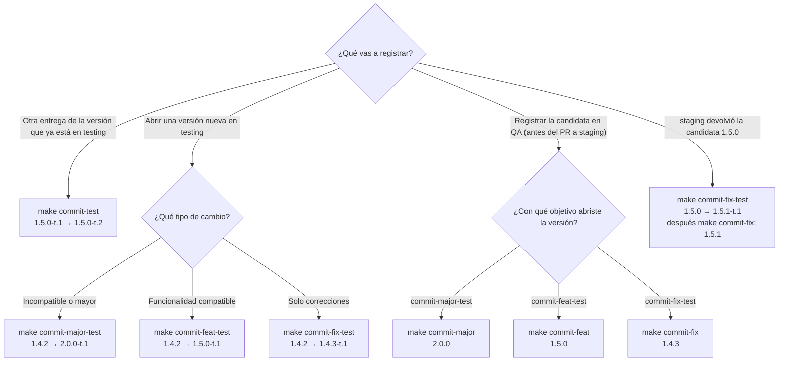
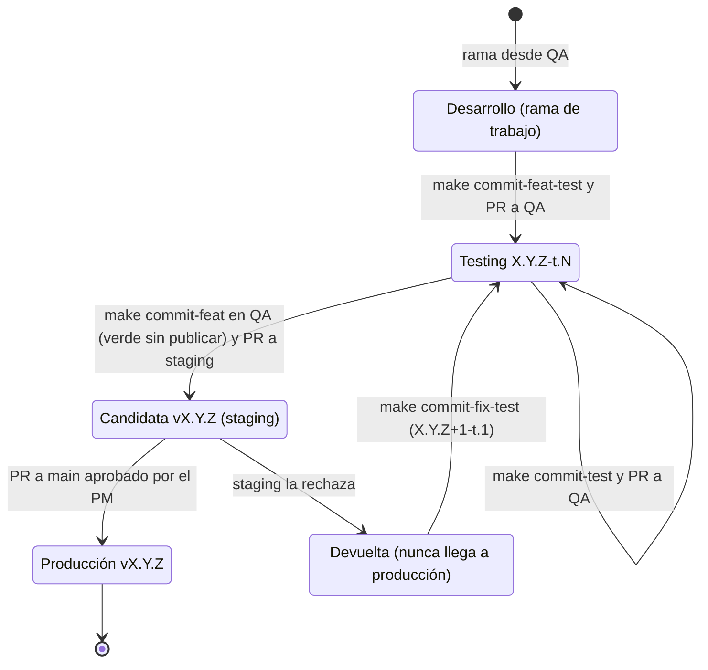

# Versionado SemVer con make commit-*

> Cómo decidir y registrar la versión de una app del equipo con `make commit-*` (que envuelve el script `infra/utils/push.sh`): qué es SemVer, cuándo subir X, Y o Z, qué es la pre-release de testing `-t.N`, qué objetivo de make usar y qué hacer cuando algo falla. Sirve para cualquier repo del equipo; el ejemplo es **EmailSendService** (`/Users/efraintics/proyects/emailService`).

## Resumen

La versión **la decide una persona**, no el CI. Antes de abrir el PR, quien entrega corre `make commit-<tipo> m="nota"` en su rama: el Makefile llama a `infra/utils/push.sh`, que calcula la versión siguiente, agrega una fila al historial `docs/versions/version-history.md`, hace commit (con la nota como mensaje) y push. El CI solo **lee la última fila** de ese historial para saber qué publicar, y nunca hace commits: solo crea tags y Releases.

Formato de versión:

| Formato | Tipo de fila | Qué es | Ejemplo |
|---------|--------------|--------|---------|
| `X.Y.Z` | `P` | Versión liberada (candidata en staging y después producción) | `1.5.0` |
| `X.Y.Z-t.N` | `T` | Pre-release de testing: N-ésima entrega a QA de la futura `X.Y.Z` | `1.5.0-t.2` |
| `X.Y.Z.TT` | — | Formato antiguo (legado). Cuenta como la liberada `X.Y.Z`, sin pruebas abiertas | `0.0.0.08` |

SemVer ordena una pre-release **antes** de su liberada: `1.5.0-t.1 < 1.5.0-t.2 < 1.5.0`. Por eso `1.5.0-t.N` significa "probando lo que será la 1.5.0".

El flujo de ramas y lo que hace el CI con cada fila están en [[flujo-ci-cd-manual]].

## Requisitos previos

- Repo con el `Makefile` en la raíz y `infra/utils/push.sh` + `infra/utils/version-lib.sh` (la biblioteca de cálculo, compartida con el CI y con `check.sh`).
- Antes de empezar, `make check` (o `make check-tools` y `make check-repo`): revisa herramientas, `git config user.name`/`user.email`, los `.env` de cada perfil y el historial, y responde `OK` / `FALTA` / `AVISO` sin mostrar nunca valores.
- `git config user.name` y `git config user.email` configurados: van en la columna **Autor** de la fila.
- Estar en una rama (no en HEAD separado) y sin merge, rebase, cherry-pick o revert a medias.
- El historial sin cambios pendientes de commit.
- Acceso de lectura a `origin/QA`: el script hace `git fetch` de esa rama para no repetir una N que otra persona ya usó.
- Bash 3.2 o superior (funciona con el bash de macOS) y GNU make (el de macOS sirve).

## Uso / Pasos

### 1. Qué sube cada número (SemVer)

| Número | Objetivo de make (bandera de `push.sh`) | Cuándo | Ejemplo desde 1.4.2 |
|--------|------------------------------------------|--------|---------------------|
| **X** (mayor) | `commit-major` (`-M`) | Cambio incompatible: contrato de API que rompe a los consumidores, esquema que exige migrar datos a mano, eliminación de funciones, o el salto a la primera versión estable (v1) | `2.0.0` |
| **Y** (funcionalidad) | `commit-feat` (`-F`) | Funcionalidad nueva compatible con lo anterior (endpoint, pantalla, slice) | `1.5.0` |
| **Z** (corrección) | `commit-fix` (`-f`) | Solo correcciones, sin funcionalidad nueva; también la versión que sustituye a una candidata devuelta | `1.4.3` |
| **N** (testing) | `commit-test` (`-T`) | Una entrega más a QA de la versión que se está probando | `1.5.0-t.1 → 1.5.0-t.2` |

Al subir X se reinician Y y Z; al subir Y se reinicia Z.

### 2. Qué objetivo usar

| Situación | Comando | Resultado (liberada 1.4.2) |
|-----------|---------|----------------------------|
| Primera entrega a testing de una funcionalidad nueva | `make commit-feat-test m="nota"` | `1.5.0-t.1` |
| Otra entrega a testing de la misma versión (QA pidió cambios) | `make commit-test m="nota"` | `1.5.0-t.2` |
| QA aprobó: registrar la candidata en `QA` antes del PR a staging | `make commit-feat m="nota"` (el mismo tipo con el que se abrió) | `1.5.0` |
| Solo correcciones a testing | `make commit-fix-test m="nota"` | `1.4.3-t.1` |
| Cambio incompatible a testing | `make commit-major-test m="nota"` | `2.0.0-t.1` |
| Staging devolvió la candidata 1.5.0 | `make commit-fix-test m="nota"` y, al aprobarse, `make commit-fix m="nota"` | `1.5.1-t.1` … `1.5.1` |
| Ensayo (no escribe nada) | agregar `n=1` | Muestra la versión y la fila |

`m="nota"` es **obligatoria** (sin ella, `make` responde `Falta la nota de la versión (m)`); admite espacios, comillas y `$`. Cada objetivo equivale a una combinación de banderas de `push.sh`:

| Objetivo | Banderas | Objetivo | Banderas |
|----------|----------|----------|----------|
| `commit-feat` | `-F` | `commit-feat-test` | `-F -T` |
| `commit-fix` | `-f` | `commit-fix-test` | `-f -T` |
| `commit-major` | `-M` | `commit-major-test` | `-M -T` |
| `commit-test` | `-T` | (`n=1`) | `-n` |



### 3. Cómo calcula la versión

El script junta las versiones del historial local y del de `origin/QA` y define:

- **R**: la mayor versión liberada (`X.Y.Z` o legado `X.Y.Z.TT` como `X.Y.Z`; sin filas, `0.0.0`).
- **C**: la mayor pre-release `X.Y.Z-t.N` cuya base es mayor que R (la versión de testing **abierta**).

| Objetivos (banderas) | Versión nueva | Fila |
|----------------------|---------------|------|
| `commit-major`, `commit-feat` o `commit-fix` (`-M`, `-F` o `-f`) | `bump(R)` | `P` |
| `commit-major-test`, `commit-feat-test` o `commit-fix-test` (bump con `-T`) | `bump(R)-t.N` (N = 1 o la siguiente libre para esa base) | `T` |
| `commit-test` (solo `-T`) | C con N+1 (error si no hay C) | `T` |

Una vez registrada la liberada `1.5.0`, R pasa a ser `1.5.0` y ya no hay versión de testing abierta: `make commit-test` da error hasta abrir la siguiente con un `commit-*-test`.

### 4. Ciclo de vida de una versión

1. **Desarrollo:** rama de trabajo (`feat/*`, `fix/*`, `test/*`, `ver/*`) que sale de `QA`.
2. **Testing:** `make commit-feat-test m="…"` en la rama y PR a `QA`. Al hacer merge, el CI publica `1.5.0-t.1` en testing con tag y Release pre-release. Cada ronda de cambios es otro `make commit-test` (`1.5.0-t.2`, `-t.3`…).
3. **Candidata:** QA aprueba; en `QA` se registra la liberada con `make commit-feat m="…"` (`1.5.0`). Ese push a `QA` termina en **verde sin publicar** (testing no cambia y `qa-testing` se salta). Después se abre el PR a `staging` y el CI crea el tag `v1.5.0` y su Release como pre-release "(candidata)".
4. **Producción:** el PM aprueba el PR a `main`. El CI publica en producción y el Release `v1.5.0` pasa a definitivo.
5. **Devuelta:** si staging rechaza la 1.5.0, esa versión **nunca llega a producción** (su Release se queda como candidata). La corrección abre `1.5.1-t.1` con `make commit-fix-test` y se libera como `1.5.1` con `make commit-fix`.



Secuencia completa de ejemplo:

```
1.4.2  ──(commit-feat-test)──▶ 1.5.0-t.1 ──(commit-test)──▶ 1.5.0-t.2 ──(commit-feat)──▶ 1.5.0  (candidata)
                                                                                          │
                                                          staging la devuelve ◀──────────┘
1.5.0  ──(commit-fix-test)──▶ 1.5.1-t.1 ──(commit-fix)──▶ 1.5.1  (candidata → producción)
```

### 5. Uso de make commit-* y de push.sh

```bash
make check                                           # antes de empezar: herramientas, .env, historial (OK / FALTA / AVISO)
make commit-feat-test m="Slice 9: seguimiento" n=1   # ensayo: muestra la versión y la fila
make commit-feat-test m="Slice 9: seguimiento"       # registra, hace commit y push
```

| Variable | Qué hace |
|----------|----------|
| `m="nota"` | **Obligatoria.** Va en la columna Descripción y es el mensaje del commit (`-d` de `push.sh`) |
| `n=1` | Ensayo: muestra versión y fila; no escribe, no hace commit ni push (`-n`) |

El script subyacente se puede llamar directamente (p. ej. desde otro script o un repo sin Makefile):

```bash
./infra/utils/push.sh (-M | -F | -f) [-T] -d "nota" [-n] [--file ruta]
./infra/utils/push.sh -T -d "nota" [-n] [--file ruta]
```

| Opción | Qué hace |
|--------|----------|
| `-M`, `-F`, `-f` | Bump de X, Y o Z sobre la mayor liberada |
| `-T` | Versión de testing `X.Y.Z-t.N` |
| `-d "nota"` | **Obligatoria.** Nota de la versión |
| `-n` | Ensayo |
| `--file ruta` | Otro historial (por defecto `docs/versions/version-history.md`) |
| `-h` | Ayuda |

Las banderas cortas se pueden agrupar (`-FT` equivale a `-F -T`). Solo se admite un bump a la vez (`-M`, `-F` o `-f`).

Qué hace, en orden:

1. Valida el repo (rama, operaciones de git en curso, historial sin cambios, autor de git).
2. `git fetch` de `origin/QA` y suma su historial al local (variables `PUSH_REMOTE` y `PUSH_QA_BRANCH`).
3. Calcula la versión y comprueba que no exista ya.
4. Agrega la fila: `| Fecha | Hora | Versión | Tipo | Autor | Descripción | Archivo |` (Tipo `T` o `P`; Autor `user.name <email>`; Archivo con las imágenes, p. ej. `email-send-service:1.5.0-t.1, email-service-panel:1.5.0-t.1`).
5. `git add` **solo del historial**, `git commit -m "nota"` y `git push` (con `-u origin <rama>` si no tiene upstream). Lo que ya estuviera en stage entra en el mismo commit.
6. La última línea es `VERSION=<versión>` (también con `-n`), para usarla desde otros scripts.

Recomendación: corre primero con `n=1` y revisa la versión antes de registrar.

### 6. Llevarlo a otro repo

1. Copia `infra/utils/push.sh` e `infra/utils/version-lib.sh` desde EmailSendService (en la misma carpeta: `push.sh` carga la biblioteca desde su propio directorio).
2. Copia del `Makefile` la sección "Versionado": las variables `MAKE_NOTE`, `COMMIT_FLAGS_*` y `COMMIT_TARGETS` y la regla `$(COMMIT_TARGETS)`; con eso tienes los `make commit-*`. Si el repo publica en Harbor con `push-harbor.sh`, copia también la regla `publish-testing publish-prod`.
3. Ajusta los nombres en `version-lib.sh` o expórtalos en el entorno: `VL_APP_NAME` (título del historial), `VL_API_IMAGE` y `VL_PANEL_IMAGE` (columna Archivo).
4. Si la rama de pruebas no se llama `QA` o el remoto no es `origin`, usa `PUSH_QA_BRANCH` y `PUSH_REMOTE`.
5. No hace falta crear el historial: la primera ejecución lo crea con su encabezado.
6. En el CI, carga la biblioteca con `. infra/utils/version-lib.sh` y lee la última fila con `vl_read_versions <historial> | tail -n 1`; `vl_classify` dice si es `pre`, `release` o `legacy` y `vl_compare` compara versiones.

### 7. Primera v1 desde el formato antiguo

Los repos con filas `0.0.0.TT` tienen R = `0.0.0`. Para la primera versión estable:

```bash
make commit-major-test m="v1: primera entrega a testing"   # 1.0.0-t.1
make commit-test m="ajustes de QA"                         # 1.0.0-t.2 (las que hagan falta)
make commit-major m="v1.0.0"                               # 1.0.0 (candidata)
```

## Troubleshooting

| Síntoma | Causa | Solución |
|---------|-------|----------|
| `Falta la nota de la versión (m)` | `make commit-*` sin `m=` o con nota vacía | `make commit-<tipo> m="nota"` |
| `Falta la version a subir` / `Solo se admite un bump a la vez` | Llamada directa a `push.sh` sin bandera o con dos bumps | Usa el objetivo de make de la sección 2 (o una sola bandera) |
| `No hay una version de testing abierta` | `make commit-test`, pero la última versión ya se liberó (o no hay ninguna `-t.N`) | Abre la siguiente con `commit-major-test`, `commit-feat-test` o `commit-fix-test` |
| `La version X ya existe en el historial (local o origin/QA)` | Otra persona registró esa versión en `QA` | Actualiza tu rama con `QA` (merge o rebase) y vuelve a correr `make commit-*` |
| Aviso `No se pudo hacer git fetch de origin/QA` | Sin red o sin la rama remota | Se usa solo el historial local y se puede repetir una N: revisa la conexión antes de seguir |
| Aviso `Hay una version de testing abierta (…) con otra base que la nueva` | Se liberó con un tipo distinto al que abrió la versión (p. ej. testing `1.5.0-t.2` y se corrió `commit-fix`) | El script ya hizo commit y push en tu rama: quita la fila con `git revert --no-edit HEAD` (si el commit llevaba otros cambios en stage, también se revierten) y repite con el objetivo correcto. Para evitarlo, ensaya antes con `n=1` |
| `El historial … tiene cambios sin commitear` | Se editó el historial a mano | Haz commit o `git checkout -- docs/versions/version-history.md` |
| `HEAD esta separado` / `Hay una operacion de git en curso` | Detached HEAD, merge o rebase a medias | Cambia a una rama o termina/aborta la operación |
| `Falta git config user.name` / `user.email` | Autor de git sin configurar (`make check-tools` lo marca como `FALTA`) | `git config user.name "Nombre"` y `git config user.email correo` |
| `Fallo git push; el commit queda en local` | Rama protegida, sin permisos o sin red | Reintenta con el comando que sugiere el script; en ramas protegidas trabaja en tu rama de trabajo y abre PR |
| El CI de `QA` falla con `La ultima fila del historial no es X.Y.Z-t.N` | Se hizo merge a `QA` sin registrar la versión de testing (la última fila no es `X.Y.Z-t.N` ni la candidata `X.Y.Z`) | Antes del PR a `QA`, corre `make commit-test` (o un `commit-*-test`). Si la última fila es la candidata `X.Y.Z`, el job **no falla**: termina en verde sin publicar |
| El CI de `staging` falla: `no es mayor que la última versión liberada` o `el tag ya existe con otro árbol` | La candidata ya existe o no se registró una versión nueva | Registra la liberada con `make commit-feat`, `commit-fix` o `commit-major` en `QA` y repite el PR |
| El CI de `main` falla: `vX.Y.Z no paso por staging` | Se llegó a `main` sin pasar por `staging` | Haz el PR `QA → staging` primero y después `staging → main` |

## Relacionado

- [[flujo-ci-cd-manual]] — ramas, jobs del CI, tags, Releases, despliegue y tabla de comandos de make.
- [[to-production-manual]] — script anterior de despliegue por SSH (otros proyectos).
- [[email-service-plan]] — proyecto de referencia (EmailSendService).
