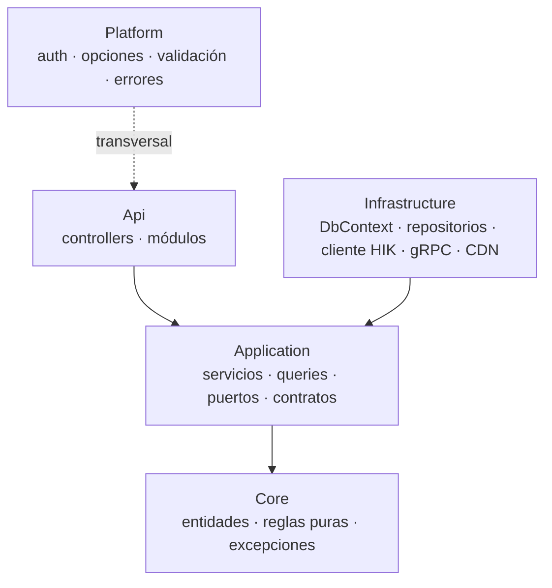
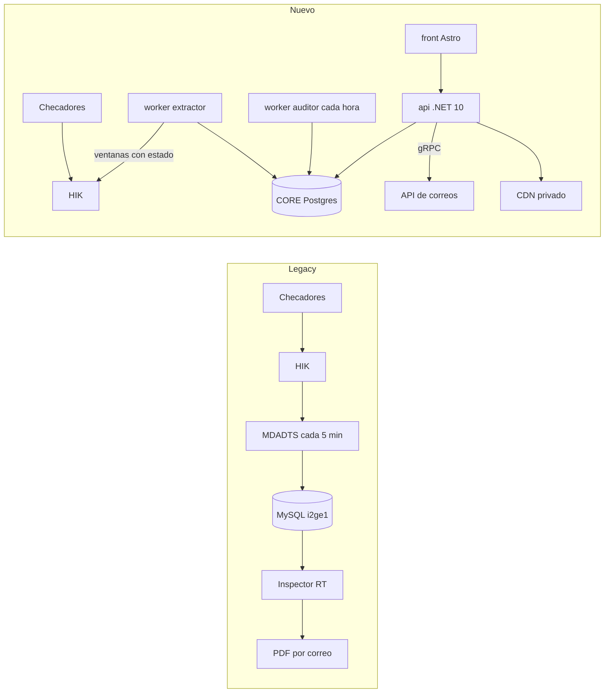
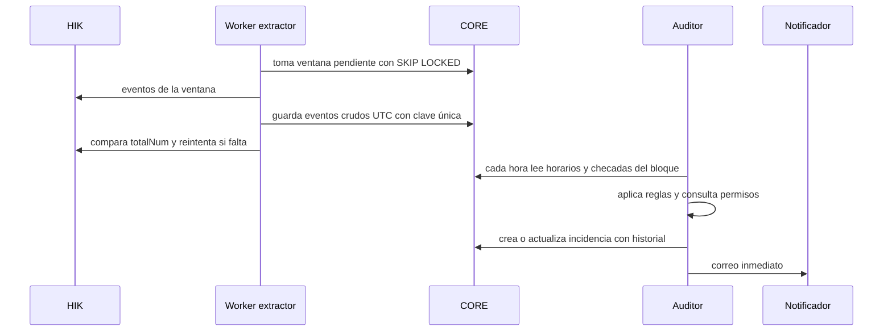
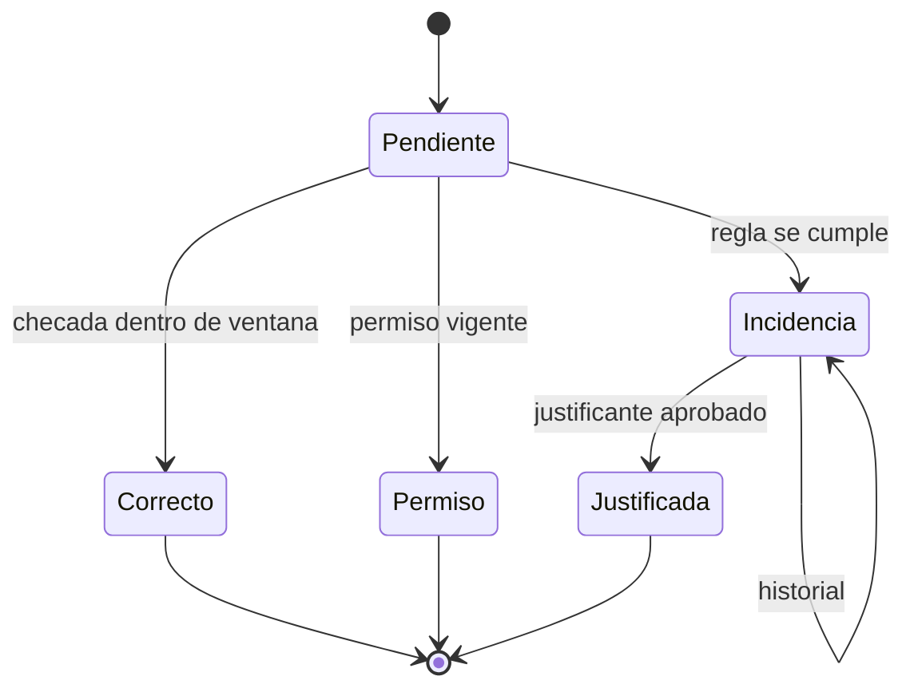
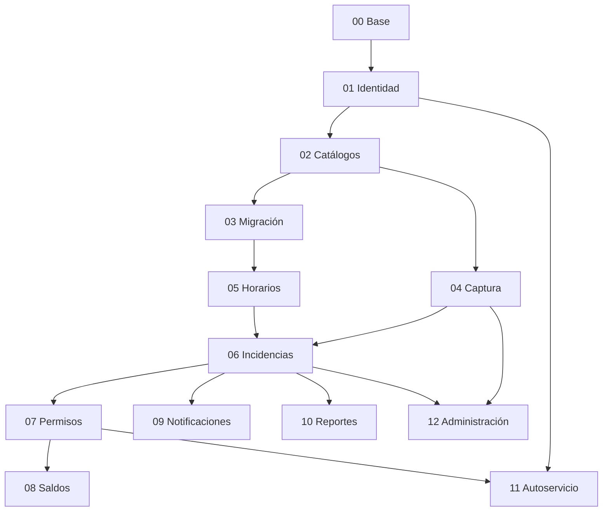

# Checadores — Plan de Desarrollo

> Reescritura a **.NET 10** del sistema de asistencia legacy (MDA / Inspector RT) con **Postgres propio (CORE)**, un **worker** que captura las checadas de HIK y un **auditor** que genera incidencias con reglas dinámicas, más un frontend **Astro**. Se desarrolla por **vertical slices** (BD + API + pantalla) sobre una **Clean Architecture adaptada**. Tareas en Plane: proyecto `CHECADORES` (CHECADORES-1 a 77). Bitácora de decisiones en el repo: `docs/decisiones-sesion.md`.

## Contenido

- [[#Reglas de Trabajo]] · [[#Legacy vs nuevo]] · [[#Diagramas de Funcionamiento]]
- [[#Pendientes]] · [[#Estado Actual (resumen ejecutivo)]] · [[#Decisiones de Diseño (vigentes)]]
- [[#Arquitectura y Notas Técnicas]] · [[#Archivos Clave del Proyecto]] · [[#Cómo se hace un slice (definición de hecho)]]
- [[#Fases]] · [[#Dependencias y Orden de Ejecución]]

**Glosario.** **CORE** = Postgres nuevo (vacío hoy). **CORE legacy** = MariaDB de producción. BD de checadas (i2ge1) que se migra. **HIK** = HikConnect de los checadores Hikvision; `personCode` = código HIK del empleado.

---

# Reglas de Trabajo

## 1. Método: entrevista antes del plan
- Antes del proyecto y de **cada slice** se dialoga con el usuario; el plan se redacta **después** de una sesión de preguntas y respuestas (cómo funciona hoy → problemas → mejora recomendada → decide el usuario). Rondas de máximo 4 preguntas.
- Si el plan es largo o el contexto se llena, las decisiones van a un documento temporal en la raíz del repo (`decisiones-sesion.md`).
- Lo que se deja pendiente (contratos, fórmulas, contenido) se anota en el slice y se resuelve al implementarlo.

## 2. Clean Architecture adaptada y SOLID
- Un solo proyecto en `checadores-back/Src/`: `Core/ · Application/ · Infrastructure/ · Api/ · Platform/`. Dependencias hacia adentro: `Api → Application → Core` e `Infrastructure → Application → Core` (convención, no la verifica el compilador).
- Un servicio por agregado; `IXService` (escrituras y reglas) e `IXQueries` (lecturas) separados; interfaces en `Application`, implementaciones en `Infrastructure`; se extiende agregando implementaciones, no editando servicios.
- Endpoint: `Controller → Service/Queries → Repository → Data`. Un `CommitAsync` por caso de uso; servicios sin HTTP y con `TimeProvider`. Worker, consumidor o REST son solo adaptadores.
- Repositorio por intención (`FindAsync`, `ExistsAsync`); devuelve `null`/`bool`, no lanza; nunca expone `IQueryable`.

## 3. Excepciones, validación y API
- `DomainException → AuthException / RequestException / InfrastructureException`; el nivel de log es de la clase base. Bajo 500 se muestra el mensaje; desde 500, un detalle genérico. `ProblemDetails` con `code` y `traceId`.
- Validación con atributos nativos; 400 con `errors` por campo. Rutas en plural y kebab-case, fechas UTC ISO, páginas `{ items, page, pageSize, total }`.

## 4. Seguridad
- Secretos solo por entorno (Dokploy); nunca se copian credenciales del legacy; se reportan como `[REDACTADO]`. Postgres en red interna; solo el proxy con HTTPS.
- Contraseñas con hash; sesión por cookie en Astro y JWT hacia la API; SSO después, detrás de un puerto.

## 5. Estilo, pruebas y proceso
- Español en código, docs y commits; comentarios solo a nivel de clase. Los agentes **no escriben tests**; se verifica con `dotnet build` (0 errores/0 advertencias), `bun run build` y `curl` contra el contenedor.
- Cada paso lo ejecuta un sub-agente (CREAR → MODIFICAR → ENLAZAR) y no se avanza sin visto bueno. **No se toca git** (lo hace el responsable). Ramas: `feat/*` → `Qa` → `Staging` → `main`. Cambios de esquema, dependencias y contratos requieren confirmación.

---

# Legacy vs nuevo

| Tema | Legacy (MDA / Inspector RT) | Nuevo |
|------|------------------------------|-------|
| Plataforma | Node/pkg (MDADTS), Inspector RT (Clarion/Delphi), MySQL 5.5, SQLite, Mongo | .NET 10 + Postgres (CORE) + Astro |
| Captura | DTS cada 5 min con 3 estrategias (224–226) y 2 reconciliaciones fijas (10:16 y 11:16) | Worker con ventanas con estado, cola en Postgres, reintentos y reconciliación por `totalNum` |
| Idempotencia | `MAX(CODCHECADA)+1` y archivo `lastProcessed` | Clave única por evento; estado en BD |
| Entrada/salida | Heurística `hora < 12` | Evento crudo en UTC sin clasificar; el auditor decide contra el horario |
| Fechas | Clarion (días desde 1800-12-27; hora en centésimas + 1) | `timestamptz` UTC; zona `America/Mexico_City` solo en reglas |
| Horarios | `agregarHorario` (230–235), tolerancias en centésimas + 1 | Fijos y dinámicos con vigencia; grupos de tolerancia y ventanas por tipo editables |
| Incidencias | AU / RE / OE / OS calculadas por Inspector RT (sin código) y estrategias 236–238 | 5 clases con reglas dinámicas; Falta absorbe el bloque; auditor cada hora con máquina de estados |
| Justificantes | Tablas `AdministracionJustificantes*` | Permiso no genera incidencia; justificante no la borra; solicitud, aprobación y documento firmado en CDN |
| Reportes | PDF por departamento por cronograma, enviado por correo | Bajo demanda (panel, visor y correo) y estadísticas |
| Notificaciones | `emailService` ad hoc | `INotificador` por gRPC a la API institucional; correo inmediato e informes por turno |
| Acceso | Usuario `kiosko` compartido, formularios dinámicos, contraseñas en claro | Cuenta propia por persona, pantallas fijas, hash, roles y SSO a futuro |
| Operación | Logs sueltos, `Timeout exceeded` por timeout fijo de 20 s | Logs estructurados y métricas a Grafana; panel de colas, auditor y bitácora |
| Despliegue | Servidor Windows con puertos abiertos | Contenedores en Dokploy detrás de proxy HTTPS |

---

# Diagramas de Funcionamiento

## D1. Capas y dependencias

## D2. Arquitectura: legacy → nuevo

## D3. Datos de una checada, de punta a punta

## D4. Ciclo de una incidencia

---

# Pendientes

- [ ] Esquema Postgres (`docs/esquema-postgres.sql` y `.md`) y su confirmación antes de migrar.
- [ ] Documentos de análisis, mejora y rediseño (`docs/analisis-infraestructura.md`, `docs/mejora-infraestructura.md`, `docs/rediseno-reglas-flujos.md`).
- [ ] Proyectos en blanco: `checadores-back/` y `checadores-front/` (requiere confirmar dependencias).
- [ ] Confirmar con RH el régimen de prestaciones (LFT A, LFTSE B o condiciones propias) → slice 08.
- [ ] Contratos pendientes hasta su implementación: CDN privado (07), gRPC de correos (09), contenido de reportes (10).
- [ ] Responsable: verificar puertos expuestos del servidor legacy y rotar credenciales.
- [ ] Sincronizar estas notas con la bóveda de Nextcloud (regla de la bóveda).

# Estado Actual (resumen ejecutivo)

| Área | Estado |
|------|--------|
| Análisis del legacy (`docs/`, `huecos.md`) | ✅ |
| Entrevista de decisiones (bitácora) | ✅ cerrada 2026-11-23 |
| Índice de slices y Plane (CHECADORES-1 a 77) | ✅ |
| Plan maestro y sub-planes | ✅ |
| Esquema Postgres | ⏳ |
| Proyectos en blanco | ⏳ |

| Fase / Slice | Dominio | Estado |
|--------------|---------|--------|
| 0 | Base y plataforma — [[checadores-slice-00-base-sub-plan]] | ⏳ |
| 1 | Identidad, roles y permisos — [[checadores-slice-01-identidad-sub-plan]] | ⏳ |
| 2 | Catálogos y organización — [[checadores-slice-02-catalogos-sub-plan]] | ⏳ |
| 3 | Migración CORE legacy → CORE — [[checadores-slice-03-migracion-sub-plan]] | ⏳ |
| 4 | Captura de checadas — [[checadores-slice-04-captura-sub-plan]] | ⏳ |
| 5 | Horarios, tolerancias y calendario — [[checadores-slice-05-horarios-sub-plan]] | ⏳ |
| 6 | Reglas e incidencias — [[checadores-slice-06-incidencias-sub-plan]] | ⏳ |
| 7 | Permisos y justificantes — [[checadores-slice-07-permisos-sub-plan]] | ⏳ |
| 8 | Saldos y prestaciones — [[checadores-slice-08-saldos-sub-plan]] | ⏳ |
| 9 | Notificaciones — [[checadores-slice-09-notificaciones-sub-plan]] | ⏳ |
| 10 | Reportes y estadísticas — [[checadores-slice-10-reportes-sub-plan]] | ⏳ |
| 11 | Autoservicio / kiosko — [[checadores-slice-11-autoservicio-sub-plan]] | ⏳ |
| 12 | Administración y observabilidad — [[checadores-slice-12-administracion-sub-plan]] | ⏳ |

# Decisiones de Diseño (vigentes)

1. **Reglas e incidencias dinámicas:** tipos y reglas son datos editables, no enums.
2. **Cinco clases:** Retardo, Omisión de entrada, Omisión de salida, Salida anticipada y **Falta** (mayor severidad; absorbe lo demás del bloque).
3. **Auditor cada hora** con máquina de estados por empleado y bloque; las checadas se ven en el panel (refresco cada 5 min) y el estado se marca solo cuando entra el auditor.
4. **Permiso** no genera incidencia; **justificante** se aplica a una incidencia sin borrarla (historial). Ambos con formato y documento firmado en CDN privado.
5. **Horarios** fijos (administrativos) y dinámicos con vigencia (docentes), relación 1–N con reglas por bloque. Al vencer sin asignación hay aviso y las checadas se revalidan al asignar.
6. **Ventanas por tipo** (entrada/salida) con tolerancia anterior y posterior; fuera de rango se descarta o genera incidencia (configurable). Redondeo configurable (1 min por defecto) solo antes de la hora de salida. Omisión de salida con 1 h de tolerancia. Salida anticipada sin tolerancia.
7. **Captura:** worker en el mismo proyecto, dos contenedores (`api`, `worker`); estado y cola en **Postgres** (`FOR UPDATE SKIP LOCKED`, advisory lock; sin Redis); interfaz de proveedor para cambiar al SDK propio; eventos crudos UTC; ráfagas marcadas; bandeja de no identificadas.
8. **Configuración** en Postgres con **caché en memoria** (invalida al guardar; el worker recarga por versión). Sin SQLite.
9. **Migración** CORE legacy → CORE: carga idempotente lanzada desde un botón del panel, con todo el histórico convertido.
10. **Kiosko** = autoservicio con cuenta propia (SSO a futuro); sin formularios dinámicos ni usuario `kiosko`.
11. **Notificaciones** por `INotificador` con cliente gRPC a la API institucional; correo inmediato al empleado, administrador del departamento, jefe de carrera (docentes) y RH; informes diarios por turno (~10:00 y ~19:00, editables).
12. **Jerarquía** por asignación explícita en el panel.
13. **Saldos** por paquetes con edición individual y cálculo por reglas configurables (esquemas LFT / LFTSE).
14. **Alertas** por logs, notificadas por Grafana. **Respaldos** en proyecto aparte (Dokploy + S3, tipo pgBackRest). Reportes bajo demanda.

# Arquitectura y Notas Técnicas

- **Stack:** .NET 10 (ASP.NET Core, EF Core + Npgsql, `BackgroundService`/Quartz para el auditor), Postgres, Astro (server, adapter Node, React, Tailwind vía Vite, Actions, Bun), gRPC (correos).
- **Contenedores:** `api`, `worker` (extractor, auditor y migración), `front`, `postgres`; mismo código, dos procesos.
- **Zona horaria:** UTC en BD; `America/Mexico_City` solo en reglas y reportes.
- **API de HIK:** token con vigencia de 7 días, límite de 5 req/s, eventos en `acs/v1/event/certificaterecords/search`. El servidor HIK es de pocos recursos: no sondear por segundo.
- **Convenciones de BD:** `snake_case` en español, `timestamptz`, claves únicas de idempotencia, claves de origen para la migración.

# Archivos Clave del Proyecto

| Archivo | Propósito |
|---------|-----------|
| `docs/decisiones-sesion.md` | Bitácora de la entrevista (fuente de las decisiones) |
| `docs/indice-tareas.md` | Índice de slices y tareas |
| `docs/modelo-negocio.md`, `docs/huecos.md` | Análisis del legacy y lo no determinado |
| `legacy-code/estrategias-y-reportes/estrategias/` | Estrategias 224–241 (captura, horarios, incidencias, reporte) |
| `legacy-code/base-de-datos-i2ge1/esquema.sql` | Esquema consolidado de i2ge1 (173 tablas) |
| `checadores-back/Src/` | Backend nuevo (por crear) |
| `checadores-front/` | Frontend Astro (por crear) |
| `AGENTS.md` | Reglas del repo, incluido el método de entrevista |

# Cómo se hace un slice (definición de hecho)

- [ ] **Entrevista previa** con el usuario y decisiones anotadas.
- [ ] **Esquema y entidad** con su migración (confirmada).
- [ ] **Datos:** puerto `IXRepository` e implementación.
- [ ] **Lógica:** `XService` y `XQueries`; reglas puras en `Core`.
- [ ] **Contratos** con validación nativa y su builder.
- [ ] **Entrada:** controller o worker con política de rol.
- [ ] **Pantalla** en Astro con su Action, leyendo errores por campo.
- [ ] **Documentación** y colección de Insomnia al día.
- [ ] **Verificación:** `dotnet build`, `curl` (401 uniforme, caso feliz, 400/404/409) y `bun run build`.

# Fases

| Fase | Slices | Objetivo |
|------|--------|----------|
| 0 | — | Documentos, esquema Postgres y proyectos en blanco |
| 1 | 00 | Base y plataforma |
| 2 | 01, 02 | Identidad y catálogos |
| 3 | 03, 04 | Migración de CORE legacy y captura de checadas |
| 4 | 05, 06 | Horarios y motor de incidencias |
| 5 | 07, 08, 09 | Permisos, saldos y notificaciones |
| 6 | 10, 11, 12 | Reportes, autoservicio y administración |

# Dependencias y Orden de Ejecución

El 03 y el 04 corren en paralelo; el 05 necesita los horarios migrados. El 12 se alimenta de lo que cada slice emite (logs, métricas, bitácora). Antes de cada slice se hace su entrevista y se actualiza su sub-plan.

# Relacionado

- [[AGENTS]] · [[email-service-plan]] (modelo de este plan) · [[asistencias-plan]] (proyecto hermano de checadas desde app)
