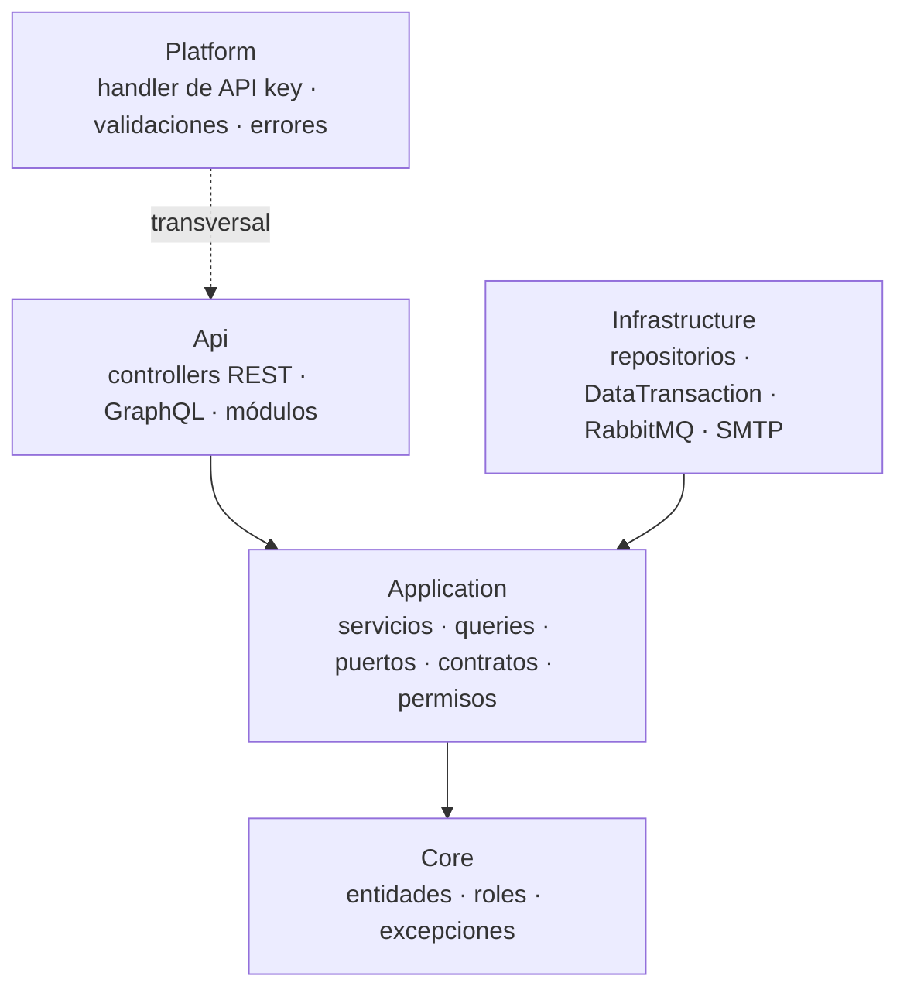
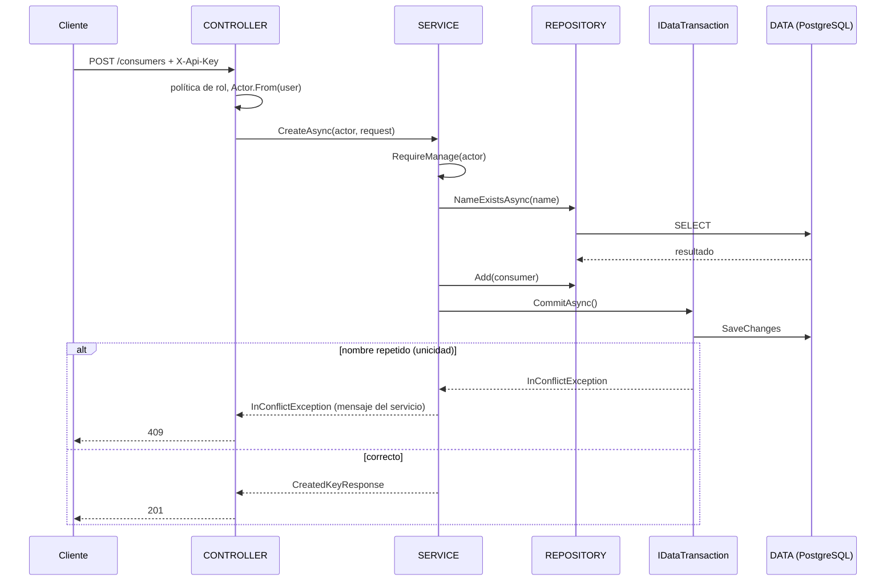
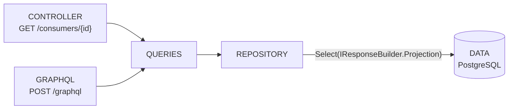
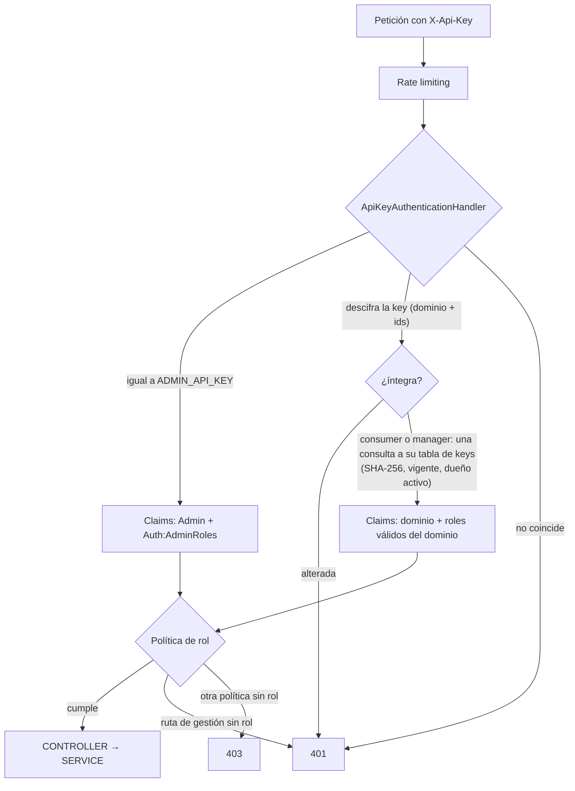
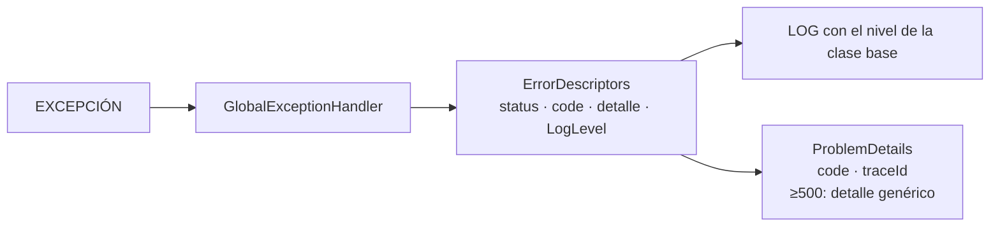
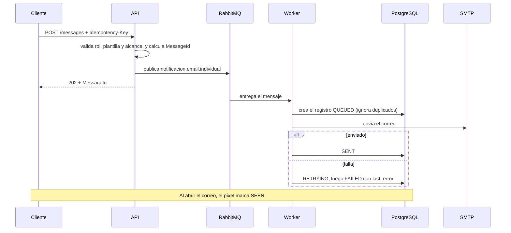

# EmailSendService — Plan de Desarrollo

> API .NET 10 (minimal API) que envía correos 1 a 1 y a grupos, con PostgreSQL, RabbitMQ y secretos en OpenBao, más un panel de administración en Astro. Se desarrolla por **vertical slices** (BD + API + panel) sobre una **Clean Architecture adaptada**. Primero van las reglas de trabajo y los diagramas (decisiones de arquitectura); después, el plan desde la Fase 1.

## Contenido

- [[#Reglas de Trabajo]]
- [[#Diagramas de Funcionamiento]]
- [[#Pendientes]] · [[#Estado Actual (resumen ejecutivo)]] · [[#Decisiones de Diseño (vigentes)]]
- [[#Arquitectura y Notas Técnicas]] · [[#Archivos Clave del Proyecto]] · [[#Cómo se hace un slice (definición de hecho)]]
- FASE 1 a 4 · [[#Dependencias y Orden de Ejecución]]

---

# Reglas de Trabajo

## 1. Clean Architecture (adaptada)

- Un solo proyecto; los límites son carpetas: `Core/ · Application/ · Infrastructure/ · Api/ · Platform/`.
- **Las dependencias apuntan hacia adentro:** `Api → Application → Core` e `Infrastructure → Application → Core`. Nada de adentro conoce a nada de afuera.
- Qué vive en cada capa:

| Capa | Contenido |
|------|-----------|
| `Core/` | Entidades (`Core/Entities`, generadas por scaffold), `ConsumerRole`, `ApiKeyHasher`, jerarquía de excepciones con su nivel de log |
| `Application/` | Servicios (`IXService`) y lecturas (`IXQueries`), puertos (`IXRepository`, `IDataTransaction`, `INotificationPublisher`…), contratos (request/response), `IResponseBuilder` y sus builders, permisos (`Actor`, `Can/Require`) |
| `Infrastructure/` | `EmailDbContext`, repositorios, `DataTransaction`, RabbitMQ, SMTP |
| `Api/` | Controllers REST, tipos GraphQL, módulos de cada dominio (DI y rutas), pipeline |
| `Platform/` | Transversal técnico: handler de API key, opciones, atributos de validación, descriptores de error |

- La regla se documenta; el compilador no la verifica (un solo proyecto).

## 2. SOLID aplicado a los servicios

- **SRP:** un servicio por agregado (`ConsumerService`, `KeyService`), nunca un servicio "de administración" que lo haga todo.
- **ISP:** `IXService` para escrituras y reglas; `IXQueries` para lecturas y listas. GraphQL solo conoce `Queries`.
- **DIP:** las interfaces viven en `Application`; las implementaciones, en `Infrastructure`. Cada módulo de dominio (`IServiceInstaller`) registra las suyas.
- **OCP:** se extiende agregando implementaciones (otro `IEmailSender`, otro canal), no editando servicios.
- **LSP:** un repositorio devuelve `null` si no encuentra algo; no lanza.
- **Servicios sin HTTP:** reciben el `Actor` por parámetro (el controller hace `Actor.From(user)`) y usan `TimeProvider`; así se prueban sin framework.

## 3. Capas de un endpoint: qué hace cada pieza

| Pieza                  | Responsabilidad                                                                                                   |
| ---------------------- | ----------------------------------------------------------------------------------------------------------------- |
| **Controller**         | HTTP: bind, política de rol, `Actor.From`, `Results.*`. No toca el `DbContext`                                    |
| **Service**            | Reglas de negocio, `Can/Require`, excepciones de dominio, un `CommitAsync` por caso de uso                        |
| **Queries**            | Lecturas y listas paginadas                                                                                       |
| **Repository**         | Consultas por intención (`NameExistsAsync`, `FindAsync`, `ListAsync`); sin genéricos ni `IQueryable` expuesto     |
| **`IDataTransaction`** | Confirma la transacción del caso de uso (`CommitAsync`) y traduce la unicidad de Postgres a `InConflictException` |
| **`IResponseBuilder`** | Proyección de EF a respuesta (`.Select(builder.Projection)`)                                                      |
| **Data**               | `EmailDbContext` y entidades                                                                                      |

Todo punto de entrada (controller REST, resolver GraphQL, consumidor de RabbitMQ) es un **adaptador**: solo traduce y delega a un servicio o a las queries.

## 4. API: REST y GraphQL

- **REST** para lo simple (GET por id, `whoami`, health) y para todo `POST / PUT / PATCH / DELETE`, con códigos 200, 201, 202 y 204.
- **GraphQL.NET** (paquetes `GraphQL` + `GraphQL.SystemTextJson`, endpoint propio, **solo consultas**) para las listas grandes, así no hay URLs largas.
- Listas: `page` y `pageSize` van en el cuerpo (con tope); respuesta `{ items, page, pageSize, total }`; filtros como *input* y orden como *enum*.
- GraphQL con la misma `X-Api-Key` y las mismas políticas; profundidad y complejidad máximas; introspección apagada en producción.
- Rutas en plural y en kebab-case; fechas en UTC con formato ISO; `Idempotency-Key` solo en los `POST` de envío.

## 5. Seguridad y acceso

- Tres identidades con una sola cabecera `X-Api-Key`: **Admin** (igualdad con el secreto de OpenBao), **Consumer** (app, backend a backend) y **Manager** (persona con email que administra contactos; sin contraseña, usa su key). Son dominios separados: tablas `consumer` y `manager`, cada una con su tabla de keys (`consumer_keys`, `manager_keys`).
- La key es un token cifrado y autenticado (AES-256-GCM) que lleva el dominio, el id de la key y el del dueño: al descifrarla se sabe a qué tabla ir (una sola consulta). Una key alterada se rechaza sin tocar la base; si es válida, la base manda (SHA-256, revocada, vencida, dueño inactivo). **Una sola key vigente por dueño**: rotar reemplaza la anterior al instante; `expire_at` opcional para keys temporales.
- Roles `ConsumerRole` planos y combinables, en `capabilities`, **por dominio sin mezcla**: Consumer → `Sender`, `GroupSender`; Manager → `GroupManager`, `TemplateManager`. El administrador tiene `Admin` más los de `Auth:AdminRoles`.
- Una política de autorización por rol; un consumidor que llama a una ruta de gestión recibe el mismo 401 que con una key inválida.
- Protocolo `CanX` (bool) / `RequireX` (lanza) con matriz de dos capas: rol + alcance por recurso (`consumer_group_roles`, `consumer_templates`).
- `messages/*` es consulta interna: solo `GroupManager` y Admin. Los consumidores no conocen estados internos.

## 6. Excepciones y logs

- Jerarquía: `DomainException → AuthException / RequestException / InfrastructureException → In*`.
- **El nivel de log es una propiedad de la clase base:** `RequestException` → Information, `AuthException` → Warning, `InfrastructureException` e `InExternalServiceException` → Error.
- Por debajo de 500 se muestra el mensaje al cliente; desde 500 solo un detalle genérico. La excepción completa se registra solo desde Error.
- Respuesta `ProblemDetails` con `code` y `traceId`.

## 7. Validación y respuestas

- Atributos nativos (`[Required]`, `[StringLength]`, `[RegularExpression]`…) más `Platform/Validations` (`IsEnum`, `IsEnumList`, `FutureDate`).
- Un request inválido responde 400 con `errors` por campo y `code: Validation`.
- Las respuestas se arman con `IResponseBuilder`; los requests no transforman nada.

## 8. Mensajería

- La API **valida** (rol, plantilla, alcance) y **publica** en RabbitMQ; responde 202 con un `MessageId` derivado del consumidor y la `Idempotency-Key` (así se evita duplicar sin guardar estado en la API).
- **El worker es dueño del registro:** lo crea en `QUEUED`, envía por SMTP y lo deja en `SENT`, `RETRYING` o `FAILED`. `SEEN` llega por el píxel de apertura.
- Entrega *at-least-once*: ack manual, reintentos con espera creciente y cola de fallidos.

## 9. Datos

- **Sin migraciones:** EF solo consume la base; la base de producción vive aparte y la administra Efraín.
- `db.sql` es referencia del esquema; cada slice deja listo el `ALTER` que Efraín aplica.
- Las entidades se generan por scaffold hacia `Core/Entities`.

## 10. Estilo, pruebas y proceso

- Comentarios solo a nivel de clase, breves y describiendo parámetros; un comentario dentro de un método solo si su uso es muy específico.
- Documentación en archivos `.md` (sin OpenAPI).
- **Pruebas:** unit tests los escribe Efraín; integración, otro miembro del equipo; rendimiento, con k6. Claude no escribe tests.
- Todo se trabaja en `main` hasta terminar la Fase 1; los commits los hace Efraín.
- Despliegue y respaldos se definen al terminar el desarrollo.

---

# Diagramas de Funcionamiento

## D1. Capas y dependencias



## D2. Escritura de un endpoint: [CONTROLLER] → [SERVICE] → [REPOSITORY] → [DATA]



## D3. Lectura: REST por id y GraphQL para listas



## D4. Flujo de la key (autenticación y autorización)



## D5. Excepción → log



| Excepción | Estado | Nivel de log | Qué se registra |
|-----------|:------:|:------------:|-----------------|
| `InValidationException`, `InNotFoundException`, `InConflictException` (`RequestException`) | 400 / 404 / 409 | Information | Mensaje, sin excepción |
| `InLoginException`, `InRoleNotAllowedException`, `InResourceNotGrantedException` (`AuthException`) | 401 / 403 | Warning | Mensaje, sin excepción |
| `InConfigurationException`, `InExternalServiceException` (`InfrastructureException`) | 500 / 502 | Error | Mensaje y excepción completa |

## D6. Envío de un correo



---

# Pendientes

- [x] Migrar el panel a `/whoami`, a leer `errors`, a la lista por GraphQL y a los dos dominios; su arquitectura toma como ejemplo el frontend de `bolsa-trabajo-tsj` (ver `AGENTS.md`).
- [x] Terminar la Fase 1 (API y panel).
- [x] Testing en Dokploy: la API se publica en Harbor con `push-harbor.sh` (versión `X.Y.Z.TT`) y corre con `compose.testing.yml` contra una PostgreSQL externa; el panel se usa en local con `API_URL` apuntando a testing.
- [ ] Pruebas: Efraín escribe las unitarias, el equipo las de integración y k6 mide el rendimiento (la carpeta `EmailSendService.Tests/` se queda).
- [x] Slice 3 (plantillas) implementado en API y panel, con `@maily-to/core` para el editor; probado en local.
- [ ] Deploy del slice de plantillas a testing (aplicar el `ALTER` en la base) y fase de dudas.
- [ ] Slice 4 (sincronización con el Core) en curso: detallado cerrado el 2026-10-29 como **revisión asistida por población** (ver [[email-service-sync-core-sub-plan]]); falta la consulta SQL de aspirantes.

# Estado Actual (resumen ejecutivo)

| Área | Estado |
|------|--------|
| Infra: compose, `make env/init/up`, OpenBao (AppRole) | ✅ |
| Errores: `DomainException`, ProblemDetails con `code` y `traceId`, nivel de log por clase | ✅ |
| Rate limiting: Relaxed / Moderate / Strict, global para lo no declarado | ✅ |
| Autenticación: `X-Api-Key` única cifrada con su dominio, `GET /whoami` (con `kind`), admin por OpenBao | ✅ |
| Dominios Consumer y Manager con keys separadas, una key vigente por dueño y roles por dominio | ✅ |
| Roles, políticas por rol, `Auth:AdminRoles` con `IOptions` | ✅ |
| Protocolo `Can` / `Require` y matriz `consumer_group_roles` | ✅ (sin endpoints que lo usen aún) |
| Gestión de consumidores y keys (API) | ✅ por capas (servicios, queries y repositorios); lista por GraphQL |
| GraphQL.NET (solo consultas, `POST /graphql`, solo Admin) | ✅ piloto: lista de consumidores |
| Validación nativa y `Platform/Validations` | ✅ |
| Módulos por responsabilidad y `IResponseBuilder` | ✅ |
| Mensajería RabbitMQ (publicador y consumidor) | ⚠ handler provisional que solo escribe en el log |
| Endpoints de negocio (plantillas, contactos, grupos, envíos) | ⏳ |
| Panel Astro | ✅ login solo Admin, consumidores, managers y salud |
| Testing: imagen de la API en Harbor, `compose.testing.yml` en Dokploy, base externa y secretos como `Secrets__*` (OpenBao opcional) | ✅ |

| Fase / Slice | Dominio | Estado |
|--------------|---------|--------|
| 1 | Auth (key cifrada con su dominio: Admin, Consumer, Manager) — [[email-service-auth-sub-plan]] | ✅ hecha |
| 2 | Consumidores, managers y keys — [[email-service-consumidores-keys-sub-plan]] | ✅ hecha |
| 3 | Plantillas — [[email-service-plantillas-sub-plan]] | ✅ Implementada (falta deploy a testing y refinamiento) |
| 4 | Sincronización con el Core — [[email-service-sync-core-sub-plan]] | ⏳ Pendiente |
| 5 | Contactos — [[email-service-contactos-sub-plan]] | ⏳ Pendiente |
| 6 | Grupos, miembros y asignaciones — [[email-service-grupos-sub-plan]] | ⏳ Pendiente |
| 7 | Envío 1 a 1 y worker SMTP — [[email-service-envio-individual-sub-plan]] | ⏳ Pendiente |
| 8 | Envío a grupos y lotes — [[email-service-envio-grupal-sub-plan]] | ⏳ Pendiente |
| 9 | Seguimiento y bajas — [[email-service-seguimiento-bajas-sub-plan]] | ⏳ Pendiente |

# Decisiones de Diseño (vigentes)

Resumen; el detalle de cada una está en las **Reglas de Trabajo**.

1. Clean Architecture adaptada y SOLID, con dependencias hacia adentro (regla 1 y 2).
2. Controller → service → repository → data; servicios y queries separados; `IDataTransaction` por caso de uso (regla 3).
3. REST para lo simple y las escrituras; GraphQL.NET para listas grandes (regla 4).
4. Una sola `X-Api-Key` cifrada con su dominio (Admin, Consumer, Manager); una key vigente por dueño; roles por dominio sin mezcla; matriz de dos capas; `messages/*` interno (regla 5).
5. El nivel de log vive en la clase base de cada excepción (regla 6).
6. Validación nativa y respuestas por `IResponseBuilder` (regla 7).
7. El worker es dueño del registro del mensaje (regla 8).
8. Sin migraciones; entidades por scaffold a `Core/Entities` (regla 9).
9. Sin OpenAPI; documentación en `.md`; reparto de pruebas; trabajo en `main` (regla 10).
10. Rutas de gestión sin prefijo `admin`; dar de alta contactos locales (`source = LOCAL`) lo hacen `GroupManager` y Admin; los contactos del Core llegan por sincronización.

# Arquitectura y Notas Técnicas

- **Stack:** .NET 10, EF Core + Npgsql, RabbitMQ.Client, GraphQL.NET, OpenBao (AppRole + KV v2), Astro 7 híbrido con Actions y Bun.
- **Pipeline HTTP:** manejo de errores → rate limiting → autenticación y autorización → validación nativa → controller.
- **Mensajería:** exchange `notificacion` (direct, durable) y una cola por canal y alcance `notificacion.<canal>.<alcance>`; hoy solo existe `notificacion.email.individual`.
- **Módulos:** cada funcionalidad es un `IModule` que implementa solo lo que necesita: `IServiceInstaller` (DI), `IEndpointMapper` (rutas) e `IPipelineStep` (pipeline, con `Order`).
- **Ejecución local:** `bao login` → `make env` → `make init` → `make up APP=1`; el panel con `bun --bun run dev` en `EmailServiceManagment`.
- **Deuda conocida:** `GroupPermissions` aún lee `EmailDbContext` (vive en `Platform/Auth/Permissions`); se pasa a puertos en el slice 6. `TemplatePermissions` ya está en `Application/Permissions` con puerto. `Actor.cs` importa `Platform.Auth`, contra la regla de dependencias.
- **Módulos:** cada dominio es un `IModule` (`ConsumerModule`, `ManagerModule`, `TemplateModule`…) con las capacidades `IServiceInstaller`, `IEndpointMapper`, `IQueryMapper` (campos GraphQL) e `IPipelineStep`; se descubren por reflexión en orden alfabético. Las regex viven en `Core/Text/RegexLibrary` (`IRegexLibrary`).

# Archivos Clave del Proyecto

| Archivo | Propósito |
|---------|-----------|
| `EmailSendService/Program.cs` | Arranque: OpenBao, módulos, pipeline y endpoints |
| `EmailSendService/Src/Infrastructure/Composition/` | `IModule`, `IServiceInstaller`, `IEndpointMapper`, `IPipelineStep`, `ModuleRegister` |
| `EmailSendService/Src/Platform/Auth/` | Handler de API key, opciones y claims |
| `EmailSendService/Src/Platform/Validations/` | Atributos de validación reutilizables |
| `EmailSendService/Src/Api/` | Controllers REST por dominio, `GraphQL/` y módulos (auth, rate limiting, validación) |
| `EmailSendService/Src/Application/` | Servicios, queries, puertos, contratos, builders y permisos |
| `EmailSendService/Src/Infrastructure/Persistence/` | `EmailDbContext`, repositorios y `DataTransaction` |
| `infra/db.sql` | Esquema de la base (referencia) |
| `Makefile`, `compose.yml`, `compose.app.yml` | Operación local y contenedor de la API |
| `compose.testing.yml`, `push-harbor.sh`, `docs/versions/version-history.md` | Testing en Dokploy: compose con la API de Harbor, script que la publica y su historial de versiones |
| `EmailServiceManagment/src/` | Panel Astro: acciones, cliente de la API y páginas |

**Estructura por dominio:** `Core/Entities`, `Application/<Dominio>` (servicios, queries, repositorios como interfaz, contratos, builders), `Infrastructure/Persistence/Repositories`, `Api/<Dominio>`.

# Cómo se hace un slice (definición de hecho)

- [ ] **Esquema:** cambios en `db.sql` y el `ALTER` listo para que Efraín lo aplique.
- [ ] **Entidad:** generada por scaffold en `Core/Entities`.
- [ ] **Datos:** puerto `IXRepository` en `Application` e implementación en `Infrastructure`.
- [ ] **Lógica:** `XService` (escrituras y reglas) y `XQueries` (lecturas).
- [ ] **Contratos:** request y response con validación nativa, y su builder.
- [ ] **Entrada:** controller REST (y tipo GraphQL si hay lista) con política de rol y `Can/Require`.
- [ ] **Panel:** pantalla en Astro con su Action, leyendo los errores por campo.
- [ ] **Documentación:** README y la nota del slice en esta bóveda al día.
- [ ] **Verificación:** `dotnet build` sin advertencias, curl contra el contenedor y `bun run build`. Los tests los agregan Efraín y el equipo.

# FASE 1 — Auth y consumidores (Slices 1 y 2)

> **Objetivo:** que la API acepte la API key (cifrada con su dominio: Admin, Consumer o Manager) con sus roles y que el administrador gestione consumidores, managers y keys desde el panel.
> **Estado:** ✅ Hecha (API, panel y despliegue de testing) — [[email-service-auth-sub-plan]] y [[email-service-consumidores-keys-sub-plan]].

# FASE 2 — Datos maestros (Slices 3 a 6)

> **Objetivo:** plantillas, base de contactos (sincronizada con el Core y local) y grupos con sus asignaciones.
> **Estado:** ⏳ Pendiente — [[email-service-plantillas-sub-plan]], [[email-service-sync-core-sub-plan]], [[email-service-contactos-sub-plan]], [[email-service-grupos-sub-plan]].

# FASE 3 — Envío (Slices 7 y 8)

> **Objetivo:** enviar correos 1 a 1 y a grupos con el worker SMTP real, estados y lotes.
> **Estado:** ⏳ Pendiente — [[email-service-envio-individual-sub-plan]], [[email-service-envio-grupal-sub-plan]].

# FASE 4 — Seguimiento y producción (Slice 9 y endurecimiento)

> **Objetivo:** apertura, bajas y consulta interna de mensajes; y dejar el servicio listo para producción (OpenBao por https y rotación del `secret_id`, AppRole restringido por IP, `ForwardedHeaders`, `ASTRO_KEY` y `allowedDomains` del panel, rotación de la admin key).
> **Estado:** ⏳ Pendiente — [[email-service-seguimiento-bajas-sub-plan]].

# Dependencias y Orden de Ejecución

```
Slice 1 — Auth
 │
 └── Slice 2 — Consumidores y keys
      │
      ├── Slice 3 — Plantillas ──────────────────────────┐
      │                                                   │
      └── Slice 4 — Sincronización con el Core            │
           │                                              │
           └── Slice 5 — Contactos                        │
                │                                         │
                └── Slice 6 — Grupos y asignaciones       │
                     │                                    │
                     ├── Slice 7 — Envío 1 a 1 ◄──────────┘
                     │        │
                     │        └── Slice 8 — Envío a grupos y lotes
                     │                 │
                     └─────────────────└── Slice 9 — Seguimiento y bajas
```

El Slice 7 necesita las plantillas (3) y el 8 necesita además los grupos (6). El Slice 4 puede empezar en paralelo con el 3.

# Relacionado

- [[AGENTS]]
- [[backend-manual]]
