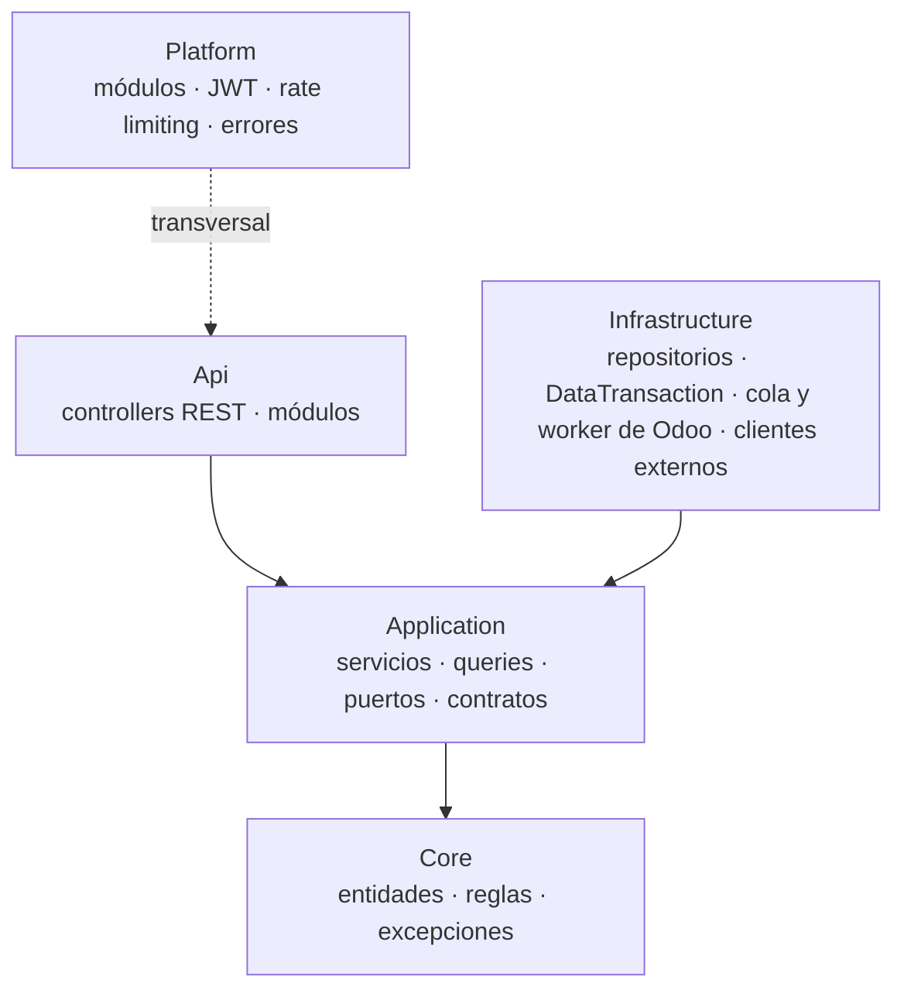
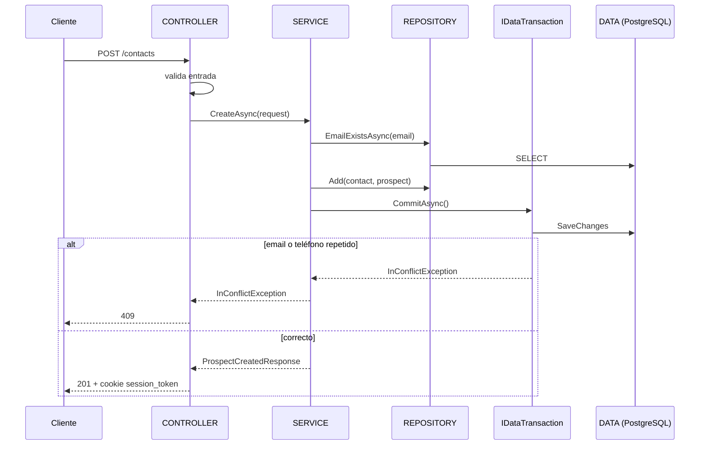
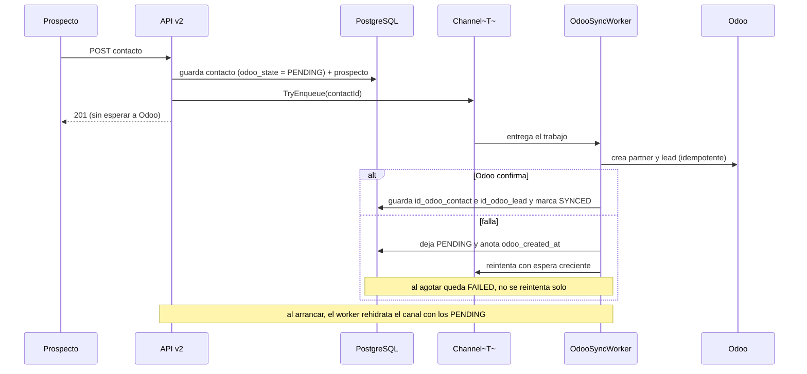
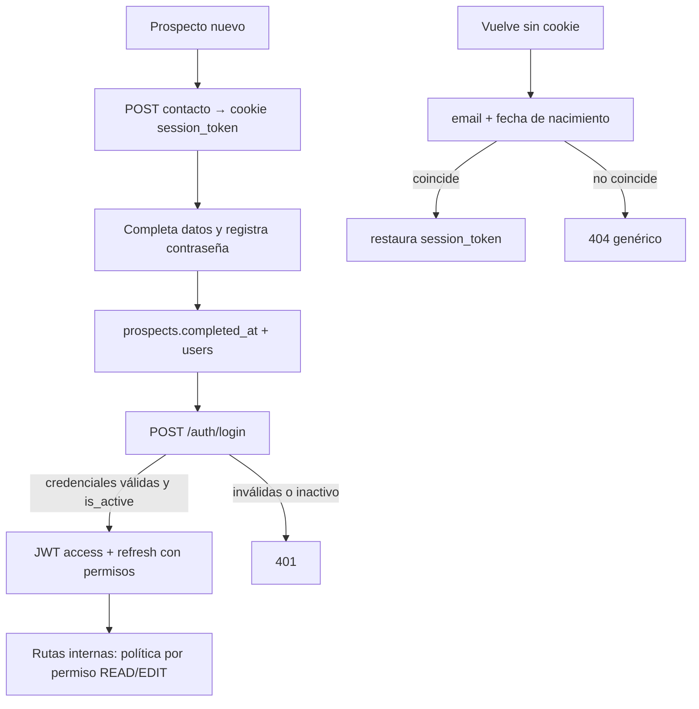
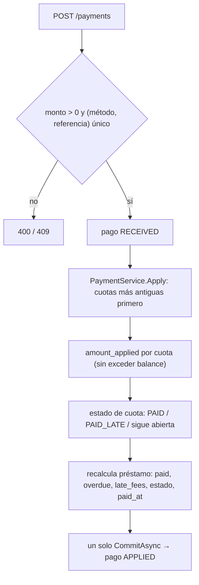
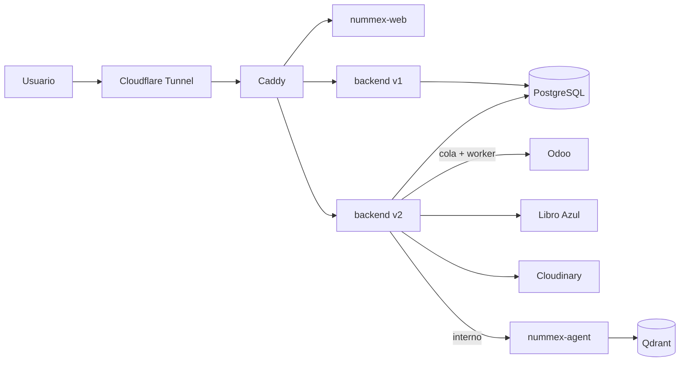

# Nummex Backend v2 — Plan de Implementación

> Reescritura en .NET 10 (minimal API) de `nummex-backend`: onboarding de prospectos, cotización con Libro Azul, documentos, sincronización con Odoo, y el ciclo completo del crédito (clientes, préstamos, cuotas, pagos y cobranza) sobre el esquema nuevo `db-migrations/initial.sql`. Se desarrolla por **vertical slices** sobre una **Clean Architecture adaptada**, con el sistema de módulos de EmailSendService. De v1 solo se extraen **reglas de negocio**, no código ni estructura.

## Contenido

- [[#Reglas de Trabajo]]
- [[#Reglas de Negocio]]
- [[#Diagramas de Funcionamiento]]
- [[#Infraestructura]]
- [[#Pendientes]] · [[#Estado Actual (resumen ejecutivo)]] · [[#Decisiones de Diseño (vigentes)]]
- [[#Arquitectura y Notas Técnicas]] · [[#Archivos Clave del Proyecto]] · [[#Cómo se hace un slice (definición de hecho)]]
- FASE 1 a 4 · [[#Dependencias y Orden de Ejecución]]

---

# Reglas de Trabajo

## 1. Clean Architecture (adaptada)

- Un solo proyecto; los límites son carpetas en `nummex-backend-v2/Src/`: `Core/ · Application/ · Infrastructure/ · Api/ · Platform/`.
- **Las dependencias apuntan hacia adentro:** `Api → Application → Core` e `Infrastructure → Application → Core`. La regla se documenta; el compilador no la verifica.
- Una capa se crea cuando un caso de uso la necesita.

| Capa | Contenido |
|------|-----------|
| `Core/` | Entidades (scaffold del esquema, en `Core/Entities`), enums de dominio, reglas puras (valuación, amortización, mora), jerarquía de excepciones con su nivel de log |
| `Application/` | Servicios (`IXService`), lecturas (`IXQueries`), puertos (`IXRepository`, `IDataTransaction`, `IOdooSyncQueue`, `ILibroAzulClient`, `IFileStorage`, `IChatAgentClient`), contratos (request/response) y builders |
| `Infrastructure/` | `NummexDbContext`, repositorios, `DataTransaction`, cola y worker de Odoo, clientes de Odoo / Libro Azul / Cloudinary / agente |
| `Api/` | Controllers REST, validación de entrada y módulos de cada dominio (DI y rutas) |
| `Platform/` | Módulos (`IModule`, `ModuleRegister`), errores, opciones, JWT, rate limiting y validaciones |

## 2. SOLID aplicado

- **SRP:** un servicio por agregado (`ProspectService`, `LoanService`, `PaymentService`); nunca un servicio que haga todo.
- **ISP:** `IXService` para escrituras y reglas; `IXQueries` para lecturas.
- **DIP:** las interfaces viven en `Application`; las implementaciones en `Infrastructure`; cada módulo (`IServiceInstaller`) registra las suyas.
- **OCP:** se extiende con implementaciones nuevas (otro proveedor de valuación, otro método de pago), no editando servicios.
- **LSP:** un repositorio devuelve `null` o `bool` si no encuentra; no lanza.
- **Servicios sin HTTP:** usan `TimeProvider` para la fecha y reciben el usuario por parámetro.

## 3. Capas de un endpoint

| Pieza | Responsabilidad |
|-------|-----------------|
| **Controller** | Bind, validación de entrada, política de autorización, `Results.*`. No toca el `DbContext` ni captura excepciones de negocio |
| **Service** | Reglas, excepciones de dominio y **un solo guardado por caso de uso** (`CommitAsync`) |
| **Queries** | Lecturas y listas paginadas |
| **Repository** | Consultas por intención (`FindAsync`, `ExistsAsync`); sin genéricos ni `IQueryable` expuesto |
| **`IDataTransaction`** | Confirma el caso de uso y traduce la unicidad de Postgres a `InConflictException` |
| **Worker** | `BackgroundService` que consume una cola; nunca corre dentro de la petición |

Todo punto de entrada (controller, worker) es un **adaptador**: solo traduce y delega.

## 4. API

- REST con códigos 200, 201, 202 y 204; rutas en plural y kebab-case; fechas UTC en ISO.
- Rutas bajo `/api` (ruta base en `App:Path`), igual que v1. Mientras v1 siga en producción, Caddy debe enrutar v2 con otro criterio (puerto, subdominio o prefijo); queda en [[#Pendientes]].
- Paginación solo cuando un slice de lista la requiera (se define entonces; no se porta la de GraphQL).
- Errores en `ProblemDetails` con `code` y `traceId`; mensajes al cliente en español.
- Endpoint público de escritura con rate limiting; las rutas internas exigen JWT.

## 5. Seguridad y acceso

- **JWT con `users`** desde la Fase 1: access token corto más refresh; el claim de permisos sale de `users.permissions` (`READ`, `EDIT`).
- El funnel público no tiene usuario todavía: se identifica con `prospects.session_token` (cookie HttpOnly, `SameSite=None; Secure` fuera de desarrollo). Un prospecto solo opera sobre su propio contacto: otro id responde 403.
- La sesión del prospecto se autentica con un esquema propio, `ProspectSession` (handler que busca el `session_token` de la cookie `nummex.session`) y la política `Prospect`; vive en `AuthModule`, que el Slice 4 amplía con JWT. Un id ajeno responde 403; sin cookie válida, 401.
- La contraseña solo existe como hash; nunca se registra ni se devuelve.
- `users.is_active = false` bloquea el login. `last_session` se actualiza en cada inicio de sesión.
- Secretos solo por variables de entorno; nunca en el repositorio.

## 6. Excepciones y logs

- Jerarquía `DomainException → AuthException / RequestException / InfrastructureException → In*`.
- **El nivel de log es una propiedad de la clase base:** `RequestException` → Information, `AuthException` → Warning, `InfrastructureException` → Error.
- Por debajo de 500 se muestra el mensaje; desde 500, un detalle genérico. La excepción completa se registra solo desde Error.
- Fallas de Odoo, Libro Azul, Cloudinary o el agente → `InExternalServiceException` (502).
- Los mensajes de las excepciones van en español, sin envoltorio en inglés. Los títulos del `ProblemDetails` salen en inglés (frases estándar de HTTP); el `detail` va en español.

## 7. Validación

- Atributos nativos más validaciones propias (`IsEnum`, teléfono, CURP/RFC, fechas).
- Las reglas del esquema (CHECK) se validan también en el servicio para devolver 400 con mensaje claro, no un error de base.
- Un request inválido responde 400 con `errors` por campo y `code: Validation`.

## 8. Colas y workers (`BackgroundService` + `Channel<T>`)

- Sin broker: el trabajo asíncrono usa **`Channel<T>` acotado** dentro del proceso y un `BackgroundService` que lo consume.
- El servicio **guarda local, encola y responde**; el usuario no espera a Odoo.
- Un trabajo **no sale de la cola hasta que el destino confirma**. Reintentos con espera creciente y tope; al agotar queda `FAILED` visible, no se descarta.
- Los trabajos son **idempotentes** (se puede reintentar sin duplicar en Odoo).
- Un `Channel<T>` vive en memoria: el estado durable está en `contacts.odoo_state` y el worker rehidrata el canal con los `PENDING` al arrancar y en un barrido periódico (ver [[#Decisiones de Diseño (vigentes)]], punto 6).

## 9. Datos

- **EF Core con scaffold, sin migraciones:** las entidades se generan del esquema hacia `Core/Entities`; el esquema vive en `db-migrations/initial.sql` y se aplica con `apply-migration.sh` (idempotente).
- Mientras v2 no tenga una base desplegada, el esquema se edita directamente en `initial.sql` y el modelo EF a mano cuando es un ajuste pequeño. Desde la primera base desplegada, cada cambio de esquema va como `ALTER` documentado en `db-migrations/`; no hay migraciones EF en v2.
- Los campos que calcula el backend (`updated_at`, estados, saldos acumulados) los actualiza el servicio; los generados por Postgres (`duration`, `balance_amount`, `amount_due`) solo se leen.

## 10. Estilo, pruebas y proceso

- Comentarios solo a nivel de clase, breves y con los parámetros; dentro de un método, solo si el uso es muy específico.
- **Los agentes no escriben tests;** los escribe el responsable del proyecto. Verificación del agente: `dotnet build` sin advertencias, arranque y curl sobre las rutas tocadas.
- Los commits los hace el responsable; el agente propone el mensaje.
- Cada cambio grande va en **CREAR → MODIFICAR → ENLAZAR**, con visto bueno entre bloques.
- Cada paso lo ejecuta un sub-agente Haiku con un prompt autocontenido; quien coordina revisa el diff, compila (0 errores y 0 advertencias), verifica con curl y propone el commit (sin `Co-Authored-By`). Sin el visto bueno del responsable no se lanza el siguiente paso.
- Se trabaja en `main` de `nummex-backend-v2` hasta terminar la Fase 1.

---

# Reglas de Negocio

Extraídas de `initial.sql` (esquema) y de `nummex-backend` v1 (comportamiento ya implementado). Cuando algo no está definido en ninguno de los dos, queda en [[#Pendientes]].

## Contactos y prospectos

- `contacts` es la entidad principal: `phone`, `email` e `id_odoo_contact` son únicos. Un email repetido responde **409**.
- `birth_date` junto con el email permite al prospecto **recuperar su sesión** del funnel.
- Un contacto entra al funnel como **prospecto** (`prospects`, uno por contacto): `funnel ≥ 1` indica la fase actual; `completed_at` se llena al terminar sus datos y registrar contraseña.
- `session_token` mide 16 caracteres, es único, **no expira** y se entrega por cookie; se valida contra el email y la fecha de nacimiento del contacto.
- Borrar un contacto borra en cascada sus datos de solicitud, su prospecto y su usuario; **no** se puede borrar si ya es cliente o tiene citas.

## Usuarios y autenticación

- Un `user` por contacto, creado cuando el prospecto termina sus datos y registra contraseña; sirve para prospecto o cliente.
- `permissions` es un arreglo JSON (por defecto `READ`, `EDIT`); `is_active` habilita el acceso; `last_session` guarda el último inicio.
- Si se borra el usuario, `collection_logs.created_by` queda en `NULL` (la bitácora se conserva).

## Solicitud de crédito (datos del funnel)

- `contact_details` (uno por contacto): domicilio, código postal, RFC, CURP, ingreso y gasto mensual; los montos no pueden ser negativos.
- `contact_documents` (uno por contacto): identificación, comprobante de domicilio y de ingresos (solo URLs).
- `contact_quotes` (varias): monto ofrecido y solicitado ≥ 0, plazo en meses > 0.
- `contact_references` (varias): **la lista no puede ir vacía** (regla de v1); el parentesco es un enum cerrado: `PARENT, SIBLING, FRIEND, PARTNER, CHILD, GRANDPARENT, UNCLE_AUNT, COUSIN, COWORKER`. En v1 era texto libre: el contrato cambia.
- `contact_vehicles` (varios): marca, modelo y año obligatorios, año > 0, kilometraje ≥ 0; `vehicle_documents` guarda factura, tarjeta de circulación, tenencia, libre de gravamen y póliza.

## Cotización (Libro Azul)

- Catálogo en cascada: año → marca → modelo → versión. Es público.
- El monto de préstamo es **70 % de `Venta`** (LTV fijo), redondeado a 2 decimales (`AwayFromZero`), con **tope de 100,000,000**.
- La respuesta del proveedor se valida: `Venta > 0`, `Compra ≥ 0`, moneda no vacía (≤ 16 caracteres, sin control); si no cumple, error de servicio externo.
- Entrada: `versionKey` obligatoria (no vacía, ≤ 100 caracteres, sin caracteres de control); `mileageKm` entre 0 y 9,999,999.
- La valuación **no se persiste**. `requestedAmount` y `termMonths` se llenan después, al guardar la cotización.
- Cliente de Libro Azul: token con vigencia de 90 minutos y bloqueo para no reautenticar en paralelo, reintento ante 401, timeout de 10 s y un reintento de red; caché de 6 h para catálogos y 5 min para precio.

## Documentos

- Subida por `multipart/form-data`, **máximo 10 MB**; devuelve la URL (la guarda después `contact_documents` o `vehicle_documents`).
- `prospectId` y `phone` van **juntos o ninguno**: con ambos, el archivo va a la carpeta del prospecto; sin ellos, a la carpeta general.
- Endpoint público con rate limiting de **30 solicitudes por minuto por IP**, sin cola.

## Sincronización con Odoo

- Los datos locales mandan; Odoo se actualiza **en segundo plano** (ver la regla 8 de Reglas de Trabajo).
- Contacto → partner (`res.partner`, `company_type = person`); el proceso de crédito → oportunidad (`crm.lead`, tipo "Préstamo").
- Etapas del lead (`x_studio_ultimo_estado`): `registro → datos_auto → info_personal → documentacion_personal → documentacion_auto`.
- Auto → marca, modelo, año, versión y kilometraje del lead. Cotización → ingreso esperado y oferta del préstamo. Detalle → RFC, domicilio y código postal del partner.
- Una falla de Odoo **no tumba** la petición del usuario; queda en la cola con su error.
- `contacts.id_odoo_contact`, `prospects.id_odoo_lead` y `dates.id_odoo_date` son únicos y nulos hasta que Odoo confirme (ya editado en `initial.sql`); `contacts.odoo_state` y `odoo_created_at` indican el estado de la sincronización.

## Citas y zonas

- Una cita pertenece a un contacto (prospecto o cliente) y a una zona opcional (si se borra la zona queda `NULL`).
- `end_time > start_time`; `duration` la calcula Postgres. `confirmation` empieza en falso.
- Una zona puede traer latitud (−90…90) y longitud (−180…180) o ninguna.

## Clientes

- Un contacto pasa a **cliente** cuando empieza el proceso de crédito (uno por contacto; no se puede borrar el contacto).
- Estados: `CONTRACT-PER-SIGN → SIGNED-CONTRACT → DISBURSED → GPS-PENDING → GPS-INSTALLED → ACTIVE` y `DEACTIVATED`. Las transiciones permitidas quedan por definir.
- El desembolso de **cada préstamo** se registra en `loans.disbursed_at` (es la fuente de verdad); `clients.status` solo refleja la etapa.

## Préstamos, contratos y garantías

- Un cliente puede tener varios préstamos; `loan_number` es un folio alfanumérico único.
- Capital > 0, número de cuotas > 0, frecuencia `WEEKLY | BIWEEKLY | MONTHLY` (por defecto mensual), tasa anual ≥ 0 y tasa moratoria ≥ 0 (anual; **corre desde que vence la cuota, sin días de gracia**).
- `total_amount` = capital + intereses + comisiones programados; `maturity_date ≥ first_due_date`.
- `balance_amount` = total + moratorios − pagado (lo calcula Postgres). `overdue_amount` y `late_fees_amount` los mantiene el backend.
- Estados: `CURRENT, DUE_SOON, OVERDUE, PAID, PAID_LATE, CANCELLED, RESTRUCTURED`. `paid_at` se llena al liquidar por completo.
- Un contrato (`client_contracts`) liga cliente y préstamo, con el documento firmado y `signed_at`.
- Garantías (`loan_warranties`): tipo `VEHICLE | OTHER`, descripción obligatoria, valor estimado ≥ 0. `warranty_details` une la garantía con el activo real (hoy solo vehículo) y **impide borrar un vehículo que está en garantía**.
- Ningún préstamo, cuota, pago ni contrato se borra: las llaves son `RESTRICT`; se cancela o reestructura por estado.

## Cuotas y pagos

- La tabla de amortización genera **una fila por cuota** (`loan_installments`): `(loan, número)` único, capital + interés + cargos = `amount_due`.
- Estados de cuota: `PENDING, DUE_SOON, OVERDUE, PAID, PAID_LATE`. **`paid_at` existe si y solo si** la cuota está `PAID` o `PAID_LATE`.
- **No se puede pagar más de lo que vale la cuota.**
- Un pago (`loan_payments`) es dinero recibido: monto > 0; método `SPEI | CASH | DEPOSIT | CARD | OTHER`; estados `PENDING, RECEIVED, APPLIED, REVERSED, FAILED`; `(method, payment_reference)` es único (evita duplicar un mismo SPEI o depósito).
- Un pago se reparte entre cuotas en `loan_payment_applications`: monto aplicado > 0 y `(pago, cuota)` único. `applied_at` se llena al aplicarse.
- Aplicar un pago actualiza, en **un solo guardado**: monto pagado de cada cuota y su estado, `paid_amount`, `overdue_amount`, estado del préstamo y, si se liquida, `paid_at`.
- Hoy la amortización la calcula el frontend con **2.9 % mensual / 1.45 % quincenal**; v2 la calcula en el backend (fórmula por definir).

## Cobranza

- La bitácora (`collection_logs`) registra el contacto sobre un préstamo vencido y, opcionalmente, una cuota.
- Acción: `CALL, WHATSAPP, SMS, EMAIL, VISIT, OTHER`. Resultado: `CONTACTED, NO_ANSWER, PROMISE_TO_PAY, REFUSED, WRONG_NUMBER, OTHER`.
- `promised_amount` > 0 cuando existe; `promised_date` es la fecha prometida; `created_by` es el usuario que contactó.

## Chat con el agente

- El navegador habla con el backend, que reenvía al agente interno (`nummex-agent`); el agente no expone puertos al host.
- Se exige `conversationId` y `message` no vacíos; el tiempo máximo hacia el agente es de **60 s**.
- Si el agente no está configurado, no responde o devuelve vacío, el usuario recibe un error claro (502), no una falla opaca. Endpoint público con rate limiting.

---

# Diagramas de Funcionamiento

## D1. Capas y dependencias



## D2. Escritura de un endpoint: [CONTROLLER] → [SERVICE] → [REPOSITORY] → [DATA]



## D3. Funnel y cola de Odoo (`Channel<T>` + `BackgroundService`)



Etapas del funnel: cada paso del usuario (auto, datos personales, documentos) guarda local, actualiza `prospects.funnel` y encola el cambio de etapa del lead.

## D4. Sesión del prospecto y JWT



## D5. Pago recibido → cuotas



## D6. Infraestructura y despliegue



---

# Infraestructura

> Sin valores reales: solo nombres de variables (ver `.env.example`). Los secretos viven en el `.env` de la raíz y en `local-secrets/`, ignorados por git.

## Despliegue

- **Stack del monolito** (`monolito-numex`): Docker Compose con Postgres, backend, agente, Qdrant y Caddy, expuesto por Cloudflare Tunnel.
- **v2 entra como servicio nuevo** (`backend-v2`) en el mismo compose: imagen .NET 10, puerto solo en la red interna, `depends_on` con Postgres sano y healthcheck en `GET /health`.
- **Convivencia:** v1 sigue sirviendo producción. Caddy enruta a v2 por prefijo mientras dura la migración; el corte se hace al terminar la Fase 3 y validar paridad.
- Los cambios en `docker-compose.yml`, `Caddyfile` y `start.sh` se revisan antes de desplegar.

## Base de datos

- Mismo Postgres del stack. El esquema es `db-migrations/initial.sql` (`apply-migration.sh`, idempotente) más los `ALTER` de v2 numerados y documentados.
- Cambios de esquema hechos por edición directa de `initial.sql`: `contacts.id_odoo_contact`, `prospects.id_odoo_lead` y `dates.id_odoo_date` nulos hasta confirmar; `contacts.odoo_state` y `odoo_created_at`; índice parcial de pendientes. Sin tabla de trabajos. Los índices que pidan los slices siguientes se agregan al llegar.
- El usuario de aplicación solo tiene permisos de datos (no de esquema).

## Servicios externos

| Servicio | Uso | Notas |
|----------|-----|-------|
| Odoo | Partners, leads y citas | Cola + worker; credenciales por variables de entorno |
| Libro Azul | Catálogos y precio | Token 90 min, caché 6 h / 5 min, timeout 10 s |
| Cloudinary | Documentos del prospecto | Carpeta por prospecto; URL se guarda en base |
| `nummex-agent` | Chat con RAG | Servicio interno; sin puertos al host |

## Variables de entorno (solo nombres)

Cadena de conexión de Postgres · emisor, audiencia, clave y vigencia del JWT · URL y credenciales de Odoo · URL y credenciales de Libro Azul · credenciales y carpeta de Cloudinary · URL del agente · orígenes permitidos de CORS · límites del rate limiting. Se agregan a `.env.example` cuando cada slice las introduzca.

## Operación

- Logs a stdout, con el nivel definido por la excepción. `GET /health` para Caddy y `start.sh`.
- El worker de Odoo registra intentos y errores; una consulta interna lista los trabajos `PENDING` y `FAILED`.
- Apagado ordenado: el worker termina el trabajo en curso; lo pendiente queda como `contacts.odoo_state = 'PENDING'` y se rehidrata al arrancar.
- Rotación: JWT y credenciales se rotan por variables, sin tocar el código.
- Respaldos y despliegue final se definen al terminar el desarrollo.

---

# Pendientes

- [ ] Fórmula de amortización (hoy 2.9 % mensual / 1.45 % quincenal en el frontend) y cálculo de la mora: base, capitalización y redondeo.
- [ ] Orden de aplicación de un pago: cuota más antigua primero; dentro de la cuota, ¿cargos → interés → capital?
- [ ] Umbral de `DUE_SOON` (¿cuántos días?) y quién recalcula estados: ¿un job diario o al consultar?
- [ ] Transiciones permitidas de `clients.status` y quién las dispara.
- [ ] Significado de cada fase de `prospects.funnel` y su relación con las etapas de Odoo.
- [x] Límite de intentos al recuperar sesión: `StrictWindow`, 5 por 900 s por IP (Slice 2). Un límite por correo queda fuera de alcance.
- [x] Persistencia de la cola: sin tabla; el respaldo durable es `contacts.odoo_state` (decisión 6, confirmada por el responsable).
- [ ] Confirmar con el Odoo real los parámetros de JSON-2 (`vals_list`, `vals`, `domain`, `fields`, `limit`) y obtener una key de JSON-2 y el nombre de la base para el worker (la key del MCP no sirve en `/json/2`).
- [ ] Búsqueda de partner solo por correo: decidir si se filtra además por nombre o `company_type` si en Odoo hay correos repetidos.
- [ ] Validar al arrancar `Odoo:TimeoutSeconds` y una `Odoo:BaseUrl` mal formada (hoy fallan en el primer uso).
- [ ] Consulta interna de contactos `PENDING`/`FAILED` y forma de reencolar un `FAILED` (Slice 4).
- [ ] Rotar la key de Odoo expuesta en el chat y usar una de permisos mínimos para el worker (las keys caducan como máximo a los 3 meses).
- [ ] Migración de datos de v1 (prospectos con id entero) al esquema nuevo (contactos con UUID).
- [ ] Definir si habrá proyecto de tests y quién los escribe.
- [ ] Enrutado de Caddy mientras v1 y v2 compartan `/api/*` (hoy v1 lo sirve en producción).
- [ ] `apply-migration.sh` aún busca la migración EF de v1 (`__EFMigrationsHistory`) y no aplica el `initial.sql` nuevo; definir el flujo de esquema de v2.
- [ ] Las claves de `errors` del 400 salen en PascalCase (`Name`, `Phone`...); ajustar si el frontend las espera en camelCase.
- [ ] Teléfono (10 a 15 dígitos) y edad mínima (hoy solo "anterior a hoy y no mayor de 120 años"): confirmar reglas.
- [ ] Los 409 del alta revelan si un correo o teléfono existe (como v1); mitigado con el límite `Strict`.
- [ ] Poblar las capas de `nummex-backend-v2` por slices (hecho: fundaciones y prospectos; faltan Odoo, usuarios y los dominios de las fases 2 y 3).

# Estado Actual (resumen ejecutivo)

| Área | Estado |
|------|--------|
| Sistema de módulos (`IModule`, `IServiceInstaller`, `IEndpointMapper`, `IPipelineStep`, `ModuleRegister`) | ✅ |
| `GET /health` | ✅ |
| Repo propio `YefraSoft/nummex-backend-v2` (aún no es submódulo) | ✅ |
| Esquema `initial.sql` | ✅ definido; `contacts` con `birth_date` obligatoria, `id_odoo_contact` nulo, `odoo_state` y `odoo_created_at`; `prospects.id_odoo_lead` y `dates.id_odoo_date` nulos |
| Errores, `ProblemDetails` y nivel de log por clase | ✅ |
| Entidades por scaffold (20 tablas), `NummexDbContext`, `DataTransaction` y `PersistenceModule` | ✅ |
| Rate limiting (Relaxed, Moderate, Strict, StrictWindow), CORS y validación nativa | ✅ |
| Contactos, prospectos y sesión por cookie (`AuthModule`, `ProspectSession`) | ✅ verificado con curl contra Postgres |
| Cola y worker de Odoo | ✅ (verificado con Odoo simulado; parámetros JSON-2 por confirmar con el Odoo real) |
| Usuarios y JWT | ⏳ |
| Cotización Libro Azul, documentos, citas | ⏳ |
| Clientes, préstamos, cuotas, pagos y cobranza | ⏳ |
| Chat con el agente | ⏳ |

| Fase | Slices | Estado |
|------|--------|--------|
| 1 — Fundaciones, contactos, cola Odoo y JWT — [[nummex-backend-v2-fase-1-sub-plan]] | 1 a 4 | 🔄 en progreso (slices 1 a 3 listos; falta el 4) |
| 2 — Funnel completo (paridad con v1) | 5 a 8 | ⏳ Pendiente |
| 3 — Crédito: préstamos, pagos y cobranza | 9 a 11 | ⏳ Pendiente |
| 4 — Chat, endurecimiento y corte | 12 | ⏳ Pendiente |

| Slice | Dominio | Estado |
|-------|---------|--------|
| 1 | Fundaciones: errores, `DbContext`, `IDataTransaction`, rate limiting, opciones | ✅ |
| 2 | Contactos y prospectos (funnel, `session_token`, recuperación) | ✅ |
| 3 | Cola de sincronización con Odoo (`Channel<T>` + worker) | ✅ |
| 4 | Usuarios y JWT | ⏳ |
| 5 | Catálogo y cotización Libro Azul | ⏳ |
| 6 | Datos de solicitud (detalle, referencias, vehículos, cotizaciones) | ⏳ |
| 7 | Documentos (Cloudinary) | ⏳ |
| 8 | Zonas y citas | ⏳ |
| 9 | Clientes, contratos, préstamos, garantías y amortización | ⏳ |
| 10 | Cuotas y pagos (aplicación) | ⏳ |
| 11 | Cobranza | ⏳ |
| 12 | Chat con el agente | ⏳ |

Sub-plan de la Fase 1 (slices 1 a 4): [[nummex-backend-v2-fase-1-sub-plan]]. Los de las demás fases se crean en `Sub-planes/` (`nummex-backend-v2-<tema>-sub-plan.md`) cuando arranquen.

# Decisiones de Diseño (vigentes)

1. **Alcance:** todo el esquema, en fases; paridad con v1 primero y el crédito después.
2. **Clean Architecture adaptada y SOLID** en un solo proyecto, con módulos por responsabilidad (reglas 1 y 2).
3. **Local primero, Odoo después:** el usuario no espera a Odoo; el contacto se guarda local y la sincronización va por cola (regla 8).
4. **JWT con `users` desde el inicio;** el funnel público usa `session_token` por cookie hasta que el prospecto registra contraseña (regla 5).
5. **EF Core con scaffold y sin migraciones;** el esquema lo lleva `db-migrations/` con `ALTER` documentados (regla 9).
6. **Colas con `BackgroundService` + `Channel<T>`, sin broker y sin tabla de trabajos.** Como el canal es memoria, el estado durable está en `contacts.odoo_state` (`PENDING | SYNCED | FAILED`) y `odoo_created_at`; el worker rehidrata los `PENDING` al arrancar y en un barrido periódico, de modo que un reinicio no pierde nada. Un `FAILED` no se reintenta solo. *Confirmada por el responsable.*
7. **El worker no se detiene por un error:** captura, registra, reintenta con espera creciente y deja `FAILED` visible.
8. **La amortización y la mora se calculan en el backend,** con `TimeProvider`; el frontend deja de calcularlas.
9. **Un guardado por caso de uso;** aplicar un pago es una sola transacción.
10. **Nada financiero se borra:** cancelar o reestructurar, nunca `DELETE`.
11. **El contrato de referencias cambia** (parentesco como enum); se documenta en el slice 6 y se avisa al frontend.
12. **De v1 solo se portan reglas;** el código se escribe de nuevo en la estructura de v2.
13. **Sesión del prospecto con esquema de autenticación propio** (`ProspectSession`, cookie `nummex.session`); el mismo `AuthModule` recibirá JWT en el Slice 4.
14. **Rutas bajo `/api`**, igual que v1, con la ruta base en `App:Path`.
15. **Esquema por edición directa de `initial.sql`** mientras v2 no tenga base desplegada (`contacts.birth_date` obligatoria; `id_odoo_contact` nulo hasta que Odoo confirme).
16. **El `funnel` no tiene endpoint propio:** lo suben los slices de la Fase 2 y el Slice 4 marca `completed_at`.
17. **Rate limiting:** Relaxed, Moderate y Strict por token bucket (Moderate como límite global) más `StrictWindow` de ventana fija por IP para login y recuperación de sesión.
18. **Del proyecto de ejemplo solo se porta lo que v2 usa** (sin GraphQL, email, RabbitMQ ni OpenBao).
19. **Odoo 20 se consume por JSON-2** (no JSON-RPC como v1), a través de una **abstracción HTTP compartida** con Libro Azul (`IExternalApiClient`, clase base con reintentos y estrategia de autenticación por servicio).
20. **Sincronización idempotente:** se busca antes de crear y cada id se guarda al obtenerlo; así un guardado fallido no duplica registros en Odoo.

# Arquitectura y Notas Técnicas

- **Stack:** .NET 10 (minimal API / controllers), EF Core + Npgsql, JWT bearer, `BackgroundService` + `Channel<T>`, Cloudinary, Libro Azul, Odoo (JSON-RPC), Docker Compose y Caddy.
- **Pipeline HTTP:** manejo de errores (100) → CORS (150) → rate limiting (200) → autenticación y autorización (300) → validación nativa → endpoint (`PipelineOrder`).
- **Módulos:** cada funcionalidad es un `IModule` que implementa solo lo que necesita: `IServiceInstaller` (DI), `IEndpointMapper` (rutas) e `IPipelineStep` (pipeline, con `Order`). `Program.cs` no registra servicios a mano.
- **Colas:** `IOdooSyncQueue` (puerto) con `Channel<Guid>` acotado; `OdooSyncWorker` como `BackgroundService`; `contacts.odoo_state` como estado durable (sin tabla de trabajos). **HTTP externo:** `IExternalApiClient` compartido (Odoo y Libro Azul).
- **Estructura por dominio:** `Core/Entities`, `Application/<Dominio>` (servicios, queries, puertos, contratos), `Infrastructure/Persistence/Repositories`, `Api/<Dominio>`.
- **Endpoints:** minimal API. El "controller" es una clase estática `MapXEndpoints(this IEndpointRouteBuilder)` con `RequireRateLimiting` y `RequireAuthorization`, que activa un módulo `IEndpointMapper` bajo `App:Path`.
- **Rutas hechas** (bajo `/api`): `GET /health`, `POST /api/contacts`, `POST /api/prospects/session/recover`, `GET /api/prospects/{contactId}`. **Previstas:** `/api/auth`, `/api/loan-vehicle`, `/api/loan-quotes`, `/api/loan-documents`, `/api/zones`, `/api/dates`, `/api/clients`, `/api/loans`, `/api/payments`, `/api/collection-logs`, `/api/chat`.
- **Deuda conocida:** `ProspectService` de v1 guardaba dos veces por caso de uso (local y Odoo); v2 lo evita con la cola.

# Archivos Clave del Proyecto

| Archivo | Propósito |
|---------|-----------|
| `nummex-backend-v2/Program.cs` | Arranque: módulos, pipeline y endpoints |
| `nummex-backend-v2/Src/Platform/Module/` | `IModule`, `IServiceInstaller`, `IEndpointMapper`, `IPipelineStep`, `ModuleRegister` |
| `nummex-backend-v2/Src/Api/Health/HealthModule.cs` | `GET /health` |
| `nummex-backend-v2/Src/Api/{Errors,RateLimiting,Cors,Validation,Auth}/` | Módulos transversales: errores, límites, CORS, validación y autenticación |
| `nummex-backend-v2/Src/Api/Prospects/` | `ProspectsModule` y `ProspectEndpoints` |
| `nummex-backend-v2/Src/Application/Prospects/` | Servicio, queries, puertos, permisos, contratos y builder de prospectos |
| `nummex-backend-v2/Src/Core/{Entities,Exceptions,Security}/` | 20 entidades por scaffold, excepciones de dominio y `SessionToken` |
| `nummex-backend-v2/Src/Infrastructure/Persistence/` | `NummexDbContext`, `DataTransaction`, `PersistenceModule` y repositorios |
| `nummex-backend-v2/Src/Platform/{Auth,Errors,Config,Validations}/` | Handler y cookie de sesión, descriptores de error y validaciones |
| `nummex-backend-v2/appsettings.json` | `App:Path`, `RateLimiting`, `Cors` y `ConnectionStrings` (sin valores reales) |
| `db-migrations/initial.sql` | Esquema de la base y reglas CHECK |
| `docker-compose.yml`, `Caddyfile` | Stack local y de producción |
| `apply-migration.sh`, `start.sh` | Aplicación del esquema y arranque |
| `nummex-backend/docs/API.md` | Contratos de v1 (referencia de reglas) |
| `AGENTS.md` (raíz del monolito) | Reglas de trabajo del repositorio |

# Cómo se hace un slice (definición de hecho)

- [ ] **Esquema:** `ALTER` documentado en `db-migrations/` si el slice lo necesita.
- [ ] **Entidad:** generada por scaffold en `Core/Entities`.
- [ ] **Datos:** puerto `IXRepository` en `Application` e implementación en `Infrastructure`.
- [ ] **Lógica:** `XService` (escrituras y reglas) y `XQueries` (lecturas).
- [ ] **Contratos:** request y response con validación y mensajes en español.
- [ ] **Entrada:** endpoints (`MapXEndpoints`) y módulo con política de autorización.
- [ ] **Cola:** si hay efecto externo, trabajo encolado e idempotente.
- [ ] **Documentación:** sub-plan del slice en esta bóveda al día y variables nuevas en `.env.example`.
- [ ] **Verificación:** `dotnet build` con 0 errores y 0 advertencias, y curl a las rutas tocadas (sin credenciales, inválidas, caso feliz y 400/404/409). Los tests los escribe el responsable.

# FASE 1 — Fundaciones, contactos, cola de Odoo y JWT (Slices 1 a 4)

> **Objetivo:** base técnica (errores, datos, rate limiting), alta de contactos y prospectos con sesión, sincronización asíncrona con Odoo y autenticación con JWT.
> **Estado:** 🔄 En progreso (slices 1 a 3 ✅; falta el 4) — [[nummex-backend-v2-fase-1-sub-plan]].

- **Slice 1 — Fundaciones ✅:** jerarquía de excepciones y `ProblemDetails`, scaffold de las 20 entidades y `NummexDbContext`, `IDataTransaction`, rate limiting (con `StrictWindow`), CORS y validación.
- **Slice 2 — Contactos y prospectos ✅:** alta (409 por correo o teléfono repetido), `session_token` por cookie y recuperación con correo y fecha de nacimiento; `AuthModule` con el esquema `ProspectSession`. El avance del `funnel` queda para la Fase 2.
- **Slice 3 — Cola de Odoo ✅:** estado de la sincronización en `contacts` (`odoo_state`, `odoo_created_at`) y ids de Odoo nulos, abstracción HTTP compartida, cliente de Odoo por JSON-2, cola en memoria, procesador idempotente y `OdooSyncWorker` con reintentos, rehidratación y `FAILED`. Sin tabla de trabajos.
- **Slice 4 — Usuarios y JWT:** registro de contraseña al completar el funnel, login, refresh, permisos `READ`/`EDIT` y `last_session`.

# FASE 2 — Funnel completo, paridad con v1 (Slices 5 a 8)

> **Objetivo:** reemplazar todo lo que hoy hace v1 sobre el esquema nuevo.
> **Estado:** ⏳ Pendiente.

- **Slice 5 — Cotización Libro Azul:** catálogo en cascada, valuación al 70 %, caché y política de errores.
- **Slice 6 — Datos de solicitud:** detalle, referencias (enum), vehículos y cotizaciones guardadas, con sus etapas hacia Odoo.
- **Slice 7 — Documentos:** subida a Cloudinary (≤ 10 MB, carpeta por prospecto) y guardado de URLs de contacto y vehículo.
- **Slice 8 — Zonas y citas:** zonas, citas con horario válido y sincronización con Odoo por la cola.

# FASE 3 — Crédito (Slices 9 a 11)

> **Objetivo:** el ciclo del crédito: contrato, desembolso, cuotas, pagos y cobranza.
> **Estado:** ⏳ Pendiente.

- **Slice 9 — Clientes, contratos, préstamos y garantías:** estados del cliente, folio, generación de la tabla de amortización y vínculo garantía-vehículo.
- **Slice 10 — Cuotas y pagos:** registro del pago (unicidad método + referencia), aplicación a cuotas, estados y saldos en una sola transacción; reversa de un pago.
- **Slice 11 — Cobranza:** bitácora por préstamo y cuota, promesas de pago y consulta de cartera vencida.

# FASE 4 — Chat, endurecimiento y corte (Slice 12)

> **Objetivo:** cerrar la funcionalidad y reemplazar a v1 en producción.
> **Estado:** ⏳ Pendiente.

- **Slice 12 — Chat con el agente:** cliente del agente con timeout de 60 s y errores claros.
- **Endurecimiento:** migración de datos de v1, rotación de JWT y credenciales, revisión de CORS y rate limiting, y pruebas de carga.
- **Corte:** ruteo en Caddy a v2, retiro de v1, conversión de `nummex-backend-v2` en submódulo de la raíz.

# Dependencias y Orden de Ejecución

```
Slice 1 — Fundaciones
 │
 ├── Slice 2 — Contactos y prospectos
 │    │
 │    ├── Slice 3 — Cola de Odoo ─────────────────────────┐
 │    │                                                    │
 │    └── Slice 4 — Usuarios y JWT                         │
 │         │                                               │
 │         ├── Slice 5 — Cotización Libro Azul             │
 │         ├── Slice 6 — Datos de solicitud ◄──────────────┤
 │         ├── Slice 7 — Documentos                        │
 │         └── Slice 8 — Zonas y citas ◄───────────────────┘
 │              │
 │              └── Slice 9 — Clientes, préstamos y garantías
 │                   │
 │                   └── Slice 10 — Cuotas y pagos
 │                        │
 │                        └── Slice 11 — Cobranza
 │
 └── Slice 12 — Chat (independiente; puede ir en paralelo desde el 4)
```

Los slices 6 y 8 necesitan la cola (3) para sincronizar con Odoo. El 5 y el 7 pueden empezar en paralelo una vez que existe el prospecto (2). El 9 necesita la solicitud completa (6 y 7); el 10 necesita los préstamos y sus cuotas (9).

# Relacionado

- [[nummex-backend-v2-fase-1-sub-plan]]
- [[nummex-app-plan]]
- [[nummex-agent-rag-plan]]
- [[AGENTS]]
