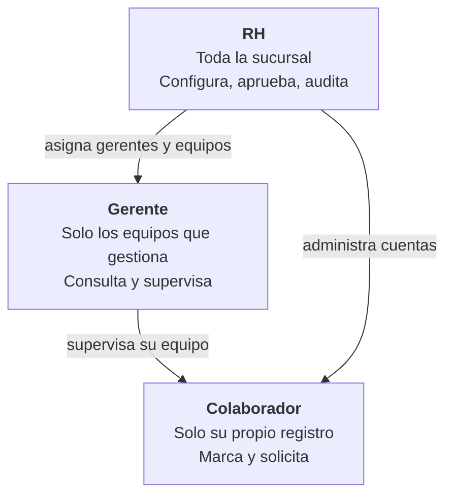
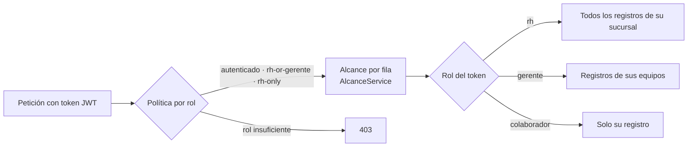
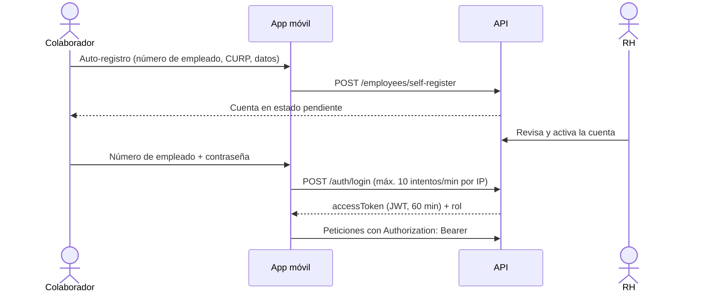
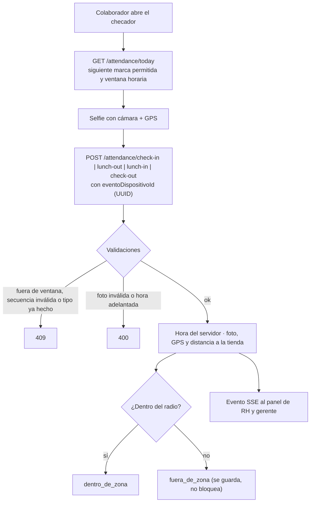
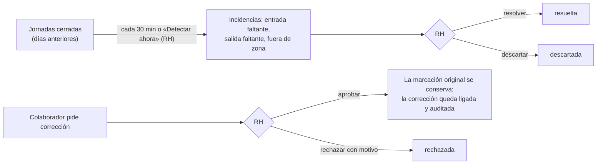
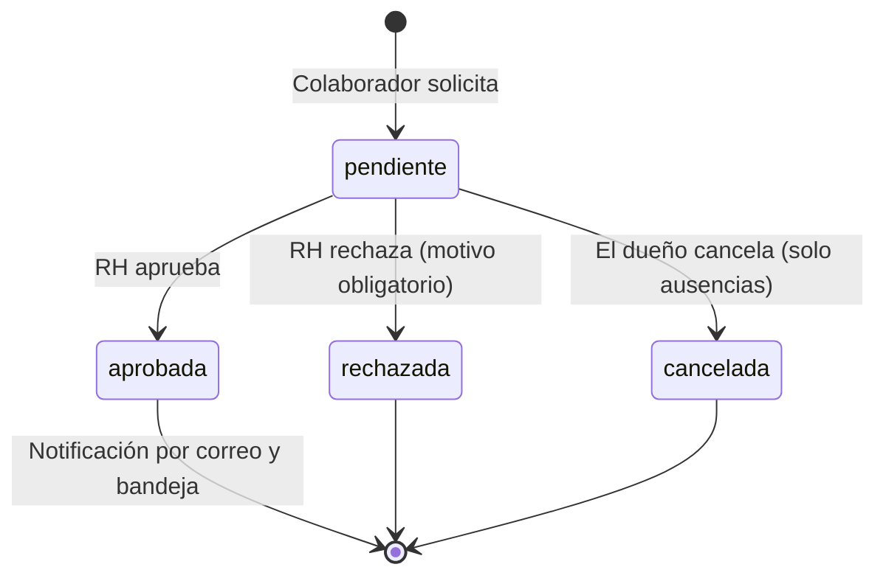

# RH Cotla — Plan de Desarrollo

> Sistema de RH de Comercial Tlaquepaque (Ferretería Cotla) desarrollado por Yefrasoft S.A. de C.V.: asistencia con selfie y GPS, solicitudes de ausencia y vacaciones, horas extra, incidencias, reportes y auditoría. Tres apps en un monorepo: **API ASP.NET Core (.NET 10)** con PostgreSQL, Redis y MinIO; **panel web Next.js** para RH y gerentes; **app móvil Expo** para colaboradores. Versión **1.0.0** cerrada el 2026-11-20. Primero van las reglas de trabajo y los diagramas (decisiones de arquitectura); después, el plan por fases. Cada fase tiene su sub-plan con el estado de las tres apps.

## Contenido

- [[#Reglas de Trabajo]]
- [[#Diagramas de Funcionamiento]]
- [[#Pendientes]] · [[#Estado Actual (resumen ejecutivo)]] · [[#Decisiones de Diseño (vigentes)]]
- [[#Arquitectura y Notas Técnicas]] · [[#Archivos Clave del Proyecto]] · [[#Cómo se cierra una fase (definición de hecho)]]
- FASE 1 a 12 · [[#Dependencias y Orden de Ejecución]] · [[#Relacionado]]

---

# Reglas de Trabajo

## 1. Un equipo, una app

| App | Directorio | Responsable | Puede editar |
|-----|------------|-------------|--------------|
| Backend `cotla-api` | `app-backend/` | Eduardo Efrain Garcia Suarez (líder DevOps y backend) | `app-backend/**`, `docker-compose.yml`, `.env` y `.env.example`, `infra/db.sql` |
| Panel web RH | `app-frontend/` | Daniela Iturbide Martinez (frontend) | `app-frontend/**` |
| App móvil | `app-movil/` | Angel Eduardo Frias Gonzalez (móvil) | `app-movil/**` |

- Se puede **leer** el progreso de las otras apps, pero no editarlo; si una tarea depende de otra app, se anota como dependencia en el plan propio y se coordina.
- Los agentes **no crean commits, ramas, etiquetas ni PR, ni hacen `push`**: Git y publicación son del usuario.
- Sin secretos en el repo: todo por `.env` y variables del compose.

## 2. Backend por capas y por módulos

- Un solo proyecto (`cotla-api`) organizado por **módulos** (Auth, Employees, Attendance, Incidents, Leave, Overtime, Reports, Dashboard, Notifications, Audit, Store, Teams…), cada uno con endpoints, servicios, contratos y repositorios.
- **Autorización siempre en el backend**, en dos capas: política por rol (`autenticado`, `rh-only`, `rh-or-gerente`) y **alcance por registro** (`AlcanceService`): RH toda la sucursal, gerente los equipos que gestiona, colaborador solo lo suyo. La sucursal sale del token firmado, no del cliente. La interfaz nunca es la única barrera.
- **Datos:** EF Core con migraciones versionadas aplicadas al arrancar (`Data/DatabaseInitializer.cs`) y semilla idempotente (`DbSeeder`); `infra/db.sql` es solo referencia. Nunca se altera la base a mano como mecanismo de despliegue.
- **API REST** `/api/v1`, JSON, fechas ISO 8601 UTC, errores `ProblemDetails` con `traceId` y mensajes en español; listados paginados (`page`, `pageSize`) y sin filtros vacíos.
- La hora oficial de toda marcación la pone el **servidor**; el cliente nunca la envía.

## 3. Pruebas y calidad

- Pruebas del backend en `cotla-api.Tests` sobre **PostgreSQL real con Testcontainers** (suite 401/401 al cierre de 1.0.0).
- Panel: `typecheck` y `lint`; móvil: sin Jest ni lint instalado (deuda en [[rh-cotla-pendientes-sub-plan]]).
- Cambios de API: contrato consistente y [[rh-cotla-integracion-clientes-manual]] sincronizado; no se rompen clientes sin actualización coordinada.

## 4. Estilo, textos y proceso

- Textos de la interfaz solo en archivos `*.text.ts` (panel); sin referencias «§x.x» visibles al usuario.
- Cambios pequeños, enfocados y coherentes con el estilo existente; no se tocan contratos ni dependencias compartidas sin necesidad.
- La fuente funcional obligatoria es `docs/especificaciones.md`; si falta una decisión, se pide dirección antes de fijar el comportamiento.
- El checklist vivo de cada fase está en su sub-plan; este plan no duplica checklists.

---

# Diagramas de Funcionamiento

## D1. Arquitectura y despliegue

```mermaid
flowchart LR
    M["App móvil<br/>(Expo · colaborador)"] -->|HTTPS| T
    W["Panel web<br/>(Next.js · RH y gerente)"] -->|HTTPS| T
    T["Cloudflare Tunnel<br/>api.yefrasoft.com · by.yefrasoft.com"] --> A
    subgraph Compose["Docker Compose"]
        A["API cotla-api<br/>ASP.NET Core .NET 10"]
        F["frontend<br/>Next.js"]
        P[("PostgreSQL 17")]
        R[("Redis<br/>caché y cola de fotos")]
        S[("MinIO<br/>selfies y documentos")]
        A --> P
        A --> R
        A --> S
    end
    T -. by.yefrasoft.com .-> F
    A -->|SMTP| C["Correo"]
```

## D2. Jerarquía de roles



| Capacidad | Colaborador | Gerente | RH |
|-----------|:-----------:|:-------:|:--:|
| Marcar, solicitar ausencias y horas extra, pedir correcciones | ✅ propias | ✅ propias | ✅ propias |
| Ver asistencia, incidencias, solicitudes y reportes | Las suyas | Sus equipos | Todas |
| Dashboard | ❌ | ✅ sus equipos | ✅ todos |
| Calendario de otro colaborador | ❌ | ❌ | ✅ |
| Aprobar/rechazar ausencias, horas extra y correcciones; resolver incidencias | ❌ | ❌ | ✅ |
| Colaboradores, catálogos, equipos, tienda, saldos, usuarios y roles, auditoría | ❌ | ❌ | ✅ |

## D3. Autorización en dos capas



## D4. Alta e inicio de sesión



## D5. Checada de asistencia



## D6. Incidencias y correcciones



## D7. Ausencias, vacaciones y horas extra



---

# Pendientes

- [ ] **Deuda, features y fixes post-1.0.0 (17 feats, 38 fixes):** centralizados en [[rh-cotla-pendientes-sub-plan]], con id por ítem (`F-…` / `FX-…`) y la fase donde nació.
- [ ] **Antes de las tiendas** (móvil): eliminación de cuenta, `EXPO_PUBLIC_API_URL` en el perfil `production` de EAS y la promesa de «galería» en horas extra (`FX-MOV-1` a `FX-MOV-3`; ver [[rh-cotla-fase-02-autenticacion-colaboradores-sub-plan]] y [[rh-cotla-fase-07-horas-extra-sub-plan]]).
- [ ] **Antes de acumular datos reales:** backups automáticos de PostgreSQL con restauración probada (`F-INF-1`, [[rh-cotla-fase-12-despliegue-sub-plan]]).
- [ ] **Regla de negocio por definir con el cliente:** ausentes del dashboard (`FX-BE-1`; hoy cuenta a RH y gerente sin horario) — [[rh-cotla-fase-09-dashboards-calendario-sub-plan]].
- [ ] Confirmar con el cliente los puntos abiertos de la especificación (§31): devengo de vacaciones (D1), límites de horario (D6), estrategia offline (D7), canal definitivo de notificaciones, hosting y conservación de archivos.
- [ ] Etiquetar `v1.0.0` y publicar el release (lo hace el usuario; el historial por versión está en `docs/versionado.md` del repo).
- [x] **Limpieza del repo y migración de la documentación (2026-11-20):** los planes y el progreso salieron del repo a esta bóveda; en el repo quedan `docs/` (especificaciones, funcionamiento, versionado), fuentes de los manuales y README.
- [x] **Cierre del backend 1.0.0 (2026-11-12):** fases 2 a 12 cerradas en código; detalle en [[rh-cotla-progreso-backend-sub-plan]].
- [x] **Endurecimiento previo a 1.0.0 (2026-11-20):** contraseña de Postgres y cuentas semilla por `.env`, puertos de Postgres/MinIO en loopback, demo apagado, Bun 1.4.4, cabeceras de seguridad, `GET /api/v1/public/company` y `/privacidad` (web y enlaces en móvil).
- [x] **Base limpia verificada (2026-11-20):** volumen `rh-cotla_postgres-data` recreado; el API migró y sembró 1 sucursal, RH (111) y gerente (112), sin colaboradores demo.
- [x] **Deuda aceptada por el usuario:** CORS abierto (A1) y `X-Forwarded-For`/`8080` expuestos (A2). Registro en [[rh-cotla-progreso-backend-sub-plan]].

# Estado Actual (resumen ejecutivo)

| Área | Estado |
|------|--------|
| API REST `/api/v1` con módulos por dominio, errores en español y `traceId` | ✅ 1.0.0 |
| Autenticación JWT (60 min), recuperación de contraseña (token 30 min), límite de 10 intentos/min por IP | ✅ |
| Autorización de dos capas: políticas por rol + `AlcanceService` | ✅ |
| Migraciones EF al arrancar + semilla idempotente (RH y gerente desde `.env`) | ✅ verificado con base limpia |
| Almacenamiento S3 (MinIO) y compresión de fotos a WebP vía cola en Redis | ✅ (verificación real contra MinIO pendiente: `FX-BE-7`) |
| Caché con `ETag` en catálogos y fotos; dashboard y reportes con retraso máximo de 15 s | ✅ |
| Eventos en tiempo real al panel (SSE, máx. 5 conexiones por usuario) | ✅ |
| Panel web Next.js 16 (RH y gerente; el colaborador entra con vista reducida) | ✅ 1.0.0 |
| App móvil «Cotla Colaborador» (Expo SDK 57) | ✅ 1.0.0; tres ⚠ antes de tiendas |
| Pruebas: backend 401/401; panel solo `typecheck` y `lint`; móvil sin pruebas | 🟡 |
| Despliegue: Docker Compose + Cloudflare Tunnel, sin CI/CD ni backups automáticos | 🟡 |

| Fase | Dominio | Backend | Panel web | Móvil |
|------|---------|:-------:|:---------:|:-----:|
| 1 | Fundaciones y modelo de datos — [[rh-cotla-fase-01-fundaciones-sub-plan]] | ✅ | — | — |
| 2 | Autenticación, cuentas y colaboradores — [[rh-cotla-fase-02-autenticacion-colaboradores-sub-plan]] | ✅ | ✅ | ✅ (⚠ eliminación de cuenta) |
| 3 | Configuración operativa y tienda — [[rh-cotla-fase-03-configuracion-tienda-sub-plan]] | ✅ | ✅ | — |
| 4 | Checador de asistencia — [[rh-cotla-fase-04-checador-sub-plan]] | ✅ | ✅ | ✅ (sin captura offline) |
| 5 | Incidencias y correcciones — [[rh-cotla-fase-05-incidencias-correcciones-sub-plan]] | ✅ | ✅ | ✅ |
| 6 | Ausencias y vacaciones — [[rh-cotla-fase-06-ausencias-vacaciones-sub-plan]] | ✅ | ✅ | ✅ |
| 7 | Horas extra — [[rh-cotla-fase-07-horas-extra-sub-plan]] | ✅ | ✅ | ✅ (⚠ «galería») |
| 8 | Reportes — [[rh-cotla-fase-08-reportes-sub-plan]] | ✅ | ✅ | — |
| 9 | Dashboards y calendario — [[rh-cotla-fase-09-dashboards-calendario-sub-plan]] | ✅ | ✅ | ✅ |
| 10 | Alertas y notificaciones — [[rh-cotla-fase-10-alertas-notificaciones-sub-plan]] | ✅ (sin push) | ✅ | ✅ |
| 11 | Archivos, auditoría y seguridad — [[rh-cotla-fase-11-archivos-auditoria-seguridad-sub-plan]] | ✅ | ✅ | — |
| 12 | Despliegue — [[rh-cotla-fase-12-despliegue-sub-plan]] | 🟡 | 🟡 | 🟡 |

Leyenda: ✅ completa en código · 🟡 parcial · — no aplica. El matiz de cada celda está en el sub-plan de la fase.

# Decisiones de Diseño (vigentes)

Resumen; el detalle está en las **Reglas de Trabajo** y en cada sub-plan.

1. **Un monorepo** con tres apps y un equipo por app (regla 1); no se separa en repos por ahora.
2. **Stack del backend:** ASP.NET Core .NET 10 + EF Core + PostgreSQL en lugar de NestJS/Prisma (desviación documentada en [[rh-cotla-tecnico-alternativo-sub-plan]]); móvil en **Expo**, no MAUI ([[rh-cotla-movil-maui-sub-plan]]).
3. **Autorización de dos capas** (política por rol + alcance por registro) y sucursal tomada del token (regla 2, D3).
4. **Login por número de empleado**; solo cuentas `activo` operan (`pendiente`, `inactivo` y `rechazado` reciben 403).
5. **Hora oficial del servidor** en toda marcación; la captura sin conexión existe en el backend (reloj ±120 s, máx. 24 h) pero la app móvil no la usa ([[rh-cotla-fase-04-checador-sub-plan]]).
6. **Fuera de zona no bloquea:** se guarda con `estadoZona = fuera_de_zona`; el bloqueo solo aplica fuera de la ventana de horario (−30 min entrada, +60 min salida, solo con horario asignado).
7. **El saldo de vacaciones no se descuenta en `pendiente`:** se aplica al aprobar; la incapacidad exige documento ([[rh-cotla-fase-06-ausencias-vacaciones-sub-plan]]).
8. **La corrección de marcación conserva la original** y queda en auditoría; RH aprueba ([[rh-cotla-fase-05-incidencias-correcciones-sub-plan]]).
9. **Archivos en almacenamiento S3 (MinIO)**; la base guarda solo la clave del objeto; las fotos se reemplazan por WebP sin EXIF/GPS ([[rh-cotla-fase-11-archivos-auditoria-seguridad-sub-plan]]).
10. **Notificaciones sin push:** correo SMTP + bandeja in-app + SSE al panel; FCM descartado (se conserva el registro de tokens) ([[rh-cotla-fase-10-alertas-notificaciones-sub-plan]]).
11. **Migraciones EF al arrancar** y semilla desde `.env` (RH y gerente); el compose falla si faltan variables obligatorias.
12. **Deuda aceptada** (decisión del usuario, 2026-11-20): CORS abierto y `8080`/`X-Forwarded-For` expuestos (A1–A2).
13. **Aviso de privacidad** publicado en `/privacidad` del panel con los datos de la empresa tomados de Configuración (`GET /api/v1/public/company`, anónimo); la app móvil lo abre en el navegador.
14. **Documentación de desarrollo en la bóveda**, no en el repo; el repo conserva `docs/` y README (2026-11-20).

# Arquitectura y Notas Técnicas

- **Stack:** .NET 10, EF Core 10 + Npgsql, Redis (caché con ETag y cola de compresión), MinIO AIStor (S3), Next.js 16 + React 19 + Bun 1.4.4 (Leaflet para mapas), Expo SDK 57.
- **Pipeline HTTP:** errores → límite de intentos (bucket `auth`) → autenticación JWT → políticas → servicio con alcance → respuesta `ProblemDetails` en caso de fallo.
- **Tiempo real:** `GET /api/v1/panel/events` (SSE, solo RH y gerente), latido cada 25 s y sin repetición al reconectar; el pub/sub vive en memoria (una instancia del API, `FX-BE-8`).
- **Tareas en segundo plano:** detección de incidencias cada 30 min sobre los últimos 7 días; alertas del día a las 07:00; envío de correos cada 60 s.
- **Exposición:** Cloudflare Tunnel (`api.yefrasoft.com → 127.0.0.1:8088`, `by.yefrasoft.com → 127.0.0.1:3000`); el panel incrusta la URL del API al compilar (`FRONTEND_API_URL`).
- **Ejecución local:** `cp .env.example .env` → completar secretos → `docker compose up -d --build` → `curl http://127.0.0.1:8088/health`.
- **Deuda conocida:** ver [[rh-cotla-pendientes-sub-plan]]; la deuda aceptada A1–A2 y el registro P1–P8 están en [[rh-cotla-progreso-backend-sub-plan]].

# Archivos Clave del Proyecto

| Ruta (repo `rh-cotla`) | Propósito |
|------------------------|-----------|
| `app-backend/cotla-api/Program.cs` | Arranque, módulos, pipeline, CORS y autenticación |
| `app-backend/cotla-api/Data/DatabaseInitializer.cs`, `DbSeeder` | Migraciones al arrancar y semilla de sucursal, roles, equipos, RH y gerente |
| `app-backend/cotla-api/Modules/` | Un directorio por dominio (Auth, Employees, Attendance, Incidents, Leave, Overtime, Reports, Dashboard, Notifications, Audit…) |
| `app-backend/cotla-api.Tests/` | Pruebas con Testcontainers sobre PostgreSQL real |
| `app-frontend/lib/api/`, `app-frontend/lib/text/` | Cliente de la API y textos del panel |
| `app-frontend/components/session-guard.tsx` | Guard de sesión en cliente (el API es el guard real) |
| `app-movil/src/app/`, `app-movil/src/lib/` | Pantallas (Expo Router) y clientes de API |
| `app-movil/src/lib/app-info.ts` | Versión, créditos y URL del aviso de privacidad |
| `docker-compose.yml`, `.env.example` | Infraestructura y variables obligatorias |
| `infra/db.sql` | Referencia del esquema (no se usa para desplegar) |
| `docs/especificaciones.md`, `docs/funcionamiento.md`, `docs/versionado.md` | Documentación vigente del repo |
| `docs/manuales/` | Fuente LaTeX de los manuales (los PDF no se versionan) |

# Cómo se cierra una fase (definición de hecho)

- [ ] **Datos:** entidad y migración de EF Core (la API la aplica al arrancar).
- [ ] **Lógica:** servicio con reglas y alcance por rol; errores en español.
- [ ] **Contrato:** endpoints con política, validación y `ProblemDetails`; [[rh-cotla-integracion-clientes-manual]] actualizado.
- [ ] **Panel web:** pantalla con textos en `*.text.ts` y manejo de errores del API.
- [ ] **App móvil:** pantalla y cliente de API si la fase la usa.
- [ ] **Verificación:** `dotnet build` y `dotnet test` sin fallos, `bun run typecheck` y `lint`, y prueba contra el contenedor (`/health` y el endpoint de la fase).
- [ ] **Documentación:** sub-plan de la fase y [[rh-cotla-progreso-backend-sub-plan]] al día; `docs/especificaciones.md` si cambió una regla.

# FASE 1 — Fundaciones técnicas y modelo de datos

> **Objetivo:** esqueleto del backend, esquema de la base, semilla y entorno reproducible con Docker Compose.
> **Estado:** ✅ Hecha — [[rh-cotla-fase-01-fundaciones-sub-plan]].

# FASE 2 — Autenticación, cuentas y colaboradores

> **Objetivo:** login, recuperación de contraseña, auto-registro, expediente del colaborador y usuarios y roles.
> **Estado:** ✅ Hecha en las tres apps — [[rh-cotla-fase-02-autenticacion-colaboradores-sub-plan]]. Pendiente móvil: eliminación de cuenta (⚠ tiendas).

# FASE 3 — Configuración operativa y tienda

> **Objetivo:** catálogos (departamentos, puestos, horarios), equipos y gerentes, tienda y zona (geocerca), saldos de vacaciones.
> **Estado:** ✅ Hecha en backend y panel — [[rh-cotla-fase-03-configuracion-tienda-sub-plan]].

# FASE 4 — Checador de asistencia

> **Objetivo:** marcar entrada, comida y salida con selfie y GPS, con horario, zona y reintentos seguros.
> **Estado:** ✅ Hecha — [[rh-cotla-fase-04-checador-sub-plan]]. La captura sin conexión está solo en el backend.

# FASE 5 — Incidencias y correcciones

> **Objetivo:** detectar incidencias de jornadas cerradas y gestionar correcciones de marcación.
> **Estado:** ✅ Hecha — [[rh-cotla-fase-05-incidencias-correcciones-sub-plan]]. Pendiente `F-BE-4`: «Detectar ahora» con fuera de zona.

# FASE 6 — Ausencias y vacaciones

> **Objetivo:** solicitudes de vacaciones, permisos e incapacidades con saldo, documentos y aprobación de RH.
> **Estado:** ✅ Hecha — [[rh-cotla-fase-06-ausencias-vacaciones-sub-plan]]. Pendiente `F-BE-1`: colisiones de permisos.

# FASE 7 — Horas extra

> **Objetivo:** registrar horas extra con hasta 5 fotos y aprobación de RH.
> **Estado:** ✅ Hecha — [[rh-cotla-fase-07-horas-extra-sub-plan]]. Pendiente `FX-MOV-3` (galería).

# FASE 8 — Reportes

> **Objetivo:** reportes de asistencia, incidencias, horas extra y vacaciones con filtros y alcance por rol.
> **Estado:** ✅ Hecha en backend y panel — [[rh-cotla-fase-08-reportes-sub-plan]].

# FASE 9 — Dashboards y calendario

> **Objetivo:** contadores del día y calendario de eventos por rango.
> **Estado:** ✅ Hecha — [[rh-cotla-fase-09-dashboards-calendario-sub-plan]]. Pendiente `FX-BE-1` (ausentes).

# FASE 10 — Alertas y notificaciones

> **Objetivo:** bandeja in-app, correo de resolución, alertas del día y eventos en vivo al panel.
> **Estado:** ✅ Hecha sin push — [[rh-cotla-fase-10-alertas-notificaciones-sub-plan]].

# FASE 11 — Archivos, auditoría y seguridad

> **Objetivo:** archivos en S3 con compresión, auditoría consultable, caché, cabeceras e IP real.
> **Estado:** ✅ Hecha — [[rh-cotla-fase-11-archivos-auditoria-seguridad-sub-plan]]. Deuda: CSP, revocación de sesiones.

# FASE 12 — Despliegue

> **Objetivo:** producción con Compose y Cloudflare Tunnel, configuración inicial y operación.
> **Estado:** 🟡 Parcial — [[rh-cotla-fase-12-despliegue-sub-plan]]. Faltan backups, CI/CD, healthchecks y carga inicial documentada.

# Dependencias y Orden de Ejecución

```
FASE 1 — Fundaciones
 │
 └── FASE 2 — Autenticación y colaboradores
      │
      └── FASE 3 — Configuración y tienda
           │
           └── FASE 4 — Checador
                │
                ├── FASE 5 — Incidencias y correcciones ──┐
                ├── FASE 6 — Ausencias y vacaciones ──────┼── FASE 8 — Reportes ── FASE 9 — Dashboards
                └── FASE 7 — Horas extra ─────────────────┘            │
                                                              FASE 10 — Alertas · FASE 11 — Archivos y auditoría
                                                                         │
                                                                   FASE 12 — Despliegue
```

Una fase del backend desbloquea las pantallas de web y móvil que la consumen. Las fases 5, 6 y 7 pueden avanzar en paralelo una vez cerrado el checador.

# Relacionado

- [[rh-cotla-pendientes-sub-plan]] — deuda técnica, features y fixes post-1.0.0 centralizados, con id por ítem y fase de origen.
- [[rh-cotla-progreso-backend-sub-plan]] — contratos implementados del backend, decisiones por fase, runbook de despliegue y registro de deuda aceptada (A1–A2) y pendiente (P1–P8).
- [[rh-cotla-integracion-clientes-manual]] — contrato de consumo del API para el panel y la app móvil (endpoints, errores, límites, CORS, variables).
- [[rh-cotla-tecnico-alternativo-sub-plan]] — plan técnico previo, superado; conserva el motivo de sustituir NestJS/Prisma por ASP.NET Core/EF Core.
- [[rh-cotla-movil-maui-sub-plan]] — plan de la app MAUI, descartado a favor de Expo; solo histórico.
- [[rh-cotla-backend-sub-plan]] · [[rh-cotla-frontend-sub-plan]] · [[rh-cotla-movil-sub-plan]] — planes por app anteriores a los sub-planes de fase; se conservan como respaldo (el estado vigente está en las fases).
- [[AGENTS]] — reglas de esta bóveda.
- [[Proyecto]] — estatus de los proyectos a cargo (incluye RH Cotla).
