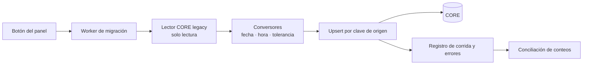

# Slice 3 — Migración de CORE legacy a CORE

> **Plan padre:** [[checadores-plan]] · **Rama:** `feat/slice-03-migracion` · Plane: CHECADORES-4 (tareas 29–34)
> Lleva la MariaDB de producción (CORE legacy, i2ge1) al Postgres nuevo (CORE) con el **histórico completo** convertido. Idempotente y lanzada solo desde un botón del panel.

## Pendientes

- [ ] Entrevista previa: tablas que se migran y se descartan (173 en `esquema.sql`), volumen del histórico y ventana de corte.
- [ ] Confirmar motor y versión de CORE legacy y credenciales de solo lectura por entorno (nunca al repo).
- [ ] Definir la clave de origen de cada tabla para el upsert.
- [ ] Ensayar en Qa con una copia de datos antes de producción.

## Estado Actual

| Área | Estado |
|------|--------|
| Requisitos | 🟡 Parciales |
| Conversión de fechas | ✅ Reglas conocidas (Clarion y centésimas) |
| Implementación | ⏳ |

## Legacy → nuevo

| Legacy | Nuevo |
|--------|-------|
| Fecha Clarion (días desde 1800-12-27) y hora en centésimas + 1 | `timestamptz` UTC |
| Tolerancias en centésimas + 1 (90001 = 15 min) | Minutos en grupos de tolerancia |
| Tabla `Asistencia` (agenda por empleado, día y bloque calculada por Inspector RT) | Se migra como histórico; el auditor nuevo calcula hacia adelante |
| `checadas` con `CODCHECADA = MAX+1` | Eventos con clave única de origen |

## Decisiones

1. **Idempotente** (upsert por clave de origen); **solo se lanza desde el panel**, sin programación.
2. Dos etapas: **datos maestros** (empleados, departamentos, horarios; muchos pero cambian poco) e **histórico** (checadas, incidencias, justificantes, `Asistencia`).
3. Carga por lotes con reanudación; el origen se trata como solo lectura.
4. **Todo el histórico** se convierte; no se archiva por fuera.
5. El proceso corre en el `worker`, no en la API.

## Alcance

Cubre lector, conversores, worker, endpoints y conciliación. No cubre el cambio de producción del legacy (corte) ni la captura nueva (slice 4).

## Forma de trabajo

Sigue las **Reglas de Trabajo** de [[checadores-plan]]. Ciclo CREAR → MODIFICAR → ENLAZAR.

## Implementación

### Paso 1 — Mapa y conversión (03.1, 03.2)
- [ ] Documento de mapeo tabla por tabla; conversores puros en `Core` (`ClarionFecha`, `ClarionHora`, `Tolerancia`).

### Paso 2 — Base de datos
- [ ] Claves de origen (`origen_id`) en las tablas destino; `migracion_corridas` y `migracion_errores`.

### Paso 3 — Worker (03.3 a 03.5)
- [ ] `IMigracionOrigen` (lector) y su implementación en `Infrastructure`; servicios de migración por etapa; reanudación por lote.
- [ ] Endpoints `POST /migraciones` (lanza), `GET /migraciones/{id}` (estado y progreso).

### Paso 4 — Conciliación y pantalla (03.6)
- [ ] Informe de conteos origen/destino y muestras; pantalla con botón, progreso y diferencias.

## Criterios de Aceptación

- [ ] Repetir la migración no duplica filas.
- [ ] Los conteos por tabla coinciden con el origen (o la diferencia queda explicada).
- [ ] Una muestra de checadas conserva el instante correcto tras la conversión.
- [ ] Una falla a media corrida se reanuda sin repetir lotes completos.

## Relacionado

- [[checadores-plan]]
- [[checadores-slice-02-catalogos-sub-plan]]
- [[checadores-slice-05-horarios-sub-plan]]
