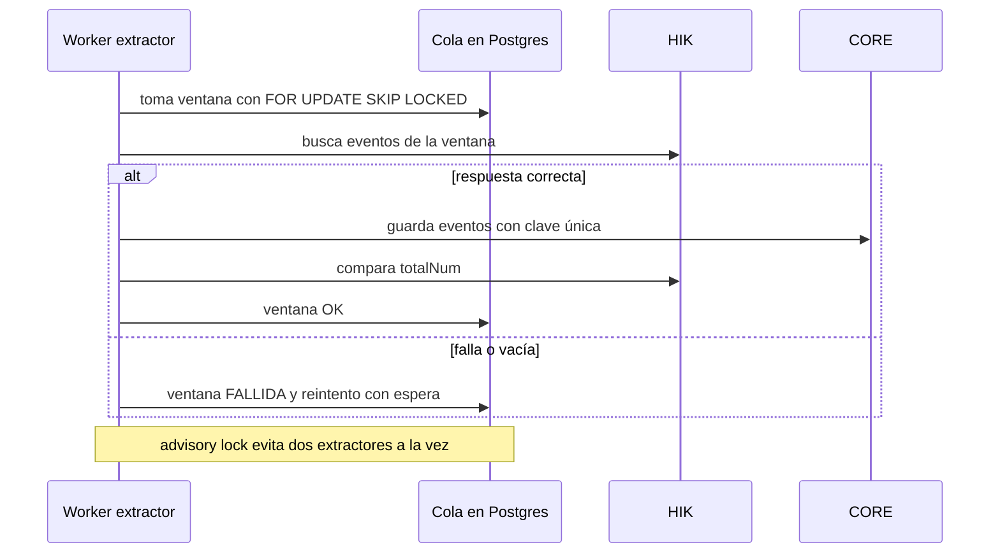

# Slice 4 — Captura de checadas

> **Plan padre:** [[checadores-plan]] · **Rama:** `feat/slice-04-captura` · Plane: CHECADORES-5 (tareas 35–41)
> Traer los eventos de HIK, guardarlos sin pérdida ni duplicados y exponer su estado. Sustituye al DTS del legacy (estrategias 224–228).

## Pendientes

- [ ] Entrevista previa: tamaño de ventana (propuesta 5 min), política de reintentos y umbral de ráfaga.
- [ ] Verificar que `totalNum` de HIK es confiable con filtros.
- [ ] Documentación de HIK (se cayó); apoyarse en `HIK_API.md` del commit `7f988c3`.
- [ ] Ritmo máximo aceptable: el servidor HIK es de pocos recursos y un sondeo por segundo lo tumbó.
- [ ] Prueba contra HIK real (la ejecuta el usuario).

## Estado Actual

| Área | Estado |
|------|--------|
| Requisitos | ✅ Definidos |
| Implementación | ⏳ |

## Legacy → nuevo

| Legacy | Nuevo |
|--------|-------|
| DTS cada 5 min, archivo `lastProcessed` | Ventanas `[desde, hasta)` con estado en Postgres |
| 2 reconciliaciones fijas (10:16 y 11:16) | Reconciliación por `totalNum` solo de lo que falta |
| `Timeout exceeded` por timeout fijo de 20 s | Timeout configurable, reintentos con espera |
| `tipoAccion` por `hora < 12` y zona `Etc/GMT+6` | Evento crudo en UTC sin clasificar |
| `MAX(CODCHECADA)+1` | Clave única por evento |

## Decisiones

1. **Worker** en el mismo proyecto, contenedor `worker`; estado y cola en **Postgres** (sin Redis).
2. **Interfaz de proveedor** `IProveedorChecadas`: HIK hoy, SDK propio después, sin tocar el resto.
3. Eventos **crudos en UTC sin clasificar**; las **ráfagas** se guardan y se marcan.
4. **Reconciliación barata** con `totalNum`; solo se reintentan ventanas con fallo o vacías.
5. HIK: token con vigencia de 7 días, límite de 5 req/s.
6. Checadas sin match → **bandeja de no identificadas**: asignar o ignorar; se revalidan al asignar.
7. El estado de sincronización se ve en el panel, con reintento manual.

## Alcance

Cubre cliente, cola, reconciliación, eventos, bandeja y panel de estado. No clasifica entrada/salida ni genera incidencias (slice 6).

## Forma de trabajo

Sigue las **Reglas de Trabajo** de [[checadores-plan]]. El extractor es un adaptador que solo traduce y delega a `ICapturaService`. Ciclo CREAR → MODIFICAR → ENLAZAR.

## Implementación

### Paso 1 — Base de datos
- [ ] Tablas (propuesta) `checadas` (evento crudo, único por origen+evento), `ventanas_captura` (desde, hasta, estado, intentos, `total_hik`, `total_local`), `checadas_no_identificadas`.

### Paso 2 — Puertos y cliente (04.1, 04.2)
- [ ] `IProveedorChecadas` en `Application`; `HikChecadasProveedor` en `Infrastructure` con token en caché, limitador de 5 req/s y paginación.

### Paso 3 — Cola y eventos (04.3, 04.5)
- [ ] `IVentanaRepository` (reclamar con SKIP LOCKED, marcar estado); `CapturaService` (guardar, marcar ráfaga, idempotencia); advisory lock de instancia única.

### Paso 4 — Reconciliación y bandeja (04.4, 04.6)
- [ ] Comparación `totalNum` vs guardado y reintentos; servicio de bandeja (asignar empleado, ignorar, revalidar).

### Paso 5 — Panel (04.7)
- [ ] `GET /sincronizacion` (ventanas, último éxito, desfases), `POST /sincronizacion/ventanas/{id}/reintentar`, `/checadas/no-identificadas`; pantallas de estado y bandeja.

## Criterios de Aceptación

- [ ] Reiniciar el worker retoma donde quedó, sin perder ni duplicar eventos.
- [ ] Dos instancias no procesan la misma ventana.
- [ ] Una ventana fallida se reintenta y queda visible en el panel.
- [ ] Nunca se supera el límite de peticiones de HIK.

## Relacionado

- [[checadores-plan]]
- [[checadores-slice-02-catalogos-sub-plan]]
- [[checadores-slice-06-incidencias-sub-plan]]
- [[checadores-slice-12-administracion-sub-plan]]
