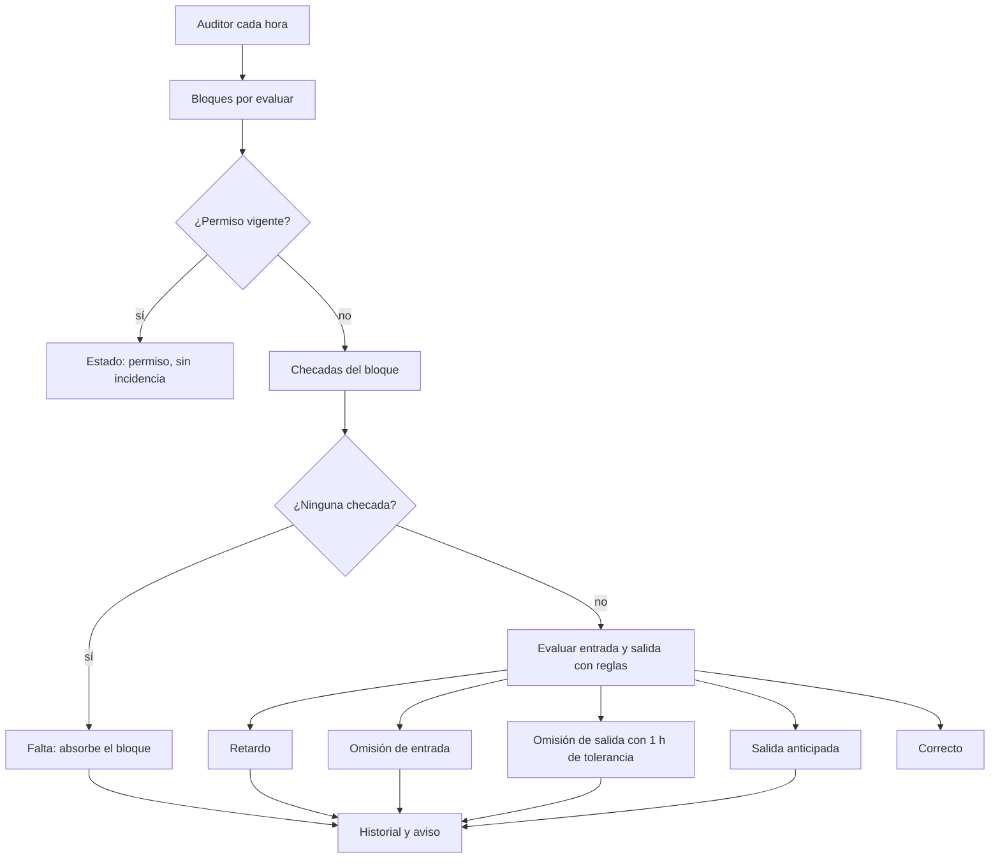

# Slice 6 — Reglas e incidencias (auditor)

> **Plan padre:** [[checadores-plan]] · **Rama:** `feat/slice-06-incidencias` · Plane: CHECADORES-7 (tareas 47–53)
> El corazón del negocio: compara checadas contra horarios y genera incidencias con reglas dinámicas. Sustituye al motor de Inspector RT y a las estrategias 236–238.

## Pendientes

- [ ] Entrevista previa: lenguaje de condiciones de las reglas (tiempo, tipo de personal, turno, calendario) y reglas iniciales.
- [ ] Confirmar al implementar que el redondeo no aplica a la entrada.
- [ ] Tratamiento de checadas dentro de una ráfaga al evaluar.
- [ ] Mapear el comportamiento heredado: `isREIncidencia = puntualidadPerfecta ? true : !isTolerance` (en tolerancia no es incidencia).
- [ ] Validar contra casos reales del histórico migrado.

## Estado Actual

| Área | Estado |
|------|--------|
| Reglas base | ✅ Definidas |
| Lenguaje de reglas dinámicas | 🟡 Por detallar |
| Implementación | ⏳ |

## Legacy → nuevo

| Legacy | Nuevo |
|--------|-------|
| AU / RE / OE / OS calculadas por Inspector RT (sin código) y `Asistencia` | Cinco clases con reglas editables; auditor propio |
| `RE` para `codToleranciaEntrada IN (3, 15, 2, 14)` | Regla en datos con umbral y tipo resultante |
| Reportes diarios por cronograma | Estado calculado cada hora; consulta bajo demanda |
| Justificante cambia la incidencia | Justificante la marca; el historial se conserva |

## Decisiones

1. Cinco clases: **Retardo**, **Omisión de entrada**, **Omisión de salida**, **Salida anticipada**, **Falta**. Tipos y reglas son **datos editables** (condición, umbral, tipo resultante, severidad), no un enum.
2. **Falta** = ninguna checada en el bloque; mayor severidad y **absorbe** las demás del mismo bloque (confirmado 2026-11-23).
3. «En tolerancia» **no** es incidencia. Llegada pasado el límite del grupo: no cuenta como retardo y el tipo resultante es configurable.
4. **Salida anticipada** sin tolerancia (redondeo de 1 min por defecto): 4:59:5x con salida a las 5:00 es correcta. **Omisión de salida**: 1 h de tolerancia configurable tras el fin del bloque.
5. **Auditor** cada hora con máquina de estados por empleado y bloque (a las 7 evalúa quién entra a las 6). Las checadas se ven en el panel pero el estado se marca solo cuando entra el auditor.
6. Antes de generar, consulta si hay **permiso** (no genera incidencia). El **justificante** se aplica a una incidencia existente sin borrarla.
7. Idempotente: reevaluar una hora no duplica incidencias.

## Alcance

Cubre tipos, reglas, evaluador, auditor, incidencias e historial con sus pantallas. No cubre la captura (slice 4), la aprobación de permisos (7) ni los avisos (9).

## Forma de trabajo

Sigue las **Reglas de Trabajo** de [[checadores-plan]]. El evaluador es lógica pura en `Core`; el auditor es un adaptador que delega a `IAuditorService`. Ciclo CREAR → MODIFICAR → ENLAZAR.

## Implementación

### Paso 1 — Base de datos
- [ ] Tablas (propuesta) `tipos_incidencia` (severidad), `reglas_incidencia`, `estados_bloque` (empleado, fecha, bloque), `incidencias`, `incidencias_historial`.

### Paso 2 — Núcleo (CREAR)
- [ ] `Core`: `EvaluadorBloque`, `ReglaIncidencia`, precedencia de Falta; `Application`: `IAuditorService`, `IIncidenciaQueries`, repositorios.

### Paso 3 — Integración (MODIFICAR)
- [ ] Lectura de horarios y tolerancias desde la caché; consulta de permisos (puerto con implementación en el slice 7).

### Paso 4 — Auditor y pantallas (ENLAZAR)
- [ ] Servicio programado cada hora con reejecución por hora o día; `GET /incidencias`, `/reglas-incidencia`, `/tipos-incidencia`; pantallas de incidencias, historial y reglas.

## Criterios de Aceptación

- [ ] Un bloque sin checadas genera solo Falta.
- [ ] Reejecutar el auditor sobre la misma hora no duplica incidencias.
- [ ] Con permiso vigente no se genera incidencia.
- [ ] Salida a las 4:59:5x en un bloque que termina 5:00 se cuenta correcta.
- [ ] Cambiar una regla en el panel se aplica en la siguiente corrida.

## Relacionado

- [[checadores-plan]]
- [[checadores-slice-04-captura-sub-plan]]
- [[checadores-slice-05-horarios-sub-plan]]
- [[checadores-slice-07-permisos-sub-plan]]
- [[checadores-slice-09-notificaciones-sub-plan]]
