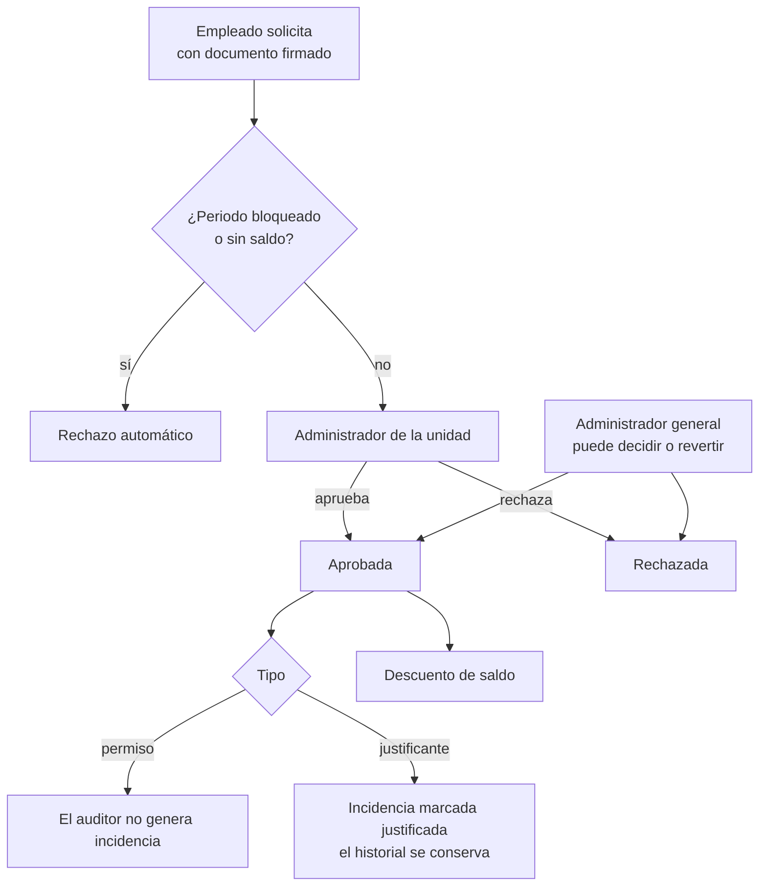

# Slice 7 — Permisos y justificantes

> **Plan padre:** [[checadores-plan]] · **Rama:** `feat/slice-07-permisos` · Plane: CHECADORES-8 (tareas 54–58)
> Solicitud, aprobación y evidencia documental de permisos (previos) y justificantes (posteriores a una incidencia).

## Pendientes

- [ ] Entrevista previa: catálogo exacto de tipos (heredados: `AU`, `PE` permiso de entrada, `PS` permiso de salida), formato del documento y plazos.
- [ ] **Contrato del CDN privado** (`docs-cdn` y `docs-service`): pendiente hasta la implementación.
- [ ] Qué ocurre con una solicitud no atendida (vence o escala).
- [ ] Límite de solicitudes por periodo (se cruza con el slice 8).

## Estado Actual

| Área | Estado |
|------|--------|
| Flujo y roles | ✅ Definidos |
| Contrato del CDN | ⏳ Pendiente |
| Implementación | ⏳ |

## Legacy → nuevo

| Legacy | Nuevo |
|--------|-------|
| `AdministracionJustificantes` y `...Parciales` | `permisos` y `justificantes` con estado e historial |
| `PreguntarElTipoDeJustificacion=0`, `SoloMaestroPuedeVerJustificacionesAjenas=1` | Roles y políticas explícitas |
| Captura solo desde Inspector RT por RH | El empleado sube su solicitud; la unidad aprueba |
| Sin documento | Formato y documento firmado en CDN privado |

## Decisiones

1. **Permiso**: deja historial y **no genera incidencia**. **Justificante**: se aplica a una incidencia existente y **no la borra**.
2. Ambos llevan **formato y documento firmado**, guardados en un **CDN privado propio**.
3. El **empleado** sube su solicitud; el **administrador de la unidad** aprueba o rechaza; el **administrador general** también decide, puede revertir y ve todos los registros.
4. Tipo **bloque** para docentes: justifica solo ciertos bloques (p. ej. 13–15 h sin afectar 7–9 h ni 19–21 h) a partir de sus horarios. El administrativo conserva el esquema de horario fijo.
5. Se pueden **bloquear periodos** del calendario (p. ej. del 7 al 14 no se piden permisos).
6. Se descuenta del saldo del empleado (slice 8).

## Alcance

Cubre tipos, solicitud, decisión, documento y pantallas. No cubre el cálculo de saldos (slice 8) ni el correo (slice 9).

## Forma de trabajo

Sigue las **Reglas de Trabajo** de [[checadores-plan]]: `ISolicitudService`, `ISolicitudQueries`, puerto `IAlmacenDocumentos`. Ciclo CREAR → MODIFICAR → ENLAZAR.

## Implementación

### Paso 1 — Base de datos
- [ ] Tablas (propuesta) `tipos_solicitud`, `solicitudes` (permiso o justificante, bloque, rango, estado), `solicitud_documentos`, `solicitud_decisiones`.

### Paso 2 — API (CREAR)
- [ ] Contratos, `SolicitudService` (crear, aprobar, rechazar, revertir), consultas filtradas por jerarquía (slice 1), `IAlmacenDocumentos`.

### Paso 3 — API (MODIFICAR)
- [ ] Puerto `IPermisosVigentes` que consume el auditor; validación contra periodos bloqueados (slice 5).

### Paso 4 — Enlazar y pantallas
- [ ] `POST /solicitudes`, `POST /solicitudes/{id}/aprobar|rechazar|revertir`, `GET /solicitudes`; cliente del CDN; pantallas de solicitud, bandeja de aprobación y consulta.

## Criterios de Aceptación

- [ ] Una solicitud sin documento firmado no avanza.
- [ ] No se puede solicitar dentro de un periodo bloqueado.
- [ ] Un justificante aprobado marca la incidencia como justificada y el historial la conserva.
- [ ] Cada decisión queda auditada, incluida una reversión.

## Relacionado

- [[checadores-plan]]
- [[checadores-slice-05-horarios-sub-plan]]
- [[checadores-slice-06-incidencias-sub-plan]]
- [[checadores-slice-08-saldos-sub-plan]]
