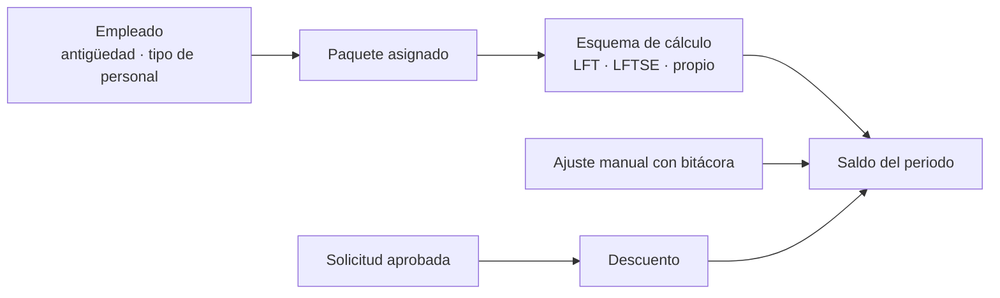

# Slice 8 — Saldos y prestaciones

> **Plan padre:** [[checadores-plan]] · **Rama:** `feat/slice-08-saldos` · Plane: CHECADORES-9 (tareas 59–63)
> Cuánto puede pedir cada persona de vacaciones, permisos y justificantes: paquetes, reglas de cálculo y ajuste manual.

## Pendientes

- [ ] **Confirmar con RH el régimen** aplicable: LFT Apartado A, LFTSE Apartado B o condiciones generales propias del organismo.
- [ ] Fórmulas finales de cada prestación (por ahora genéricas).
- [ ] Vigencia del saldo: año calendario, aniversario o semestre.
- [ ] Si el saldo no usado caduca o se acumula.
- [ ] Verificar en el DOF si la LFTSE tuvo reformas posteriores a 2018.

## Estado Actual

| Área | Estado |
|------|--------|
| Estructura (paquetes, reglas, ajuste) | ✅ Definida |
| Fórmulas y régimen | ⏳ Pendiente de RH |
| Implementación | ⏳ |

## Legacy → nuevo

| Legacy | Nuevo |
|--------|-------|
| Sin saldos ni paquetes en el sistema | Paquetes por tipo de empleado con cálculo automático |
| Permisos sin límite configurable | Máximos por paquete y validación del disponible |
| Ajustes fuera del sistema | Edición individual con bitácora |

## Decisiones

1. **Paquetes o grupos** establecidos por tipo de empleado, con **edición individual** y bitácora.
2. **Cálculo automático por reglas configurables** (base + incremento por antigüedad, tope, vigencia). Ejemplo del usuario, ilustrativo: más de 1 año → 14 días base + 1.5 por año.
3. Referencias para fórmulas genéricas:
   - **LFT (Apartado A), desde 2023:** 12 días el primer año, +2 por año hasta 20 en el quinto, luego +2 cada 5 años; prima vacacional mínima de 25 %.
   - **LFTSE (Apartado B), arts. 30 y 40:** dos periodos de 10 días laborables al año (tras 6 meses) y prima de 30 %.
4. **Esquemas de prestación** seleccionables por paquete, para soportar ambos regímenes sin cambiar código.
5. Descuento al aprobar un permiso, con validación del disponible.

## Alcance

Cubre paquetes, esquemas, saldos, movimientos, ajuste y pantallas. No cubre nómina ni el pago de la prima.

## Forma de trabajo

Sigue las **Reglas de Trabajo** de [[checadores-plan]]. El cálculo es una función pura en `Core` (`CalculadoraPrestacion`). Ciclo CREAR → MODIFICAR → ENLAZAR.

## Implementación

### Paso 1 — Base de datos
- [ ] Tablas (propuesta) `paquetes_prestacion`, `esquemas_calculo`, `reglas_calculo`, `saldos`, `saldo_movimientos` (inmutables, con motivo y autor).

### Paso 2 — API (CREAR)
- [ ] `CalculadoraPrestacion`, `SaldoService` (recalcular, ajustar), `SaldoQueries`, repositorios.

### Paso 3 — API (MODIFICAR)
- [ ] Gancho en la aprobación de solicitudes (slice 7) para descontar y validar disponible.

### Paso 4 — Enlazar y pantallas
- [ ] `/paquetes`, `/esquemas-calculo`, `/empleados/{id}/saldos`, `POST /saldos/{id}/ajustes`; pantallas de paquetes, saldos y ajustes.

## Criterios de Aceptación

- [ ] El mismo empleado produce el mismo saldo cambiando solo el esquema configurado.
- [ ] Todo ajuste manual queda en bitácora con autor y motivo.
- [ ] No se aprueba un permiso que excede el saldo.

## Relacionado

- [[checadores-plan]]
- [[checadores-slice-07-permisos-sub-plan]]
- [[checadores-slice-10-reportes-sub-plan]]
