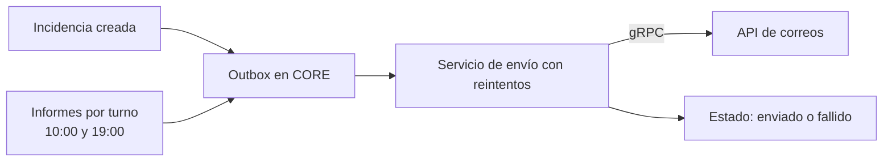

# Slice 9 — Notificaciones

> **Plan padre:** [[checadores-plan]] · **Rama:** `feat/slice-09-notificaciones` · Plane: CHECADORES-10 (tareas 64–67)
> Correos inmediatos por incidencia e informes diarios por turno, enviados con la API institucional de correos por gRPC.

## Pendientes

- [ ] **Contrato gRPC** de la API de correos: el usuario compartirá la documentación; pendiente hasta la implementación.
- [ ] Plantillas y variables de cada correo.
- [ ] Idempotencia y reintentos con outbox (modelo en [[asistencias-slice-6-notificaciones-sub-plan]]).
- [ ] Consumidor y credenciales de checadores en la API de correos (por entorno, nunca al repo).

## Estado Actual

| Área | Estado |
|------|--------|
| Destinatarios y horarios | ✅ Definidos |
| Contrato gRPC | ⏳ Pendiente |
| Implementación | ⏳ |

## Legacy → nuevo

| Legacy | Nuevo |
|--------|-------|
| `emailService` ad hoc y reporte diario por cronograma | `INotificador` con cliente gRPC; sin SMTP propio |
| Un solo reporte diario por departamento | Correo inmediato por incidencia e informes por turno |
| Destinatarios fijos en la estrategia | Jerarquía asignada en el panel (slice 1) |

## Decisiones

1. Puerto `INotificador` con cliente **gRPC** hacia la API que envía correos masivos por departamento o 1 a 1; **sin SMTP propio**.
2. **Correo inmediato** por incidencia al empleado, al administrador del departamento, al jefe de carrera (docentes) y a RH.
3. **Informe diario por turno**, separado para docentes y administrativos: matutino ~**10:00** con incidencias de llegada y vespertino ~**19:00** con salidas o faltas (turnos 7:00–15:00 y 15:00–22:00); horas editables.
4. **Informe de checadas** del personal a cargo para los jefes, según la jerarquía.
5. Una falla del servicio de correo no impide registrar checadas ni incidencias.

## Alcance

Cubre outbox, cliente, plantillas, planificación de informes y estado de envíos. No cubre el reporte PDF (slice 10).

## Forma de trabajo

Sigue las **Reglas de Trabajo** de [[checadores-plan]]. Ciclo CREAR → MODIFICAR → ENLAZAR.

## Implementación

### Paso 1 — Base de datos
- [ ] Tabla (propuesta) `notificaciones_outbox` (tipo, destinatarios, estado, intentos, `ultimo_error`, clave de idempotencia).

### Paso 2 — CREAR
- [ ] `INotificador`, `NotificacionService`, plantillas y variables, cliente gRPC en `Infrastructure`.

### Paso 3 — MODIFICAR
- [ ] El auditor (slice 6) escribe en la outbox al crear una incidencia, en la misma transacción.

### Paso 4 — ENLAZAR
- [ ] Servicio en segundo plano con reintentos y advisory lock; planificación de los informes por turno desde la configuración; pantalla de estado de envíos.

## Criterios de Aceptación

- [ ] Cada aviso se envía una sola vez.
- [ ] Un envío fallido se reintenta y deja el motivo.
- [ ] Los informes por turno salen a la hora configurada y solo incluyen el objetivo del turno.
- [ ] Sin la API de correos, el auditor sigue funcionando.

## Relacionado

- [[checadores-plan]]
- [[checadores-slice-06-incidencias-sub-plan]]
- [[email-service-plan]]
