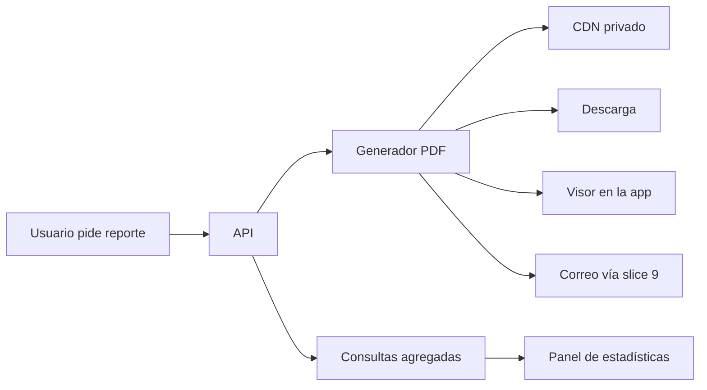

# Slice 10 — Reportes y estadísticas

> **Plan padre:** [[checadores-plan]] · **Rama:** `feat/slice-10-reportes` · Plane: CHECADORES-11 (tareas 68–70)
> Reportes PDF a demanda y estadísticas del panel.

## Pendientes

- [ ] **Contenido y plantilla de los reportes**: pendiente hasta su implementación (referencia: plantilla `incidenciasDiarias` del legacy).
- [ ] Formato de fecha del reporte (el legacy nuevo usa «7 de octubre de 2026» más fecha de generación con día de la semana).
- [ ] Librería de PDF (requiere confirmación de dependencia).
- [ ] Qué guardar en el CDN y por cuánto tiempo.

## Estado Actual

| Área | Estado |
|------|--------|
| Entrega y estadísticas | ✅ Definidas |
| Contenido del reporte | ⏳ Pendiente |
| Implementación | ⏳ |

## Legacy → nuevo

| Legacy | Nuevo |
|--------|-------|
| PDF por departamento generado por cronograma y enviado por correo (estrategias 239–241) | Generado **a demanda**: descarga, visor y correo |
| Archivo en Drive o file server con QR | CDN privado |
| Sin estadísticas | Puntualidad, tendencia, cobertura por dispositivo y saldos |

## Decisiones

1. Los reportes se generan **bajo demanda**, ya no por cronograma; PDF por departamento.
2. Entrega: **descarga en el panel, vista en la app y envío por correo** (vía slice 9); se guardan en el CDN privado.
3. **Estadísticas** sin reporte: puntualidad por departamento y periodo; ranking o tendencia de incidencias por empleado; cobertura de checadas por dispositivo o punto; saldos de permisos y vacaciones.
4. Los respaldos periódicos no son responsabilidad de este slice.

## Alcance

Cubre generación de PDF, entrega y estadísticas. No cubre la definición visual del reporte (se hace al implementar).

## Forma de trabajo

Sigue las **Reglas de Trabajo** de [[checadores-plan]]: `IReporteService`, `IEstadisticasQueries` (lecturas agregadas), puerto `IGeneradorPdf`. Ciclo CREAR → MODIFICAR → ENLAZAR.

## Implementación

### Paso 1 — CREAR
- [ ] `IGeneradorPdf` y su implementación; `ReporteService`; consultas agregadas por departamento, empleado y dispositivo; contratos.

### Paso 2 — MODIFICAR
- [ ] Índices en `incidencias` y `checadas` para las agregaciones.

### Paso 3 — ENLAZAR
- [ ] `POST /reportes`, `GET /reportes/{id}`, `GET /estadisticas/*`; visor, descarga y envío por correo; pantalla de estadísticas.

## Criterios de Aceptación

- [ ] El reporte de un departamento se descarga, se ve en la app y se envía por correo.
- [ ] Las estadísticas coinciden con las incidencias del periodo.
- [ ] Las consultas pesadas no degradan al auditor ni al extractor.

## Relacionado

- [[checadores-plan]]
- [[checadores-slice-06-incidencias-sub-plan]]
- [[checadores-slice-08-saldos-sub-plan]]
- [[checadores-slice-09-notificaciones-sub-plan]]
