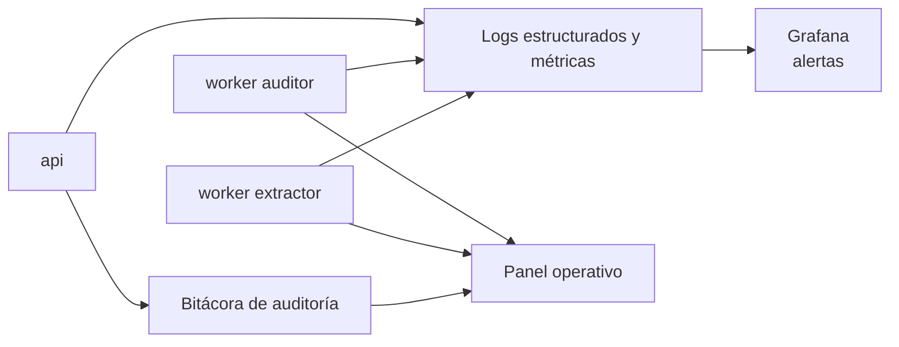

# Slice 12 — Administración y observabilidad

> **Plan padre:** [[checadores-plan]] · **Rama:** `feat/slice-12-administracion` · Plane: CHECADORES-13 (tareas 74–77)
> Operar y vigilar el sistema: panel de auditor y colas, bitácora de cambios, logs y métricas, y documentación de respaldos.

## Pendientes

- [ ] Entrevista previa: qué métricas y logs necesita Grafana (Loki o Prometheus).
- [ ] Umbrales de alerta (los define Grafana).
- [ ] Qué respaldar, como insumo del proyecto de respaldos.
- [ ] Retención de la bitácora de auditoría.

## Estado Actual

| Área | Estado |
|------|--------|
| Requisitos | ✅ Definidos |
| Implementación | ⏳ |

## Legacy → nuevo

| Legacy | Nuevo |
|--------|-------|
| Logs sueltos con `Timeout exceeded` y `console.trace` | Logs estructurados y métricas a Grafana |
| Sin bitácora de cambios | Bitácora de auditoría de horarios, reglas, permisos y saldos |
| Reintentos manuales en servidor | Panel de ventanas, auditor y colas con reintento |
| Puertos abiertos y credenciales en claro | Solo el proxy con HTTPS; secretos por entorno |

## Decisiones

1. **Panel operativo:** estado de sincronización HIK, bandeja de no identificadas, auditor y colas, y bitácora de auditoría.
2. **Alertas** por **logs**; las notificaciones las maneja **Grafana**. El sistema solo emite logs estructurados y métricas, sin correo de alertas propio; `/health` se conserva.
3. **Respaldos** en un proyecto aparte (Dokploy con S3, herramienta tipo pgBackRest o WAL-G); aquí solo se documenta qué respaldar.
4. **Seguridad:** solo el proxy con HTTPS, Postgres en red interna, secretos por entorno.
5. La bitácora registra quién cambió horarios, tolerancias, reglas, permisos, justificantes y saldos, y cuándo.

## Alcance

Cubre bitácora, panel de auditor y colas, logs, métricas y manual de respaldos. No cubre el sistema de alertas (Grafana) ni la herramienta de respaldo.

## Forma de trabajo

Sigue las **Reglas de Trabajo** de [[checadores-plan]]: `IAuditoriaService` transversal, `IOperacionQueries`. Ciclo CREAR → MODIFICAR → ENLAZAR.

## Implementación

### Paso 1 — CREAR
- [ ] Tabla (propuesta) `bitacora_auditoria` (entidad, id, acción, antes/después, autor, fecha); `IAuditoriaService`; métricas del worker y del auditor.

### Paso 2 — MODIFICAR
- [ ] Llamar a la bitácora desde los servicios de los slices 5 a 8; añadir `traceId` y contexto a los logs.

### Paso 3 — ENLAZAR
- [ ] `GET /operacion/auditor`, `POST /operacion/auditor/reejecutar` (hora o día), `GET /bitacora`; pantallas de auditor, colas y bitácora; manual de respaldos en la bóveda.

## Criterios de Aceptación

- [ ] Una ventana fallida o un auditor atrasado se ve en el panel y en los logs.
- [ ] Cada cambio de configuración deja registro con autor y fecha.
- [ ] Los logs no contienen credenciales.

## Relacionado

- [[checadores-plan]]
- [[checadores-slice-04-captura-sub-plan]]
- [[checadores-slice-06-incidencias-sub-plan]]
