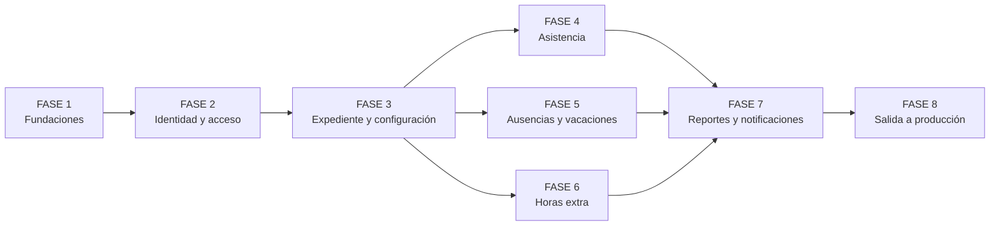

# Plan técnico alternativo (superado)

> **Plan padre:** [[rh-cotla-plan]]

> **Documento superado.** El plan vigente es **[[rh-cotla-plan]]**, que
> reorganiza el trabajo en doce fases con criterios de aceptación por fase y es el
> único que se actualiza como checklist vivo.
>
> Este documento **se conserva sin editar por su valor histórico**: registra por qué
> NestJS/Prisma se sustituyó por ASP.NET Core/EF Core, y esa decisión sigue en pie. No
> debe usarse para planificar trabajo nuevo ni para estimar el estado real del proyecto:
> su tabla «Estado actual» quedó obsoleta al cierre de la FASE 1.
>
> Referencia histórica: `app-backend/README.md` cita este documento precisamente por
> el registro de la sustitución de stack.

> Sistema de Recursos Humanos para Ferretería Cotla: asistencia con selfie y GPS,
> expedientes, ausencias, vacaciones, horas extra, reportes y auditoría.
>
> **Stack vigente:** ASP.NET Core/.NET 10, PostgreSQL 17, Next.js, Expo/React
> Native y Docker Compose. `infra/db.sql` definió el esquema inicial y queda como
> **referencia**; las **migraciones versionadas de EF Core** (con un seed
> idempotente) son el mecanismo único de despliegue del esquema.

---

## Estado actual

| Área | Estado |
| --- | --- |
| API | Proyecto ASP.NET Core inicial, OpenAPI en desarrollo y `GET /health` |
| Base de datos | Esquema inicial definido en `infra/db.sql` |
| Contenedores | API y PostgreSQL configurados en Docker Compose |
| Panel web | Plantilla Next.js, sin módulos funcionales |
| App móvil | Plantilla Expo, sin módulos funcionales |
| Especificación | MVP funcional consolidado en `especificaciones-unificada.md` |

## Decisiones vigentes

- La API usa **ASP.NET Core/.NET 10**, aun cuando la especificación original
  mencione NestJS y Prisma.
- PostgreSQL usa tablas plurales, `snake_case`, IDs `bigint` y aislamiento por
  `sucursal_id`; la sucursal es el límite lógico de tenancy.
- El número de empleado es el identificador de inicio de sesión.
- Los roles del MVP son `colaborador`, `gerente` y `rh`.
- Los archivos se guardan en un **CDN propio (a desarrollar)**; la base solo
  conserva sus referencias y metadatos.
- Las solicitudes de vacaciones no reservan saldo pendiente y descuentan días
  únicamente al aprobarse.
- Las incapacidades requieren documento como política inicial.
- El gerente solo consulta los equipos asignados; RH aprueba y configura.

## Decisiones que bloquean producción

- **CDN propio de archivos**: comportamiento, política de URLs firmadas y retención por definir.
- Canal definitivo de notificaciones: push, correo o ambos.
- Reglas exactas de ventana de marcación, tolerancia y estrategia offline.
- Política de retención de fotos, documentos y datos personales.
- Formato, calidad y proceso de migración del archivo Excel existente.

| Fase | Estado | Resultado principal |
| --- | --- | --- |
| FASE 1 — Fundaciones | ✅ Completada | Entorno, arquitectura y BD verificables |
| FASE 2 — Identidad y acceso | ⏳ Pendiente | Cuentas y autorización por alcance |
| FASE 3 — Expediente y configuración | ⏳ Pendiente | Gestión de personal y operación RH |
| FASE 4 — Asistencia | ⏳ Pendiente | Checador móvil con GPS y selfie |
| FASE 5 — Ausencias y vacaciones | ⏳ Pendiente | Solicitudes, saldos y calendario |
| FASE 6 — Horas extra | ⏳ Pendiente | Captura, evidencias y aprobación |
| FASE 7 — Reportes y notificaciones | ⏳ Pendiente | Información operativa para cada rol |
| FASE 8 — Salida a producción | ⏳ Pendiente | Calidad, seguridad, piloto y operación |

---

## FASE 1 — Fundaciones técnicas

> **Objetivo:** dejar un entorno reproducible, contratos técnicos claros y una
> base de datos validada antes de implementar funcionalidades de RH.

### 1.1 Auditoría de alcance y arquitectura

- [x] Contrastar cada requisito del MVP con el esquema SQL y registrar brechas.
- [x] Mantener `docs/especificaciones.md` como fuente funcional.
- [x] Documentar la sustitución de NestJS/Prisma por ASP.NET Core/EF Core.
- [x] Definir módulos de API: Auth, Employees, Catalogs, Attendance,
  LeaveRequests, Vacations, Overtime, Files, Notifications, Reports y Audit.
- [x] Definir convenciones de errores, paginación, filtros, fechas UTC y nombres
  de endpoints antes de publicar contratos.

**Salida:** mapa de módulos y una lista priorizada de decisiones pendientes.

### 1.2 Entorno y configuración

- [x] Completar `Dockerfile` multi-stage y endurecer la imagen de API.
- [x] Centralizar variables por ambiente: conexión PostgreSQL, CORS, JWT o
  sesión, almacenamiento, FCM y telemetría.
- [x] Añadir archivos de ejemplo sin secretos y documentar el arranque local.
- [x] Configurar CORS limitado a los orígenes del panel web y desarrollo móvil.
- [x] Añadir health checks de disponibilidad y, al conectar la BD, de
  dependencia PostgreSQL.
- [x] Asegurar que los puertos, volúmenes y nombres de servicios sean estables.

**Validación:** compilación de API, `docker compose config` y arranque limpio
en un entorno de desarrollo.

### 1.3 Base de datos y datos de referencia

- [x] Revisar `infra/db.sql` en PostgreSQL vacío y corregir problemas de DDL.
- [x] Confirmar claves foráneas compuestas e índices por `sucursal_id`.
- [x] Verificar catálogos iniciales: sucursal, roles, departamentos, puestos,
  equipos y horarios.
- [x] Definir proceso de evolución del SQL: migraciones EF Core versionadas e
  inmutables; `db.sql` queda como referencia.
- [x] Preparar datos de inicialización obligatorios en `DbSeeder` idempotente
  (separado de datos de prueba).
- [ ] Registrar el mapeo preliminar entre columnas del Excel y `empleados`.

**Criterios de aceptación:** el esquema crea todas las entidades del MVP,
impide referencias cruzadas entre sucursales y conserva integridad de cuentas,
archivos, solicitudes y auditoría.

### 1.4 Base de API y calidad

- [x] Configurar DI, opciones tipadas, logging estructurado y middleware global
  de errores.
- [x] Incorporar EF Core/Npgsql mapeando las 24 entidades de `infra/db.sql` sin
  alterar el contrato físico existente.
- [x] Habilitar OpenAPI integrado en desarrollo y documentar códigos de respuesta.
- [x] Crear proyectos de pruebas unitarias e integración con una BD aislada.
- [x] Incorporar análisis estático, formato y build en la automatización local.

**Salida:** plantilla de módulo reutilizable con endpoint protegido de ejemplo,
prueba de integración y documentación OpenAPI.

---

## FASE 2 — Identidad, cuentas y autorización

> **Objetivo:** permitir acceso seguro y aplicar el alcance exacto de cada rol
> antes de exponer datos personales o laborales.

### 2.1 Cuentas y contraseñas

- [ ] Modelar usuarios, empleados, roles, sesiones y restablecimientos desde
  `infra/db.sql`.
- [ ] Implementar login por número de empleado y contraseña con hash robusto.
- [ ] Implementar logout, cambio de contraseña, recuperación y restablecimiento
  con tokens de un solo uso y expiración.
- [ ] Invalidar sesiones al desactivar una cuenta o por acción de RH.
- [ ] Aplicar rate limiting a login y recuperación, sin revelar si una cuenta
  existe.

### 2.2 Registro y ciclo de vida del colaborador

- [ ] Crear auto-registro móvil con cuenta y empleado en estado `pendiente`.
- [ ] Validar duplicados por sucursal: número de empleado, CURP y teléfono.
- [ ] Implementar revisión, activación, rechazo y desactivación por RH.
- [ ] Conservar historial al registrar baja laboral, fecha y motivo.
- [ ] Auditar todos los cambios de cuenta, expediente y estado laboral.

### 2.3 RBAC y alcance de sucursal/equipo

- [ ] Crear policies de rol y requisito de cuenta activa.
- [ ] Exigir `sucursal_id` en el contexto autenticado, no desde parámetros de
  cliente confiables.
- [ ] Restringir colaboradores a sus recursos propios.
- [ ] Resolver el alcance de gerentes mediante `equipos_gerentes` y equipos de
  cada empleado.
- [ ] Permitir a RH consultar y administrar toda la sucursal correspondiente.
- [ ] Cubrir con pruebas los accesos denegados y las referencias entre
  sucursales.

### 2.4 Clientes de autenticación

- [ ] Crear pantallas de login, recuperación y cambio de contraseña en móvil.
- [ ] Crear login y guardas de ruta en panel web para RH y gerentes.
- [ ] Implementar cliente HTTP común con renovación/cierre ante sesión expirada.
- [ ] Mostrar estados pendientes e inactivos sin permitir operaciones de RH.

**Criterios de aceptación:** un colaborador pendiente no puede usar módulos;
un gerente no puede aprobar ni consultar fuera de sus equipos; RH puede
activar, desactivar e invalidar sesiones con auditoría.

---

## FASE 3 — Expediente, catálogos y configuración RH

> **Objetivo:** habilitar la administración segura de colaboradores y la
> configuración necesaria para la operación diaria.

### 3.1 Expediente del colaborador

- [ ] Implementar endpoints de listado, detalle, alta y actualización de
  empleados con filtros por estado, equipo y departamento.
- [ ] Validar datos personales y laborales: CURP, RFC, IMSS, teléfono, fechas,
  dirección y contacto de emergencia.
- [ ] Separar permisos de lectura de expediente completo frente a perfil propio.
- [ ] Registrar cambios sensibles en auditoría con datos previos y posteriores.

### 3.2 Catálogos organizacionales

- [ ] Implementar CRUD RH para departamentos, puestos, equipos y horarios.
- [ ] Permitir asignar colaboradores a equipo, horario, puesto y departamento.
- [ ] Permitir asignar múltiples gerentes a equipos sin conceder aprobación.
- [ ] Implementar edición de sucursal: dirección, coordenadas, radio y
  tolerancia de entrada.
- [ ] Proteger catálogos con referencias activas contra borrado físico.

### 3.3 Panel web administrativo

- [ ] Construir navegación, layout y protección de rutas para RH/gerente.
- [ ] Crear vistas de empleados, expediente, catálogos, equipos y horarios.
- [ ] Añadir formularios con validación de cliente congruente con API.
- [ ] Mostrar al gerente únicamente información resumida y permitida de su
  equipo.

### 3.4 Migración desde Excel

- [ ] Inspeccionar formato, hojas, calidad y propietario del Excel real.
- [ ] Definir mapeo de columnas, normalización, reglas de duplicados y reporte
  de errores por fila.
- [ ] Crear proceso repetible en modo simulación antes de insertar.
- [ ] Importar solo tras aprobación de RH y conservar un reporte de resultados.
- [ ] Verificar que no se creen cuentas activas sin contraseña o autorización.

**Criterios de aceptación:** RH puede administrar un expediente completo;
gerentes solo ven su alcance; el importador puede detectar y reportar datos
incompatibles sin modificar producción durante la simulación.

---

## FASE 4 — Asistencia, cámara y geolocalización

> **Objetivo:** reemplazar el checador físico mediante marcaciones confiables
> de entrada, comida y salida, conservando evidencia y trazabilidad.

### 4.1 Almacenamiento privado de archivos

- [ ] Implementar y configurar el CDN propio de archivos por ambiente.
- [ ] Crear flujo de carga autenticada, validación de tipo/tamaño y registro de
  metadatos en `archivos`.
- [ ] Generar URLs firmadas de visualización y descarga solo para usuarios con
  autorización.
- [ ] Definir compresión de imágenes y tratamiento de fallos de carga.

### 4.2 API de marcaciones

- [ ] Implementar check-in, lunch-out, lunch-in y check-out.
- [ ] Tomar la hora oficial del servidor y guardar fecha local, GPS, precisión,
  distancia y estado de zona.
- [ ] Validar la secuencia de una jornada, horario configurado y tolerancia.
- [ ] Guardar marcaciones fuera de zona con estado correspondiente, sin
  bloquearlas.
- [ ] Usar identificador de evento de dispositivo para evitar duplicados de
  sincronización.
- [ ] Detectar entradas/salidas obligatorias faltantes e incidencias derivadas.

### 4.3 Checador móvil y sincronización

- [ ] Solicitar permisos de cámara y ubicación explicando su propósito.
- [ ] Exigir captura frontal desde cámara; no habilitar selección de galería.
- [ ] Implementar cola local de sincronización y reintentos idempotentes.
- [ ] Mostrar errores de cámara, GPS, precisión, red y sesión expirada.
- [ ] Definir y probar la política definitiva de marcación sin internet antes de
  habilitarla en producción.

### 4.4 Consulta, correcciones e incidencias

- [ ] Implementar historial personal y consulta RH/gerente con filtros.
- [ ] Implementar solicitudes de corrección sin sobrescribir la marcación
  original.
- [ ] Permitir a RH aprobar/rechazar correcciones y registrar auditoría.
- [ ] Mostrar mapa, coordenadas, distancia y selfie solo a usuarios autorizados.

**Criterios de aceptación:** una marcación registra selfie, GPS, hora oficial y
zona; una marca fuera de zona se conserva; las faltantes generan incidencia y
las correcciones mantienen el histórico original.

---

## FASE 5 — Ausencias, vacaciones y calendario

> **Objetivo:** digitalizar solicitudes y saldos con flujos auditables de RH.

### 5.1 Saldos y movimientos de vacaciones

- [ ] Implementar configuración RH de saldo inicial y ajustes justificados.
- [ ] Calcular días generados, utilizados y disponibles desde los movimientos.
- [ ] Validar que vacaciones no excedan saldo, no sean de medio día ni fechas
  pasadas.
- [ ] Descontar saldo en una transacción al aprobar la solicitud y generar el
  movimiento asociado.

### 5.2 Solicitudes de ausencia

- [ ] Implementar solicitudes de vacaciones, permiso con goce, sin goce e
  incapacidad.
- [ ] Validar rango de fechas, días solicitados, motivo y documento obligatorio
  para incapacidad.
- [ ] Permitir cancelar únicamente solicitudes pendientes.
- [ ] Implementar aprobación/rechazo RH con motivo obligatorio al rechazar.
- [ ] Auditar cada transición de estado y conservar historial.

### 5.3 Interfaces y calendario

- [ ] Crear formularios y listado de solicitudes en app móvil.
- [ ] Crear bandeja de revisión RH y consulta de solo lectura para gerentes.
- [ ] Exponer calendario personal con ausencias aprobadas, asistencia,
  incidencias y horas extra aprobadas.
- [ ] Exponer vista RH por colaborador y equipos autorizados.

**Criterios de aceptación:** una solicitud válida se crea pendiente, RH puede
resolverla con motivo y el saldo solo cambia al aprobar vacaciones.

---

## FASE 6 — Horas extra

> **Objetivo:** permitir registrar y aprobar horas extra con evidencias sin
> alteración manual del cálculo.

### 6.1 Registro y evidencias

- [ ] Implementar API para fecha, hora inicial/final, concepto y comentarios.
- [ ] Calcular el total en servidor y rechazar duración negativa o editable.
- [ ] Permitir hasta cinco fotografías por registro y validar sus metadatos.
- [ ] Mostrar estado pendiente y detalle personal en la app móvil.

### 6.2 Revisión y visibilidad

- [ ] Implementar aprobación/rechazo exclusivo de RH con motivo de rechazo.
- [ ] Mostrar a gerentes solo las horas extra de equipos asignados.
- [ ] Registrar revisión y cambios de estado en auditoría.
- [ ] Publicar notificación al colaborador al resolver la solicitud.

**Criterios de aceptación:** el cálculo no puede ser manipulado desde cliente,
no hay más de cinco evidencias y solo RH puede resolver una solicitud.

---

## FASE 7 — Reportes, dashboards y notificaciones

> **Objetivo:** convertir los datos operativos en información segura y útil
> para colaboradores, gerentes y RH.

### 7.1 Reportes y filtros

- [ ] Implementar reportes en pantalla de marcaciones, incidencias, horas extra
  y saldos/solicitudes.
- [ ] Aplicar filtros por fecha, colaborador, área, equipo, tipo y estado.
- [ ] Reutilizar el mismo servicio de alcance para evitar filtraciones entre
  sucursales o equipos.
- [ ] Mantener fuera de alcance exportación Excel/PDF durante el MVP.

### 7.2 Dashboards

- [ ] Construir indicadores RH: activos, presentes, ausentes, fuera de zona,
  incidencias, solicitudes, horas extra, cumpleaños y aniversarios.
- [ ] Construir vista de gerente limitada a sus equipos.
- [ ] Definir consultas agregadas, índices y actualización de indicadores sin
  degradar marcaciones operativas.

### 7.3 Notificaciones

- [ ] Registrar dispositivos y tokens push por usuario, con revocación segura.
- [ ] Integrar FCM para cambios de solicitud y horas extra.
- [ ] Añadir correo solo si se confirma como canal requerido.
- [ ] Registrar resultado de envío sin incluir contenido sensible en logs.

**Criterios de aceptación:** los reportes respetan alcance; RH y gerentes ven
sus indicadores; el colaborador recibe y consulta cambios de estado.

---

## FASE 8 — Calidad, seguridad y salida a producción

> **Objetivo:** entregar un MVP operable, seguro y verificable con usuarios
> reales de una sucursal piloto.

### 8.1 Pruebas y contratos

- [ ] Cubrir reglas críticas con pruebas unitarias: horarios, GPS, saldo,
  secuencias, cálculo de horas y estados.
- [ ] Crear pruebas de integración de API contra PostgreSQL aislado.
- [ ] Validar contratos OpenAPI con panel web y app móvil.
- [ ] Ejecutar pruebas end-to-end de los flujos colaborador, gerente y RH.
- [ ] Probar regresiones de permisos y aislamiento de sucursal.

### 8.2 Seguridad y privacidad

- [ ] Forzar HTTPS, cabeceras de seguridad y configuración de CORS restrictiva.
- [ ] Revisar hash de contraseñas, expiración/revocación de sesiones y secretos.
- [ ] Probar autorización de archivos firmados y denegación de acceso ajeno.
- [ ] Definir retención, eliminación autorizada y respaldos de datos/archivos.
- [ ] Verificar auditoría de activaciones, expedientes, saldos, aprobaciones y
  correcciones.

### 8.3 Operación y despliegue

- [ ] Definir ambientes desarrollo, pruebas y producción con variables propias.
- [ ] Automatizar build, pruebas y publicación de imágenes sin secretos.
- [ ] Configurar monitoreo, logs centralizados, alertas y procedimientos de
  recuperación.
- [ ] Probar restauración de backup antes de la liberación.
- [ ] Preparar guía de soporte para RH: cuentas, incidencias, archivos y
  escalamiento.

### 8.4 Piloto y liberación

- [ ] Ejecutar migración Excel aprobada en ambiente de pruebas.
- [ ] Realizar UAT con RH, gerentes y un grupo de colaboradores.
- [ ] Corregir hallazgos clasificados por bloqueo, seguridad y experiencia.
- [ ] Capacitar a RH y definir canal de soporte del piloto.
- [ ] Liberar a una sucursal, revisar métricas y aprobar expansión posterior.

**Criterios de salida del MVP:** se cumplen todos los criterios de aceptación
de la especificación; no existen fallos críticos de privacidad, autorización o
asistencia; los respaldos y la recuperación se han probado.

---

## Fuera de alcance del MVP

- Nómina, pagos y cálculo fiscal.
- Exportación Excel o PDF.
- Reconocimiento facial automático.
- Turnos avanzados/rotativos, medio día y solicitudes de vacaciones pasadas.
- Cancelación directa de solicitudes aprobadas y salidas anticipadas.
- Reclutamiento, evaluación de desempeño, KPI y mensajería SMS/WhatsApp.
- Operación simultánea de múltiples sucursales, aunque el modelo la soporte.

## Orden de dependencias

## Relacionado

- [[rh-cotla-plan]] — plan vigente; este documento solo conserva el registro histórico de la sustitución de stack.
- [[rh-cotla-backend-sub-plan]] — plan por fases del backend ya con ASP.NET Core.
