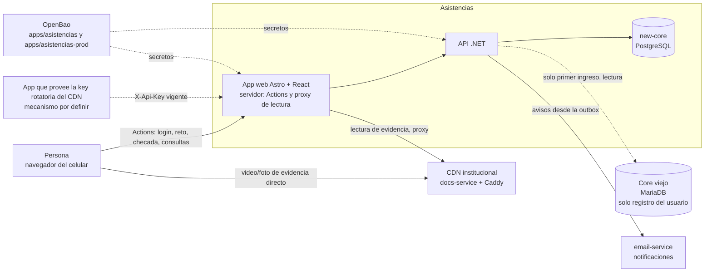
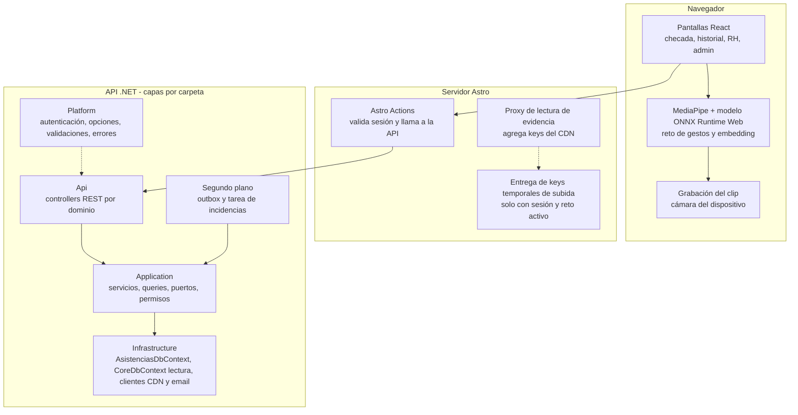
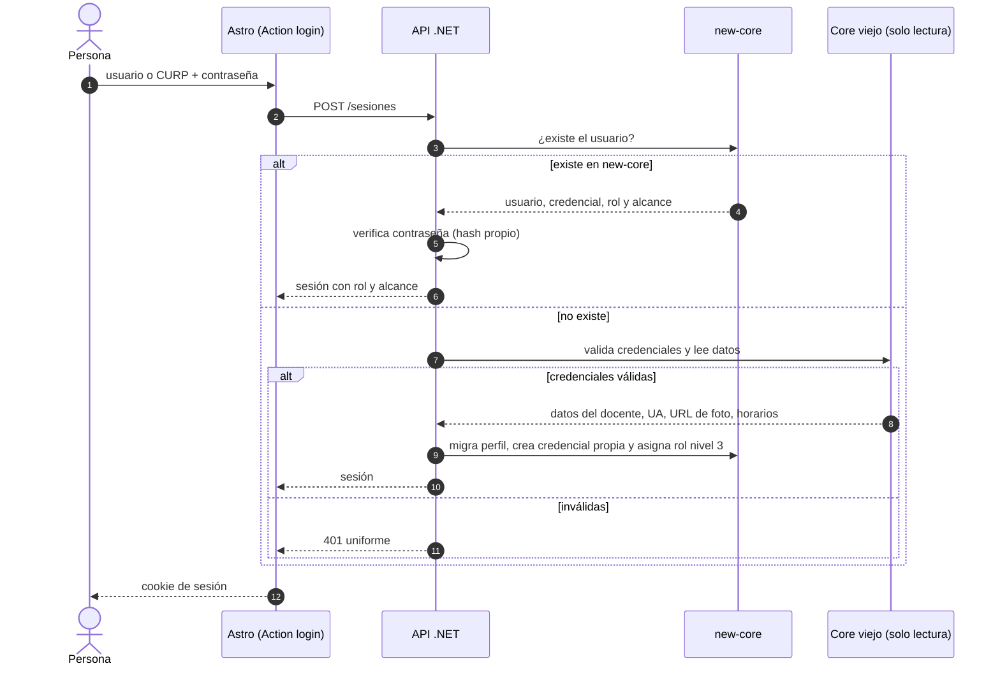
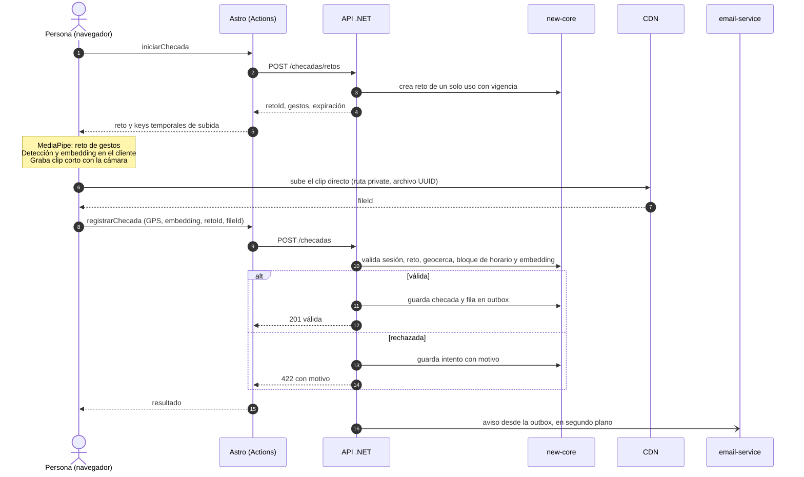
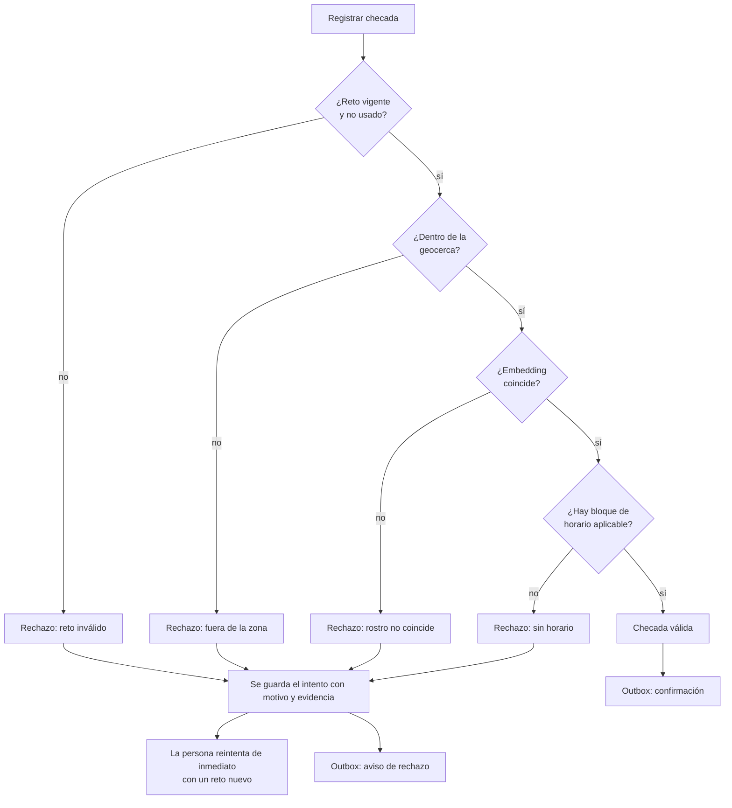
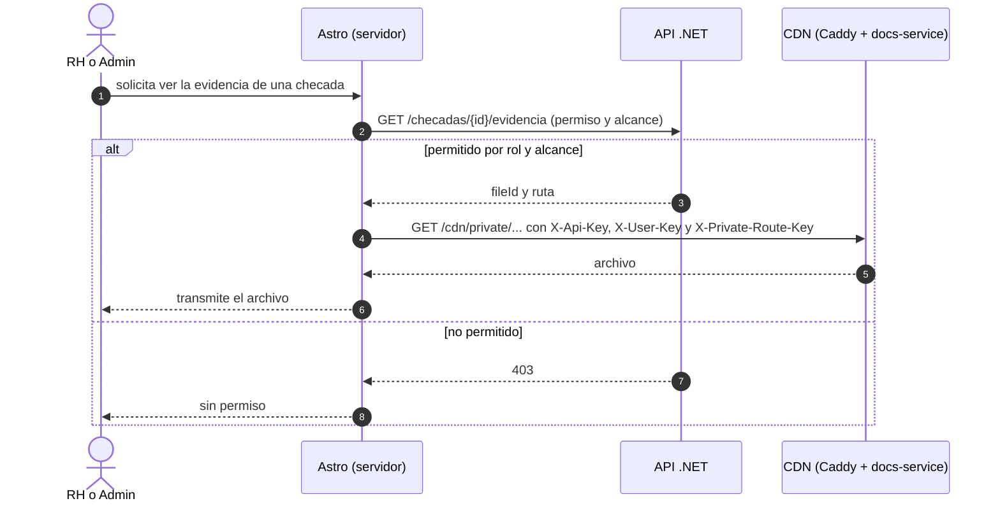
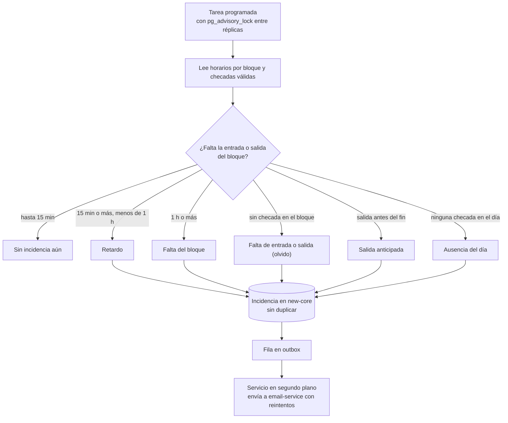
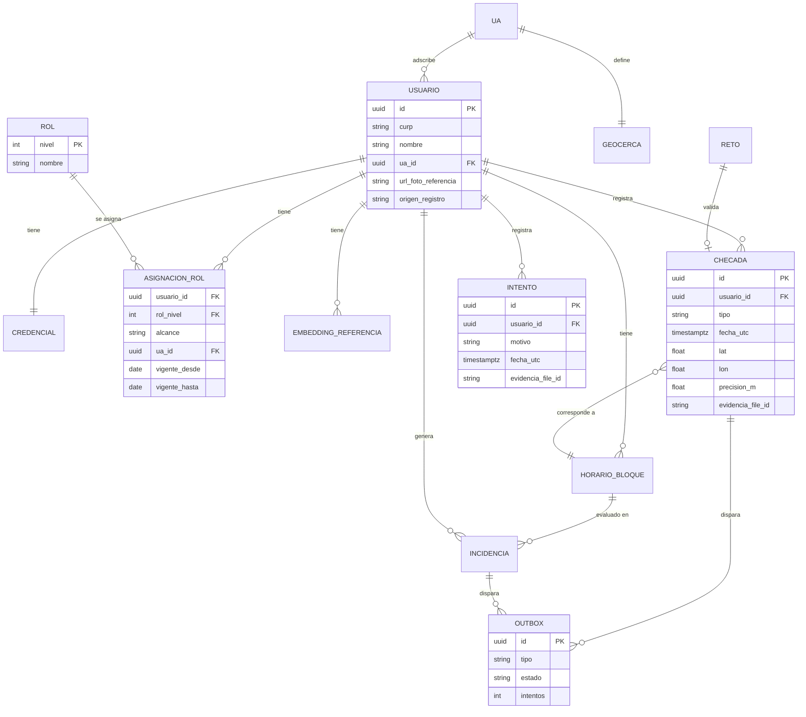
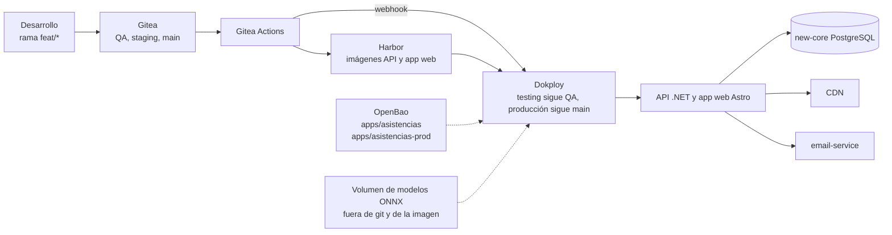

# Asistencias — Arquitectura y flujo de información

> Diagramas de cómo funciona la app: contexto, componentes, flujos de checada, evidencia, incidencias, datos y despliegue. Plan maestro: [[asistencias-plan]]. Roles y autorización: [[asistencias-roles-permisos-wiki]].

## Contenido

- [[#1. Principios y decisiones]]
- [[#2. Contexto del sistema]]
- [[#3. Componentes]]
- [[#4. Ingreso: primer ingreso y posteriores]]
- [[#5. Checada válida]]
- [[#6. Rechazo y reintento]]
- [[#7. Consulta de evidencia]]
- [[#8. Incidencias y avisos]]
- [[#9. Modelo de datos de new-core]]
- [[#10. Despliegue y secretos]]
- [[#11. Pendientes técnicos]]

## 1. Principios y decisiones

- **Ligero por Astro Actions, pesado directo al CDN.** El navegador habla con el servidor de Astro (Actions) para todo lo ligero; el video/foto de evidencia va **directo al CDN**, sin pasar por la API ni por Astro Actions.
- **Cálculo en el cliente, comparación en el servidor.** Detección, reto de gestos (MediaPipe) y embedding se calculan en el navegador; la API verifica la comparación contra el embedding de referencia, la geocerca y las reglas.
- **`new-core` es la fuente tras el registro.** El Core viejo (MariaDB) solo se consulta en el primer ingreso de cada persona; los roles viven en `new-core` y se ligan por usuario.
- **Sin RabbitMQ en Asistencias.** El post-proceso y los avisos usan una tabla **outbox** y un servicio en segundo plano; las incidencias, una tarea programada con bloqueo entre réplicas.
- **Evidencia privada.** Los archivos van a la ruta `private/` del CDN; Astro (servidor) hace de proxy de lectura para RH/Admin.

## 2. Contexto del sistema

## 3. Componentes

Las dependencias apuntan hacia adentro: `Api → Application → Core` e `Infrastructure → Application → Core`.

## 4. Ingreso: primer ingreso y posteriores

El Core viejo solo se consulta para el **registro del usuario**; todo inicio de sesión posterior es contra `new-core`.

Pendiente: qué se migra exactamente y cómo se reflejan cambios posteriores del Core (ver [[#11. Pendientes técnicos]]).

## 5. Checada válida

Verificaciones del backend (el cliente no decide): sesión y rol, reto vigente y no reutilizado, coordenada dentro de la geocerca con la precisión permitida, bloque de horario correspondiente, forma y dimensión del embedding, similitud contra el embedding de referencia (umbral configurable) y hora del servidor.

## 6. Rechazo y reintento

## 7. Consulta de evidencia

La `X-Private-Route-Key` y las demás keys nunca salen del servidor de Astro. Las imágenes no se incluyen en reportes.

## 8. Incidencias y avisos

La evaluación es **por bloque**: un docente puede tener varias incidencias el mismo día.

## 9. Modelo de datos de new-core

El Core viejo no aparece: solo se lee en el primer ingreso y no se migra su esquema.

## 10. Despliegue y secretos

## 11. Pendientes técnicos

- Cómo llega la `X-Api-Key` rotatoria a Asistencias (hoy "se obtiene desde otra app"; el CDN espera un endpoint propio que reciba la nueva key) y dónde se guardan la `private_route_key` y la `X-User-Key` de rol `UPLOADER` (OpenBao).
- Supuesto vigente: Astro entrega al navegador una `X-Api-Key` vigente y la `X-User-Key` UPLOADER solo en sesión autenticada con reto activo; riesgo aceptado (visibles en el navegador). El límite de tasa del CDN lo sube el responsable (tarea en Plane).
- Nombres de colección e identificador en el CDN (propuesta: `UA-<id>-<AAAA-MM>` y archivo con UUID, sin datos personales).
- Qué se migra del Core en el primer ingreso (perfil, UA, URL de foto, horarios) y cómo se reflejan cambios posteriores (baja, UA, horario, contraseña).
- Algoritmo del hash propio de la credencial y política de bloqueo del login.
- Si los horarios pasan a administrarse en Asistencias en la v1 (`RH_DIR`) o solo se migran desde el Core.

## Índice / Tabla de contenidos

- [[#1. Principios y decisiones]]
- [[#2. Contexto del sistema]]
- [[#3. Componentes]]
- [[#4. Ingreso: primer ingreso y posteriores]]
- [[#5. Checada válida]]
- [[#6. Rechazo y reintento]]
- [[#7. Consulta de evidencia]]
- [[#8. Incidencias y avisos]]
- [[#9. Modelo de datos de new-core]]
- [[#10. Despliegue y secretos]]
- [[#11. Pendientes técnicos]]

## Relacionado

- [[asistencias-plan]]
- [[asistencias-roles-permisos-wiki]]
- [[asistencias-reglas-de-negocio-wiki]]
- [[cdn-service-manual]]
- [[email-service-plan]]
