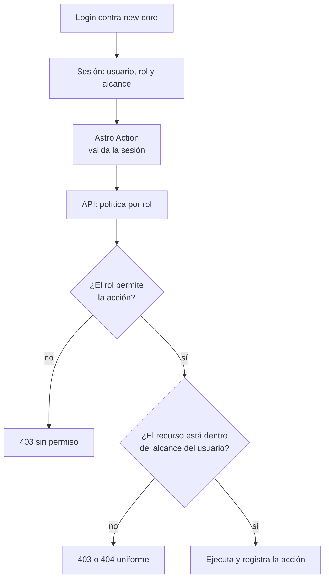

# Asistencias — Roles y permisos

> Modelo de roles de Asistencias. Los roles **no existen en el Core viejo**: viven en `new-core` y se ligan por usuario. Arquitectura: [[asistencias-arquitectura-wiki]]. Plan maestro: [[asistencias-plan]].

## Contenido

- [[#1. Niveles de rol]]
- [[#2. Matriz de permisos]]
- [[#3. Alcance]]
- [[#4. Asignación y ciclo de vida]]
- [[#5. Flujo de autorización]]
- [[#6. Relación con el SSO]]
- [[#7. Pendientes]]

## 1. Niveles de rol

| Nivel | Rol | Permisos | Alcance |
|-------|-----|----------|---------|
| 3 | Docente o Administrativo | `CREATE_OWN`: envía su checada y crea su "registro" | Solo sus propios datos |
| 2 | `RH_ENLACE` | `SEE_OWN`: ve los datos de su unidad académica | Su UA |
| 1 | `RH_DIR` | `SEE_ALL` y `EDIT_ALL`: ve todas las checadas, rechaza por inconsistencia y administra horarios | Global (17 UA) |
| 0 | `ADMIN` | `ALL`: control total del sistema | Global |

Un número menor es mayor autoridad. Cada usuario tiene un rol ligado en `new-core` (con alcance y vigencia opcionales).

## 2. Matriz de permisos

Propuesta a partir de los niveles definidos (lo marcado con ❓ está por confirmar):

| Acción | Nivel 3 | `RH_ENLACE` | `RH_DIR` | `ADMIN` |
|--------|:-------:|:-----------:|:--------:|:-------:|
| Checar (entrada o salida) | ✅ propia | — | — | — |
| Ver su historial | ✅ ❓ | — | — | ✅ |
| Ver checadas e intentos | — | ✅ su UA | ✅ todas | ✅ |
| Ver evidencia (video/foto) | — | ✅ su UA ❓ | ✅ | ✅ |
| Rechazar una checada por inconsistencia | — | ❓ | ✅ | ✅ |
| Ver y verificar incidencias | — | ✅ su UA | ✅ | ✅ |
| Administrar horarios | — | — | ✅ | ✅ |
| Descargar reportes (Excel) | — | ✅ su UA | ✅ | ✅ |
| Administrar UA, geocercas y parámetros | — | — | — | ✅ |
| Administrar usuarios y roles | — | — | — | ✅ |

## 3. Alcance

- **Persona:** solo los datos del propio usuario (nivel 3).
- **UA:** los datos de su unidad académica (`RH_ENLACE`).
- **Global:** las 17 UA (`RH_DIR` y `ADMIN`).

El alcance se aplica en la **API** como filtro obligatorio en cada consulta (no solo en la interfaz). Los reportes y las consultas heredan el mismo alcance.

## 4. Asignación y ciclo de vida

- En el primer ingreso (migración desde el Core viejo) cada persona recibe el rol de nivel 3.
- `ADMIN` asigna o cambia roles (`RH_ENLACE`, `RH_DIR`, `ADMIN`) desde el panel; el primer `ADMIN` se siembra por configuración o migración (por confirmar).
- Cada asignación puede tener fecha de inicio y fin (vigencia); al vencer se desactiva sola.
- Todo cambio de rol queda registrado (quién, cuándo, a quién).

## 5. Flujo de autorización

- **Doble verificación:** la interfaz oculta lo no permitido, pero la API siempre vuelve a verificar rol y alcance.
- **Denegado por omisión:** sin permiso explícito, se niega.
- La sesión es ligera (identidad, rol, alcance); el detalle se resuelve en el servidor.

## 6. Relación con el SSO

El diseño sigue la forma del SSO MiTSJ (aplicación → módulo → acción, roles con alcance Global/UA/Área y vigencia) para poder migrar después. Mapa de equivalencias: Asistencias es una *aplicación*; sus *módulos* serían Checadas, Incidencias, Horarios, Reportes y Administración; las *acciones* `CREATE_OWN`, `SEE_OWN`, `SEE_ALL`, `EDIT_ALL` y `ALL`. Grupos, suplencias y llaves excepcionales quedan para v2. Ver [[sso-diseno-base-wiki]].

## 7. Pendientes

- Confirmar si el nivel 3 puede ver su propio historial (propuesta: sí).
- Confirmar si `RH_ENLACE` puede rechazar checadas de su UA (hoy solo `SEE_OWN`) y ver evidencia de su UA.
- Confirmar qué significa "crea su registro" para el nivel 3: ¿la checada o el enrolamiento de referencia?
- Definir cómo se siembra el primer `ADMIN` y el procedimiento de alta de `RH_ENLACE` y `RH_DIR`.
- Definir si un usuario puede tener más de un rol o alcance a la vez.

## Índice / Tabla de contenidos

- [[#1. Niveles de rol]]
- [[#2. Matriz de permisos]]
- [[#3. Alcance]]
- [[#4. Asignación y ciclo de vida]]
- [[#5. Flujo de autorización]]
- [[#6. Relación con el SSO]]
- [[#7. Pendientes]]

## Relacionado

- [[asistencias-plan]]
- [[asistencias-arquitectura-wiki]]
- [[asistencias-reglas-de-negocio-wiki]]
- [[asistencias-slice-1-ingreso-roles-sub-plan]]
- [[sso-diseno-base-wiki]]
