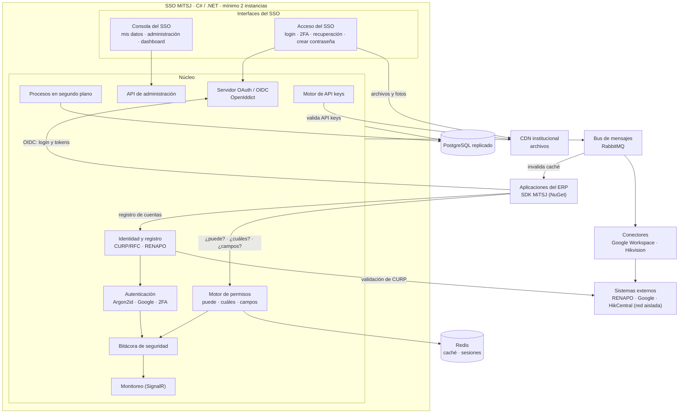
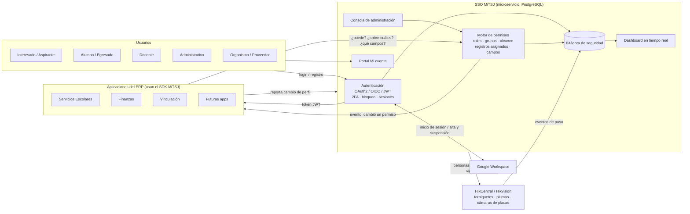
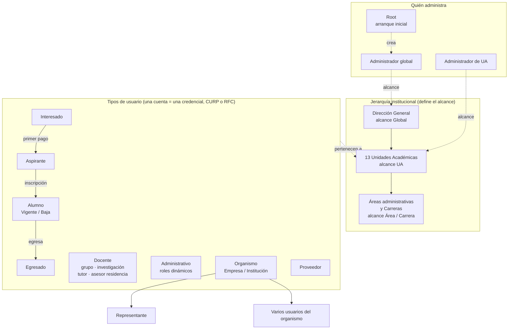
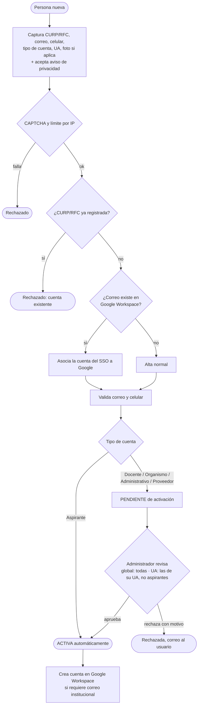
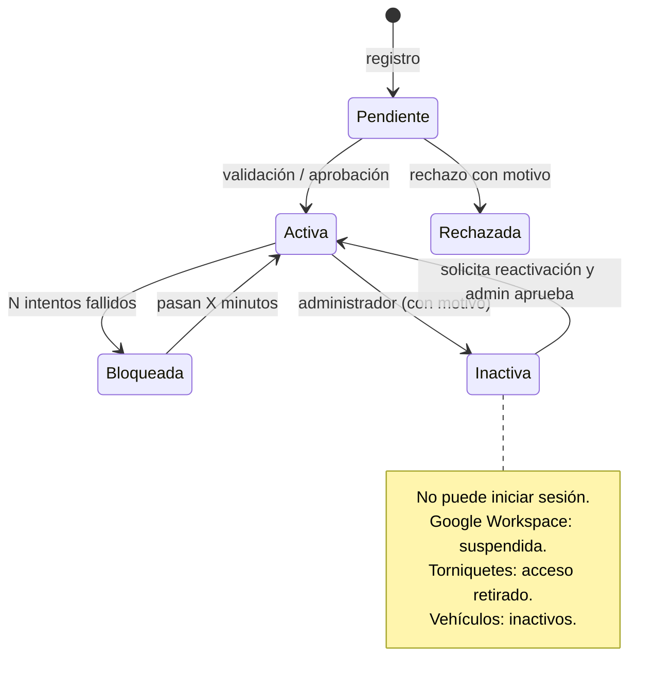
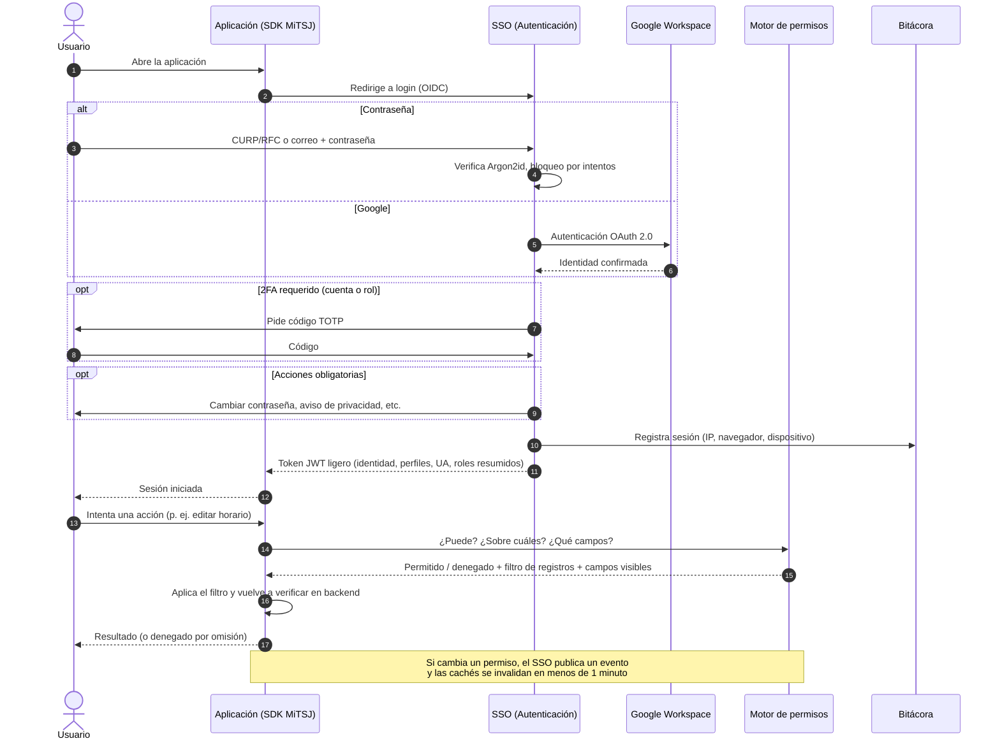
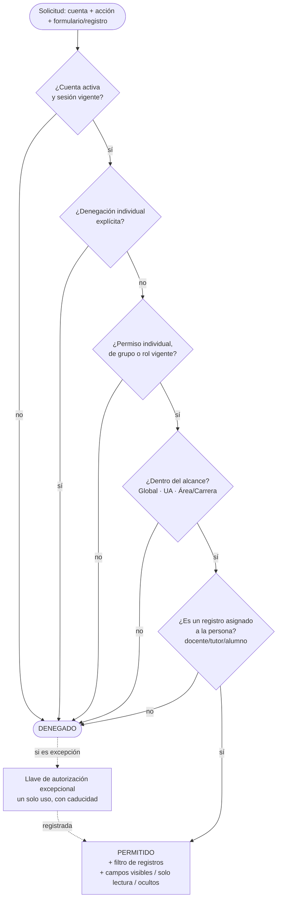
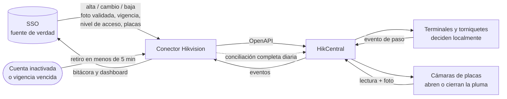
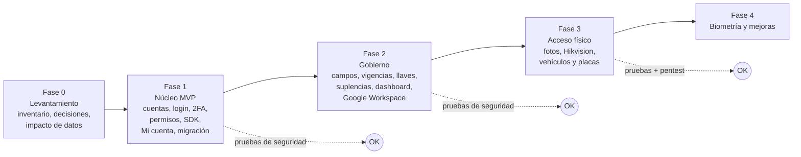

# Diagramas del SSO MiTSJ

## Contenido

### 1. Arquitectura general (Mermaid)

Equivale al diagrama de `arquitectura.md` §1 (imagen y vista en texto), reconstruido en Mermaid para que se pueda editar y versionar como texto.

### 2. Diagramas de flujo

> Copia literal de `Obsidian/documents/SCRUM/diagramas-sso.md` (27-oct-2026).

> Origen: [[sso]] · Backlog: [[backlog-sso]]
> Los diagramas están en Mermaid: se ven en Obsidian en modo lectura o Live Preview.

---

## 1. Visión general (arquitectura)

---

## 2. Mapa de usuarios y cómo se relacionan

> Los cambios de perfil (Aspirante → Alumno → Egresado) **no los decide el SSO**: los reporta la aplicación responsable (Admisión / Servicios Escolares) y el SSO ajusta roles y permisos.

---

## 3. Registro y activación de cuentas

### Ciclo de vida de una cuenta (nunca se elimina)

---

## 4. Flujo de inicio de sesión y autorización

### Cómo se decide un permiso

---

## 5. Control de acceso físico (fase 3)

> A Hikvision solo se envía lo necesario (ID interno, nombre, foto, vigencia). **Nunca la CURP.**

---

## 6. Fases del proyecto

## Relacionado

- [[sso-implementacion-plan]]
- Requerimientos: `sso` (v0.16) y `arquitectura` (v0.9), en las Fuentes del plan.
